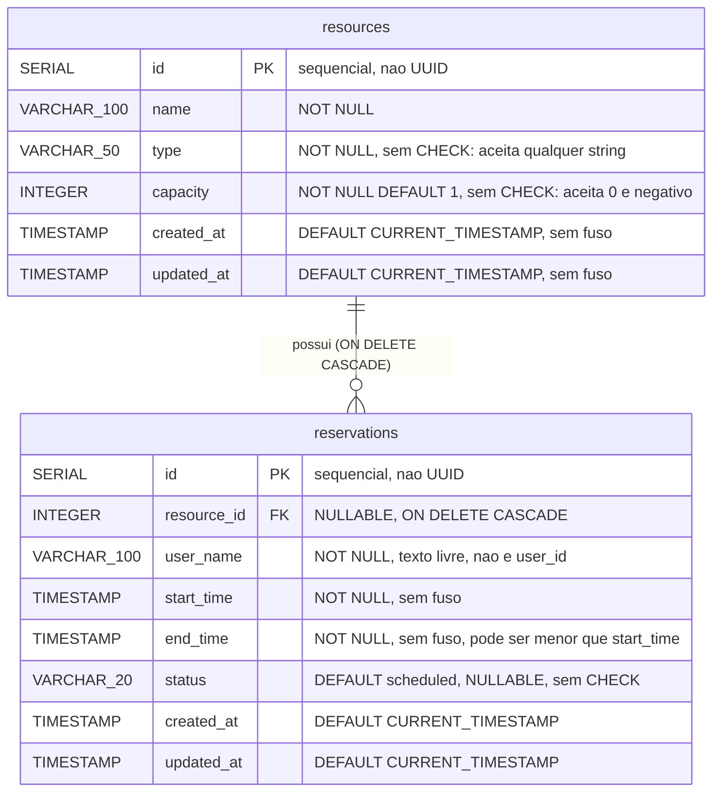
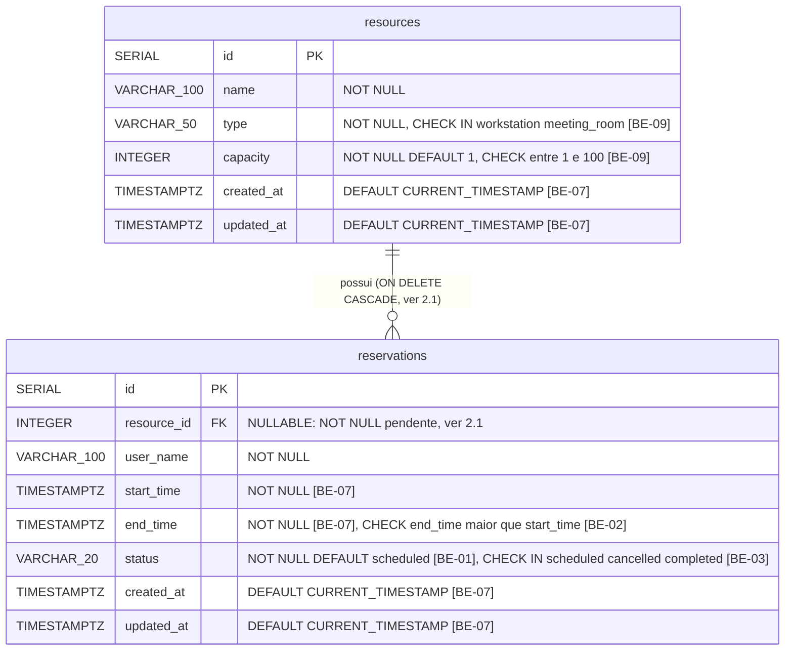

# DER do SREC — recebido e atual

Dois diagramas. O primeiro é o banco que recebemos do grupo anterior; o
segundo é o banco da `main` depois das migrations do backend da N2 (PR #41). A
diferença entre eles é a entrega de integridade desta etapa, e o que ficou de
fora está declarado na seção 2.1.

Fonte de verdade do diagrama recebido: `server/src/config/initDb.js:4-24` no
commit `8431181` (`git show 8431181:server/src/config/initDb.js`). Fonte de
verdade do diagrama atual: `server/src/config/initDb.js` da `main` mais as
quatro migrations de `server/migrations/`, conferidas com
`pg_get_constraintdef` num PostgreSQL 16.

## 1. DER recebido — o schema do código entregue



No schema recebido, `resource_id` e `status` **aceitavam `NULL`**, e não havia:

* nenhum `CHECK`: os valores válidos de `type` e `status` estavam em
  **comentário SQL**, que o banco ignora;
* nenhum `UNIQUE`;
* nenhum `EXCLUDE`: a regra anti-sobreposição (RN03) vivia só como `SELECT`;
* nenhum índice além das duas chaves primárias;
* nenhuma coluna `is_active`;
* nenhuma coluna `user_id` e nenhuma tabela de usuários.

Verificação sobre o código recebido:

```bash
git show 8431181:server/src/config/initDb.js | grep -cE "CHECK|UNIQUE|EXCLUDE"   # 0
git show 8431181:server/src/config/initDb.js | grep -ci "CREATE INDEX"           # 0
git show 8431181:server/src/config/initDb.js | grep -c "NOT NULL"                # 6
```

## 2. DER atual — a `main` depois das migrations



Em banco criado do zero, o `initDb.js` da `main` já declara as colunas de
data como `TIMESTAMPTZ NOT NULL` (`server/src/config/initDb.js:10-11`, `:18-19`
e `:22-23`); em banco antigo, a migration `0001_timestamptz.sql` converte o
tipo e mantém a coluna como estava.

A constraint de tabela que o diagrama não consegue desenhar é o `EXCLUDE`. As
constraints da `main`, como o `pg_get_constraintdef` as devolve depois de
`npm run db:migrate`:

```sql
-- BE-01 e BE-07: a regra RN03 no banco
reservations_no_overlap
  EXCLUDE USING gist (resource_id WITH =, tstzrange(start_time, end_time) WITH &&)
  WHERE (status <> 'cancelled')

-- BE-02: janela válida, RN05
reservations_time_window_check
  CHECK (end_time > start_time)

-- BE-03: domínio fechado de status, RN07
reservations_status_check
  CHECK (status IN ('scheduled', 'cancelled', 'completed'))

-- BE-09: tipo e capacidade do espaço, RN01 e RN02
resources_type_check
  CHECK (type IN ('workstation', 'meeting_room'))
resources_capacity_check
  CHECK (capacity >= 1 AND capacity <= 100)
```

Mais o `SET NOT NULL` e o `SET DEFAULT 'scheduled'` em `status`
(`server/migrations/001_reservation_no_overlap.sql`).

Quatro observações técnicas que não podem se perder:

1. **As migrations não rodam sozinhas.** `npm run db:migrate`
   (`server/package.json:15`, `server/scripts/migrate.js`) aplica e registra
   cada arquivo em `schema_migrations`, mas nem o boot
   (`server/src/index.js:12` só chama o `initDb.js`) nem o `docker compose up`
   o executam. Num banco recém-criado pelo compose, nada da seção acima existe:
   o banco aceita as sete violações da seção 5.
2. **`btree_gist` é obrigatório.** O `EXCLUDE` combina igualdade em `integer`
   com sobreposição de intervalo, e a extensão `btree_gist` fornece a classe de
   operadores. Ela vem no `postgresql-contrib`, presente na imagem
   `postgres:16-alpine` do `docker-compose.yml:5`, e exige papel com permissão
   para criar extensão.
3. **A ordem dos arquivos desarma as checagens de dado legado.** O
   `node scripts/migrate.js` aplica em ordem alfabética: `0001_timestamptz.sql`
   vem antes de `001_reservation_no_overlap.sql`. Como o `0001` já cria o
   `EXCLUDE`, ele roda antes da normalização de `status NULL` e da contagem de
   sobreposições do `001`, e antes da contagem de intervalos invertidos do
   `002`. Num banco com dado inválido, a migração falha com o erro cru do
   PostgreSQL, por exemplo
   `range lower bound must be less than or equal to range upper bound`, em vez
   da mensagem que diz quantas linhas corrigir. Foi o que aconteceu ao migrar
   um banco de teste com uma reserva invertida.
4. **Nada disso funciona editando `initDb.js`.** O arquivo usa
   `CREATE TABLE IF NOT EXISTS` (`server/src/config/initDb.js:5` e `:14`): em
   banco que já tem as tabelas, não faz nada. Mudança de schema vem como
   migration.

### 2.1. Pendências declaradas

Itens que o schema precisa e que **nenhuma migration da `main` entrega**. Não
estão no diagrama atual.

| Pendência | Regra | Situação |
|---|---|---|
| `reservations.resource_id SET NOT NULL` | RN10 | nenhuma spec e nenhum prefixo reservado |
| `ON DELETE CASCADE` → `ON DELETE RESTRICT` | RN09, BUG-06 | prefixo `1761000008000` reservado em OPS-02, sem spec. FE-05 (PR #44) avisa na interface; o PR #41 manteve a exclusão física |
| Índices em `reservations(resource_id)` e `reservations(start_time)` | CS-09 | prefixo `1761000006000` reservado em OPS-02; o `EXCLUDE` já cria um índice GiST em `resource_id`, então falta medir com `EXPLAIN ANALYZE` se o B-tree compensa |
| Aplicar as migrations na subida | RNF02, RNF15 | OPS-02 (#17) |

SQL alvo das duas primeiras, executado com sucesso sobre a `main` migrada no
teste da seção 5:

```sql
ALTER TABLE reservations ALTER COLUMN resource_id SET NOT NULL;
ALTER TABLE reservations DROP CONSTRAINT reservations_resource_id_fkey;
ALTER TABLE reservations
  ADD CONSTRAINT reservations_resource_id_fkey
  FOREIGN KEY (resource_id) REFERENCES resources(id) ON DELETE RESTRICT;
```

Regra de processo: **quem implementar uma pendência atualiza este diagrama no
mesmo PR.**

### 2.2. Divergência entre specs e o que entrou

O PR #41 seguiu as specs de backend, não a tabela de prefixos de OPS-02: as
migrations são `.sql` com prefixo curto (`0001_`, `001_`, `002_`, `003_`), e
não `.js` do `node-pg-migrate` com prefixo `1761000000000`; e o
`SET NOT NULL` em `status` está no arquivo de BE-01, enquanto OPS-02 o
atribuía a BE-03. A ordem que OPS-02 prescrevia (BE-02 e BE-03 antes de BE-01)
é justamente a que evitaria o problema da observação 3. Os dois pontos estão
na #17.

## 3. Mapeamento físico

| Entidade do negócio | Tabela | Chave | Observação |
|---|---|---|---|
| Espaço (estação ou sala) | `resources` | `id SERIAL` | `type` distingue `workstation` de `meeting_room` |
| Reserva | `reservations` | `id SERIAL` | `resource_id` → `resources.id` |
| Responsável | — | — | **não é entidade**: é a coluna de texto `reservations.user_name` (RN12) |
| Usuário do sistema | — | — | **não existe** (RF13) |
| Papel ou permissão | — | — | **não existe** (RF14) |

Vocabulário gravado no banco. Use exatamente esta grafia:

| Coluna | Valores reais | Evidência |
|---|---|---|
| `resources.type` | `workstation`, `meeting_room` | `client/src/constants/domain.js:1-4`, comentário em `initDb.js:8` |
| `reservations.status` | `scheduled`, `cancelled`, `completed` | `server/src/domain/reservationStatus.js:1-5`, `client/src/constants/domain.js:11-15`, `reservations_status_check` |

Atenção ao `cancelled` com **dois `l`**. O diagrama da documentação recebida
escreve `Canceled` com um (`Documentação Oficial SREC.md:97`), além de usar
inicial maiúscula. Quem programar contra aquele diagrama escreve um status que
o código nunca grava e que o `CHECK` de BE-03 rejeita.

## 4. As divergências do banco: D-01, D-02 e D-03

O catálogo das 12 divergências entre a documentação recebida e o código vive
em [`docs/auditoria/divergencias-doc-codigo.md`](../auditoria/divergencias-doc-codigo.md).
Esta seção detalha as três que tratam do modelo de dados, que são as que esta
página resolve. As outras nove são tratadas por REQ-01, REQ-03, OPS-05, FE-01,
BE-06, QA-01 e QA-02, conforme aquele catálogo.

| # | O que a doc dizia | O que o código faz | Resolução |
|---|---|---|---|
| D-01 | MER com `UUID id PK` nas duas entidades (`Documentação Oficial SREC.md:84`, `:92`) | `id SERIAL PRIMARY KEY`, inteiro sequencial (`initDb.js:6`, `:15`) | **Corrigir a doc.** Os dois diagramas desta página mostram `SERIAL`. Migrar para `UUID` mudaria o formato dos ids nas 6 rotas com `:id` (`server/src/routes/resourceRoutes.js:8-10`, `reservationRoutes.js:8-10`), que hoje `validateIdParam` exige inteiros, e exigiria migrar a FK, sem benefício para o usuário. A exposição de cardinalidade por id sequencial fica como **débito da N3**, a pagar junto com autenticação (RF13). |
| D-02 | `resources.is_active BOOLEAN` (`Documentação Oficial SREC.md:88`) | a coluna não existe (`initDb.js:5-12`) e nenhuma migration a cria; nenhum model a referencia (`resourceModel.js:6`, `:29`) | **Corrigir a doc.** Registrada como RF15 e RN14 `documentado mas inexistente`. O PR #41 manteve a exclusão física, e o FE-05 a cercou de aviso; tirar um espaço de circulação ainda destrói o histórico (RN09). |
| D-03 | `reservations.user_id UUID` (`Documentação Oficial SREC.md:94`) | `user_name VARCHAR(100) NOT NULL`, texto livre (`initDb.js:17`, `client/src/features/reservations/ReservationForm.jsx:73-81`) | **Corrigir a doc** + **débito da N3**. Identidade de usuário é funcionalidade nova, com tabela, autenticação e migração de dado: escopo de N3, não de manutenção. RF13 e RN12. |

### 4.1. O que confere

Uma única coisa, e é a mais importante: a fórmula anti-sobreposição
documentada em `Documentação Oficial SREC.md:72`,
`Início_banco < Fim_novo AND Fim_banco > Início_novo`, é **exatamente** a
implementada em `server/src/models/reservationModel.js:55`
(`start_time < $3 AND end_time > $2`, com `$2` = início novo e `$3` = fim
novo, conforme `reservationModel.js:58`).

O grupo anterior acertou a regra central do produto. O defeito (BUG-01) estava
em executá-la como `SELECT` isolado, fora de transação e sem constraint de
respaldo. O PR #41 promoveu a fórmula a constraint `EXCLUDE` de banco, que
vale assim que as migrations são aplicadas.

## 5. Prova executada

Roteiro rodado em PostgreSQL 16.15, com uma reserva de 09:00 às 10:00 já
gravada e sete violações tentadas direto no banco, por `psql`:

* **Recebido:** schema de `initDb.js:4-24` no commit `8431181`.
* **Main, só o boot:** banco criado pelo `initDb.js` da `main`, sem migrations.
* **Main migrada:** o mesmo banco depois de `npm run db:migrate`.
* **Com as pendências:** a `main` migrada mais o SQL da seção 2.1.

| # | Violação | Regra | Recebido | Main, só o boot | Main migrada | Com as pendências |
|---|---|---|---|---|---|---|
| 1 | reserva sobreposta no mesmo espaço | RN03 | aceita | aceita | recusada (`reservations_no_overlap`) | recusada |
| 2 | fim antes do início | RN05 | aceita | aceita | recusada (`reservations_time_window_check`) | recusada |
| 3 | `status = 'banana'` | RN07 | aceita | aceita | recusada (`reservations_status_check`) | recusada |
| 4 | `status = NULL` | RN07 | aceita | aceita | recusada (`NOT NULL`) | recusada |
| 5 | `type = 'banana'` | RN01 | aceita | aceita | recusada (`resources_type_check`, BE-09) | recusada |
| 6 | `capacity = 0` | RN02 | aceita | aceita | recusada (`resources_capacity_check`, BE-09) | recusada |
| 7 | reserva com `resource_id NULL` | RN10 | aceita | aceita | **aceita** | recusada (`NOT NULL`) |

Com as pendências aplicadas, `DELETE FROM resources` de um espaço com reserva
também passa a ser recusado (`ON DELETE RESTRICT`, RN09).

O resultado se lê em três passos: o banco recebido recusava **0 de 7**; a
`main` migrada recusa **6 de 7** (4 até o PR #41, mais 2 com a BE-09); a
pendência da seção 2.1 leva a **7 de 7**. A coluna "Main, só o boot" é o motivo da observação 1: sem
`npm run db:migrate`, o ganho de integridade não chega ao banco. A API recusa
as violações 2 a 7 por validação própria, mas a 1, sob concorrência, só
a constraint garante.
