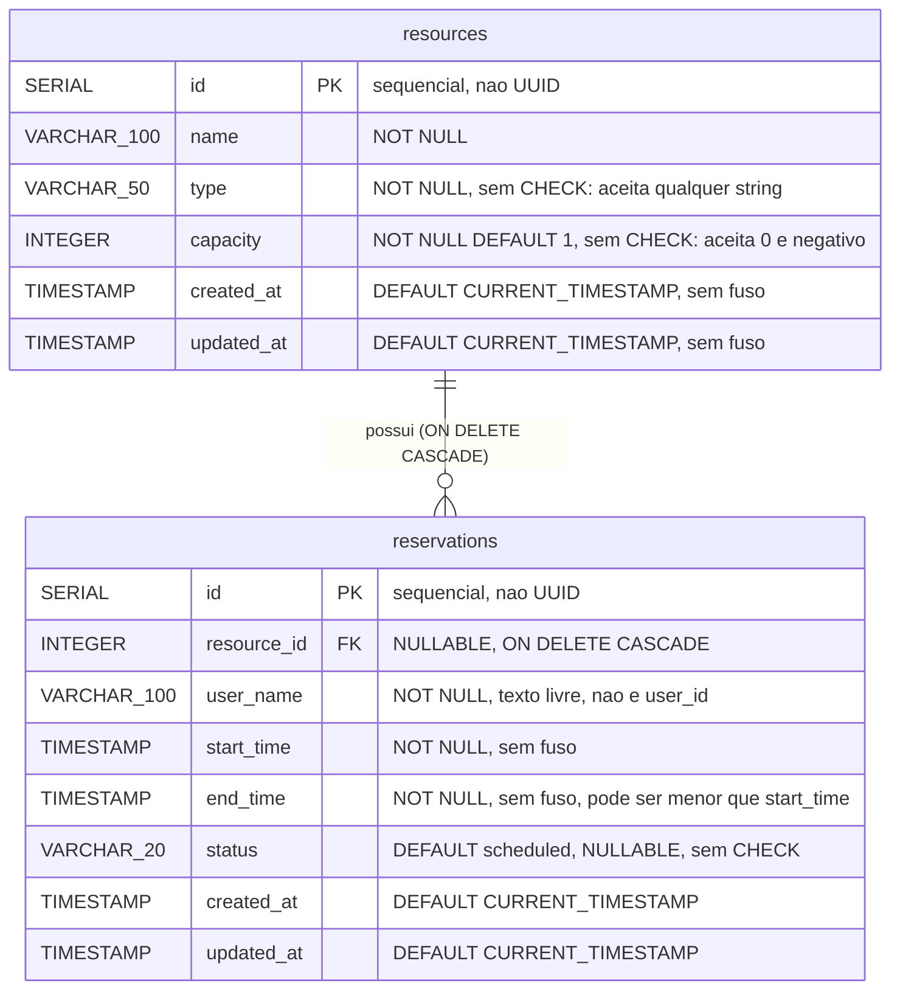
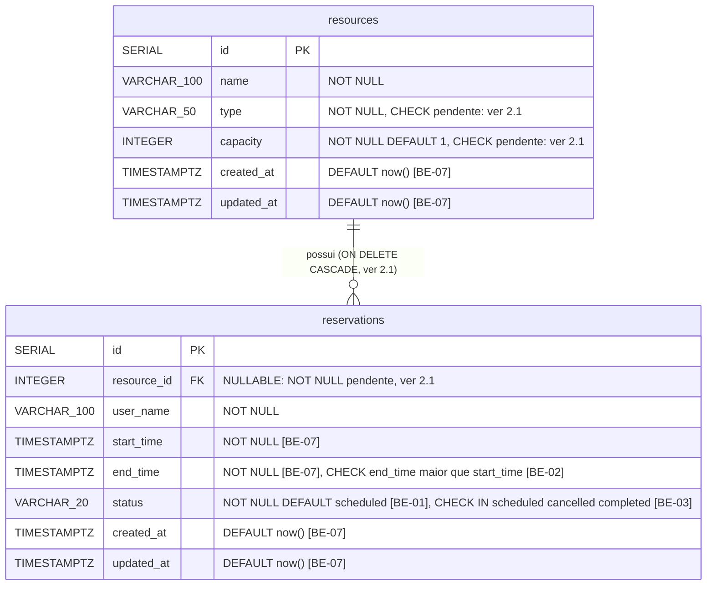

# DER do SREC — real e alvo

Dois diagramas. O primeiro é o banco que recebemos; o segundo é o banco depois
das migrations que as specs da N2 se comprometem a entregar. A diferença entre
eles é a entrega de integridade desta etapa, e o que ficou de fora está
declarado na seção 2.1.

Fonte de verdade do diagrama real: `server/src/config/initDb.js:4-24`. Fonte de
verdade do diagrama alvo: o SQL das specs BE-01, BE-02, BE-03 e BE-07, na ordem
da tabela de prefixos de
[OPS-02](../specs/ops-02-versioned-migrations/implementacao.md), que é a casa
canônica da ordem de schema do projeto.

## 1. DER real — o schema como ele é hoje



`resource_id` e `status` **aceitam `NULL`** (`initDb.js:16` e `:20` não
declaram `NOT NULL`). É o que sustenta as regras RN10 e RN07 de
[`docs/produto/overview.md`](../produto/overview.md).

O que **não** aparece no diagrama porque não existe no banco:

* nenhum `CHECK`: os valores válidos de `type` e `status` estão em
  **comentário SQL** (`initDb.js:8`, `:20`), que o banco ignora;
* nenhum `UNIQUE`;
* nenhum `EXCLUDE`: a regra anti-sobreposição (RN03) vive só como `SELECT` em
  `server/src/models/reservationModel.js:49-61`;
* nenhum índice além das duas chaves primárias, embora as consultas de reserva
  filtrem ou ordenem por `resource_id` e `start_time`
  (`reservationModel.js:15`, `:27`, `:52-55`);
* nenhuma coluna `is_active`;
* nenhuma coluna `user_id` e nenhuma tabela de usuários.

Verificação, a qualquer momento:

```bash
grep -cE "CHECK|UNIQUE|EXCLUDE" server/src/config/initDb.js   # 0
grep -ci "CREATE INDEX" server/src/config/initDb.js           # 0
grep -c "NOT NULL" server/src/config/initDb.js                # 6
```

As 6 linhas com `NOT NULL` são `resources.name`, `resources.type`,
`resources.capacity`, `reservations.user_name`, `reservations.start_time` e
`reservations.end_time` (`initDb.js:7-9` e `:17-19`).

## 2. DER alvo — o schema depois das migrations da N2

Só entra neste diagrama o que alguma spec se compromete a entregar, com o SQL
escrito. Cada anotação traz a spec de origem.



A constraint de tabela que o diagrama não consegue desenhar é o `EXCLUDE` de
BE-01. O estado final de cada constraint, conferido com
`pg_get_constraintdef` depois de aplicar o SQL das specs:

```sql
-- BE-02 (prefixo 1761000002000): janela válida, RN05
ALTER TABLE reservations
  ADD CONSTRAINT reservations_time_window_check CHECK (end_time > start_time);

-- BE-03 (prefixo 1761000003000): domínio fechado de status, RN07
ALTER TABLE reservations
  ADD CONSTRAINT reservations_status_check
  CHECK (status IN ('scheduled', 'cancelled', 'completed'));

-- BE-07 (prefixo 1761000004000): instantes com fuso, RN11
ALTER TABLE reservations
  ALTER COLUMN start_time TYPE TIMESTAMPTZ USING start_time AT TIME ZONE 'America/Sao_Paulo',
  ALTER COLUMN end_time   TYPE TIMESTAMPTZ USING end_time   AT TIME ZONE 'America/Sao_Paulo';
-- (mais created_at e updated_at nas duas tabelas, com DEFAULT now())

-- BE-01 (prefixo 1761000005000): a regra RN03 passa a ser inviolável
CREATE EXTENSION IF NOT EXISTS btree_gist;
UPDATE reservations SET status = 'scheduled' WHERE status IS NULL;
ALTER TABLE reservations ALTER COLUMN status SET NOT NULL;
ALTER TABLE reservations
  ADD CONSTRAINT reservations_no_overlap
  EXCLUDE USING gist (
    resource_id WITH =,
    tstzrange(start_time, end_time, '[)') WITH &&
  ) WHERE (status <> 'cancelled');
```

O bloco acima resume o efeito. As migrations completas, com as verificações de
dado legado que abortam com mensagem útil, estão em cada spec.

Quatro observações técnicas que não podem se perder:

1. **`btree_gist` é obrigatório.** O `EXCLUDE` combina igualdade em `integer`
   (`resource_id WITH =`) com sobreposição de intervalo
   (`tstzrange ... WITH &&`). O GiST nativo não cobre `=` em `integer`; a
   extensão `btree_gist` fornece a classe de operadores. Ela vem no
   `postgresql-contrib`, presente na imagem `postgres:16-alpine` do
   `docker-compose.yml:5`, e exige papel com permissão para criar extensão.
2. **A ordem das migrations é a da tabela de OPS-02:** BE-02, BE-03, BE-07,
   BE-01. A ordem inversa entre BE-01 e BE-07 também funciona, porque a
   migration de BE-07 remove o `EXCLUDE` antes de mudar o tipo das colunas e o
   recria sobre `tstzrange`; as duas ordens foram executadas no teste da seção
   5. OPS-02 fixa BE-07 primeiro para que nenhuma spec precise refazer a
   constraint de outra.
3. **Dado legado inválido bloqueia a constraint.** Um banco com `status NULL`
   (alcançável hoje por um `PATCH` com corpo vazio, ver RN07), com intervalo
   invertido ou com reservas sobrepostas faz o `ALTER` falhar. Por isso as
   migrations de BE-01, BE-02 e BE-03 contam as linhas inválidas e abortam com
   mensagem antes do `ADD CONSTRAINT`.
4. **Nada disso funciona editando `initDb.js`.** `server/src/config/initDb.js:5`
   e `:14` usam `CREATE TABLE IF NOT EXISTS`: em banco que já tem as tabelas,
   o arquivo não faz nada. As mudanças **têm** de vir como migrations
   versionadas (RNF02, OPS-02). Editar o `initDb.js` produz um schema correto
   só em banco criado do zero, e um falso senso de pronto em todos os outros.

### 2.1. Pendências declaradas do DER alvo

Itens que o schema precisa e que **nenhuma spec com SQL se comprometeu a
entregar**. Não estão no diagrama alvo, porque diagrama que promete o que
ninguém vai fazer repete o defeito da documentação recebida.

| Pendência | Regra | Situação nas specs |
|---|---|---|
| `CHECK (type IN ('workstation','meeting_room'))` | RN01, BUG-10 | prefixo `1761000007000` reservado em OPS-02, sem spec. O índice de specs atribui BUG-10 a BE-03, mas a BE-03 só trata `status` |
| `CHECK (capacity > 0)` | RN02, BUG-09 | mesmo prefixo `1761000007000`, sem spec. O índice atribui BUG-09 a BE-02, mas a BE-02 só trata a janela da reserva |
| `reservations.resource_id SET NOT NULL` | RN10 | nenhuma spec e nenhum prefixo reservado |
| `ON DELETE CASCADE` → `ON DELETE RESTRICT` | RN09, BUG-06 | prefixo `1761000008000` reservado em OPS-02, sem spec. FE-05 só avisa na interface e depende da decisão de BE-08 entre exclusão física e desativação lógica |
| Índices em `reservations(resource_id)` e `reservations(start_time)` | CS-09 | prefixo `1761000006000` reservado em OPS-02, sem spec; OPS-02 pede `EXPLAIN ANALYZE` antes e depois, porque o `EXCLUDE` de BE-01 já cria um índice GiST em `resource_id` |

SQL alvo das quatro primeiras, executado com sucesso no teste da seção 5:

```sql
ALTER TABLE resources
  ADD CONSTRAINT resources_type_check CHECK (type IN ('workstation', 'meeting_room'));
ALTER TABLE resources
  ADD CONSTRAINT resources_capacity_check CHECK (capacity > 0);
ALTER TABLE reservations ALTER COLUMN resource_id SET NOT NULL;
ALTER TABLE reservations DROP CONSTRAINT reservations_resource_id_fkey;
ALTER TABLE reservations
  ADD CONSTRAINT reservations_resource_id_fkey
  FOREIGN KEY (resource_id) REFERENCES resources(id) ON DELETE RESTRICT;
```

Regra de processo: **quem implementar uma pendência atualiza este diagrama no
mesmo PR.**

### 2.2. Divergência entre specs a resolver

A migration de BE-01 aplica `ALTER COLUMN status SET NOT NULL`
([BE-01](../specs/be-01-prevent-double-booking/implementacao.md), passo 1),
enquanto a tabela de prefixos de OPS-02 atribui o `SET NOT NULL` em `status` a
BE-03. O diagrama alvo segue o SQL escrito, que está em BE-01. As specs também
divergem no formato do arquivo de migration: BE-01, BE-02, BE-03 e BE-07 criam
`.sql` com prefixo curto (`001_`, `0001_`), e OPS-02 reserva arquivos `.js` do
`node-pg-migrate` com prefixo `1761000000000`. Os dois pontos ficam para o
responsável de backend com o DevOps; este documento não decide por eles.

## 3. Mapeamento físico

| Entidade do negócio | Tabela | Chave | Observação |
|---|---|---|---|
| Espaço (estação ou sala) | `resources` | `id SERIAL` | `type` distingue `workstation` de `meeting_room` |
| Reserva | `reservations` | `id SERIAL` | `resource_id` → `resources.id` |
| Responsável | — | — | **não é entidade**: é a coluna de texto `reservations.user_name` (RN12) |
| Usuário do sistema | — | — | **não existe** (RF13) |
| Papel ou permissão | — | — | **não existe** (RF14) |

Vocabulário gravado no banco. Use exatamente esta grafia:

| Coluna | Valores reais | Evidência |
|---|---|---|
| `resources.type` | `workstation`, `meeting_room` | `client/src/constants/domain.js:1-4`, comentário em `initDb.js:8` |
| `reservations.status` | `scheduled`, `cancelled`, `completed` | `client/src/constants/domain.js:11-15`, comentário em `initDb.js:20` |

Atenção ao `cancelled` com **dois `l`**. O diagrama da documentação recebida
escreve `Canceled` com um (`Documentação Oficial SREC.md:97`), além de usar
inicial maiúscula. Quem programar contra aquele diagrama escreve um status que
o código nunca grava e que o `CHECK` de BE-03 rejeita.

## 4. As divergências do banco: D-01, D-02 e D-03

O catálogo das 12 divergências entre a documentação recebida e o código vive
em [`docs/auditoria/divergencias-doc-codigo.md`](../auditoria/divergencias-doc-codigo.md).
Esta seção detalha as três que tratam do modelo de dados, que são as que esta
página resolve. As outras nove são tratadas por REQ-01, REQ-03, OPS-05, FE-01,
BE-06, QA-01 e QA-02, conforme aquele catálogo.

| # | O que a doc dizia | O que o código faz | Resolução |
|---|---|---|---|
| D-01 | MER com `UUID id PK` nas duas entidades (`Documentação Oficial SREC.md:84`, `:92`) | `id SERIAL PRIMARY KEY`, inteiro sequencial (`initDb.js:6`, `:15`) | **Corrigir a doc.** O DER real desta página mostra `SERIAL`. Migrar para `UUID` mudaria o formato dos ids nas 6 rotas com `:id` (`server/src/routes/resourceRoutes.js:7-9`, `reservationRoutes.js:7-9`) e exigiria migrar a FK, sem benefício para o usuário. A exposição de cardinalidade por id sequencial fica como **débito da N3**, a pagar junto com autenticação (RF13). |
| D-02 | `resources.is_active BOOLEAN` (`Documentação Oficial SREC.md:88`) | a coluna não existe (`initDb.js:5-12`); nenhum model a referencia (`resourceModel.js:6`, `:29`) | **Corrigir a doc.** O DER real e o alvo não têm a coluna. Registrada como RF15 e RN14 `documentado mas inexistente`. A decisão entre exclusão física e desativação lógica é de BE-08; hoje a única forma de tirar um espaço de circulação é `DELETE`, que destrói o histórico (RN09). |
| D-03 | `reservations.user_id UUID` (`Documentação Oficial SREC.md:94`) | `user_name VARCHAR(100) NOT NULL`, texto livre (`initDb.js:17`, `client/src/features/reservations/ReservationForm.jsx:60-71`) | **Corrigir a doc** + **débito da N3**. O DER real mostra `user_name`. Identidade de usuário é funcionalidade nova, com tabela, autenticação e migração de dado: escopo de N3, não de manutenção. RF13 e RN12. |

### 4.1. O que confere

Uma única coisa, e é a mais importante: a fórmula anti-sobreposição
documentada em `Documentação Oficial SREC.md:72`,
`Início_banco < Fim_novo AND Fim_banco > Início_novo`, é **exatamente** a
implementada em `server/src/models/reservationModel.js:55`
(`start_time < $3 AND end_time > $2`, com `$2` = início novo e `$3` = fim
novo, conforme `reservationModel.js:59`).

O grupo anterior acertou a regra central do produto. O defeito (BUG-01) está
em executá-la como `SELECT` isolado, fora de transação e sem constraint de
respaldo. É isso que BE-01 conserta, promovendo a fórmula de consulta de
aplicação a constraint `EXCLUDE` de banco.

## 5. Prova executada

Roteiro rodado em PostgreSQL 16.15: schema recebido (`initDb.js:4-24`) com
uma reserva de 09:00 às 10:00, sete violações antes, o SQL das specs aplicado
na ordem de OPS-02, as mesmas sete violações depois, e por fim as pendências da
seção 2.1.

| # | Violação | Regra | Schema recebido | Depois das specs | Com as pendências |
|---|---|---|---|---|---|
| 1 | reserva sobreposta no mesmo espaço | RN03 | aceita | recusada (`reservations_no_overlap`) | recusada |
| 2 | fim antes do início | RN05 | aceita | recusada (`reservations_time_window_check`) | recusada |
| 3 | `status = 'banana'` | RN07 | aceita | recusada (`reservations_status_check`) | recusada |
| 4 | `status = NULL` | RN07 | aceita | recusada (`NOT NULL`) | recusada |
| 5 | `type = 'banana'` | RN01 | aceita | **aceita** | recusada (`resources_type_check`) |
| 6 | `capacity = 0` | RN02 | aceita | **aceita** | recusada (`resources_capacity_check`) |
| 7 | reserva com `resource_id NULL` | RN10 | aceita | **aceita** | recusada (`NOT NULL`) |

Com as pendências aplicadas, `DELETE FROM resources` de um espaço com reserva
também passa a ser recusado (`ON DELETE RESTRICT`, RN09).

O resultado mais importante da tabela é a coluna do meio: as specs da N2, como
estão escritas, fecham 4 das 7 brechas de integridade do banco. As outras 3
dependem das pendências da seção 2.1.
