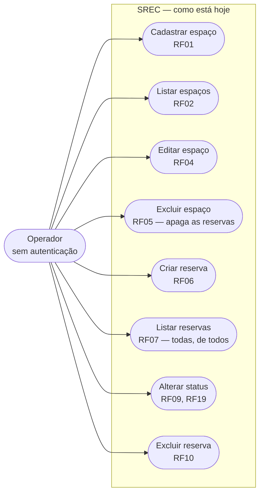

# Requisitos do SREC — reconstruídos por engenharia reversa

Este documento **não** descreve o sistema que gostaríamos de ter. Descreve o
sistema que o grupo da N2 recebeu, derivado linha a linha do código em
`server/src/` e `client/src/`.

A documentação recebida do grupo anterior (`Documentação Oficial SREC.md`) é
preservada no repositório como registro histórico e **não é fonte de verdade**.
Onde ela divergir do código, o código vence. As 12 divergências estão
catalogadas em
[`docs/auditoria/divergencias-doc-codigo.md`](../auditoria/divergencias-doc-codigo.md).

As evidências apontam para o código da `main` depois do backend da N2
(PR #41: BE-01 a BE-08), do frontend (FE-01 a FE-05, PRs #35, #36, #42, #43 e
#44) e da subida em Docker Compose (OPS-01, PR #40).
Quando um requisito já mudou de situação por um PR da N2, isso aparece no
campo **Corrigido na N2**, com a situação original preservada para o relatório
de antes e depois.

## Como ler este documento

Cada requisito tem:

* **Identificador** — `RFnn` (funcional) ou `RNFnn` (não funcional).
* **História** — `Como <ator>, quero <ação>, para <benefício>`.
* **Situação** — um de quatro valores, e nada além deles:
  * `implementado` — o código faz o que está escrito e os critérios passam.
  * `implementado com defeito (BUG-nn)` ou `(CS-nn)` — existe, com defeito
    catalogado na auditoria.
  * `documentado mas inexistente` — a doc recebida promete; não há código.
  * `não implementado` — não existe e a doc recebida também não prometia.
* **Evidência** — arquivo e linha que sustentam a situação declarada.
* **Critérios de aceitação** — verificáveis, no formato que QA-01 a QA-04
  convertem em teste automatizado.
* **Trabalho na N2** — qual spec mexe nisso, ou `nenhum (débito da N3)`.

Requisito com `Situação` diferente de `implementado` **não** é promessa de
entrega. Entrega é o que está em [`docs/specs/`](../specs/README.md).

## Atores

| Ator | Existe no código? | Observação |
|---|---|---|
| **Operador** | sim | Qualquer pessoa com acesso à URL. Não há login, sessão, token ou cabeçalho de identificação. Tem poder total sobre recursos e reservas. É o único ator real do sistema. Evidência: a cadeia de middlewares de `server/src/app.js:14-19` não tem autenticação, e as rotas só validam o `:id` (`server/src/routes/resourceRoutes.js:6-10`, `server/src/routes/reservationRoutes.js:6-10`). |
| **Administrador** | não | A doc recebida o declara em `Documentação Oficial SREC.md:39`, amarra a ele o CRUD de espaços (`:52`) e marca `POST /api/resources` como "Nível de acesso Admin" (`:109`). Não há uma linha de autorização no código. Ver RF14. |
| **Usuário identificado** | não | A doc recebida declara `reservations.user_id UUID` (`:94`) e afirma que `GET /api/reservations` lista "as reservas do usuário atual" (`:116`). O schema tem `user_name VARCHAR(100)` preenchido por digitação livre (`server/src/config/initDb.js:17`, `client/src/features/reservations/ReservationForm.jsx:73-81`). Ver RF13. |

Enquanto só existir o ator `Operador`, **todo requisito de visibilidade,
propriedade ou permissão é vácuo**. Isso não é opinião: é o que explica RF13 e
RF14 serem `documentado mas inexistente`.

## Requisitos funcionais

### RF01 — Cadastrar recurso

**História.** Como Operador, quero cadastrar uma estação de trabalho ou sala de
reunião informando nome, tipo e capacidade, para que ela possa ser reservada.

**Situação.** `implementado`

**Evidência.** `POST /api/resources` em
`server/src/routes/resourceRoutes.js:6` → `ResourceController.createResource`
(`server/src/controllers/resourceController.js:5-7`) →
`ResourceService.create` (`server/src/services/resourceService.js:13-18`) →
`ResourceModel.create` (`server/src/models/resourceModel.js:4-12`). O
formulário está em `client/src/features/resources/ResourceForm.jsx:58-102`,
com validação no cliente em `client/src/features/resources/validation.js:14-34`.

**Critérios de aceitação.**

1. `POST /api/resources` com `{ "name": "Sala Alpha", "type": "meeting_room", "capacity": 8 }`
   responde `201` e o corpo traz a linha inteira, porque o `INSERT` usa
   `RETURNING *` (`server/src/models/resourceModel.js:8`).
2. `POST /api/resources` sem `name` **ou** sem `type` responde `400` com
   `code: "RESOURCE_FIELDS_REQUIRED"` (`resourceService.js:14`).
3. `POST /api/resources` sem `capacity` responde `201` com `capacity: 1`: o
   default do parâmetro em `resourceService.js:13`.
4. `POST` com `capacity` 0, negativa, fracionária, não numérica ou acima de
   100 responde `400` com `code: "INVALID_CAPACITY"` e não grava
   (`resourceService.js:16`, `server/src/domain/resourceType.js`).
5. `POST` com `type` fora de `workstation`/`meeting_room` responde `400` com
   `code: "INVALID_RESOURCE_TYPE"` (`resourceService.js:15`). Ver RN01 em
   [`docs/produto/overview.md`](overview.md).

A interface barra os três casos antes do envio
(`client/src/features/resources/validation.js:23-31`), mas isso protege só
quem usa a tela.

**Corrigido na N2.** BE-09 (issue #47, PR #61): validação no serviço e `CHECK`
de tipo e capacidade no banco
(`server/migrations/004_resource_type_capacity_check.sql`). Situação antes:
`implementado com defeito (BUG-09, BUG-10)`: `capacity: 0` ou `-5` e
`type: "banana"` respondiam `201` e eram gravados.

---

### RF02 — Listar recursos

**História.** Como Operador, quero ver a lista de todos os espaços
cadastrados com tipo e capacidade, para escolher onde reservar.

**Situação.** `implementado`

**Evidência.** `GET /api/resources` em
`server/src/routes/resourceRoutes.js:7` → `getAllResources`
(`resourceController.js:8`) → `ResourceService.list` (`resourceService.js:9`)
→ `SELECT * FROM resources ORDER BY id ASC` (`resourceModel.js:15`).
Renderizado em `client/src/features/resources/ResourceList.jsx:15-37`.

**Critérios de aceitação.**

1. `GET /api/resources` responde `200` com um array JSON, ordenado por `id`
   crescente (`resourceModel.js:15`).
2. Com a tabela vazia, responde `200` com `[]` (não `404`), e o cliente exibe
   "Nenhum espaço cadastrado ainda." (`ResourceList.jsx:20`).
3. A resposta inclui todas as colunas da tabela, inclusive `created_at` e
   `updated_at`, porque a consulta é `SELECT *`.

**Nota de divergência.** A doc recebida descreve este endpoint como "Lista
todos os espaços **disponíveis**" (`Documentação Oficial SREC.md:108`). Ele
lista **todos**, sem qualquer filtro: não há `WHERE`, não há `is_active` (ver
RF15) e não há cruzamento com reservas. A palavra "disponíveis" é falsa.

**Trabalho na N2.** nenhum no comportamento; REQ-03 corrige a descrição no
contrato `docs/arquitetura/openapi.yaml`.

---

### RF03 — Consultar um recurso por identificador

**História.** Como Operador, quero consultar um espaço específico pelo seu
identificador, para ver seus dados isoladamente.

**Situação.** `implementado`

**Evidência.** `GET /api/resources/:id` em
`server/src/routes/resourceRoutes.js:8`, com `validateIdParam()` antes do
controller → `getResourceById` (`resourceController.js:9`) →
`ResourceService.getById` (`resourceService.js:10-14`).

**Critérios de aceitação.**

1. `GET /api/resources/1` com o recurso 1 existente responde `200` com o
   objeto.
2. `GET /api/resources/99999` responde `404` com `code: "RESOURCE_NOT_FOUND"`
   (`resourceService.js:12`).
3. `GET /api/resources/abc` responde `400` com `code: "INVALID_ID_PARAM"`:
   `server/src/middlewares/validateIdParam.js:4-6` recusa tudo que não for
   inteiro positivo de até 2147483647. Vale para as seis rotas com `:id`
   (`resourceRoutes.js:8-10`, `reservationRoutes.js:8-10`). Coberto por
   `server/tests/integration/errorHandling.test.js`.

**Nota de cobertura de interface.** O cliente tem `api.getResource`
(`client/src/services/api.js:10-12`), mas nenhuma tela a chama. É escopo de
produto não entregue, não defeito do endpoint.

**Corrigido na N2.** BE-04 e BE-05 (PR #41). Situação no código recebido:
`implementado com defeito (BUG-04)`: `GET /api/resources/abc` respondia `500`,
porque o `22P02` do Postgres caía no `catch` genérico do controller.

---

### RF04 — Atualizar um recurso

**História.** Como Operador, quero corrigir nome, tipo ou capacidade de um
espaço já cadastrado, para manter o cadastro fiel à realidade física.

**Situação.** `implementado`

**Evidência.** `PUT /api/resources/:id` em
`server/src/routes/resourceRoutes.js:9` → `updateResource`
(`resourceController.js:10`) → `ResourceService.update`
(`resourceService.js:25-33`) → `ResourceModel.update`
(`resourceModel.js:26-35`), que usa `COALESCE` para manter os campos não
enviados. A tela de edição existe: botão em
`client/src/features/resources/ResourceListItem.jsx:40-46`, formulário em modo
`edit` em `ResourceListItem.jsx:15-27`, gravação em
`client/src/hooks/useResources.js:29-37`.

**Critérios de aceitação.**

1. `PUT /api/resources/1` com `{ "name": "Alpha", "type": "meeting_room", "capacity": 10 }`
   responde `200` com o objeto atualizado e `updated_at` renovado
   (`resourceModel.js:30`).
2. `PUT /api/resources/99999` responde `404` (`resourceService.js:19`).
3. `PUT /api/resources/1` com corpo parcial `{ "capacity": 4 }` responde `200`
   e mantém `name` e `type` (`resourceModel.js:29-30`).
4. `PUT` com corpo vazio responde `400` com `code: "EMPTY_UPDATE"`, e com
   `name` em branco responde `400` com `code: "INVALID_NAME"`
   (`resourceService.js:26-27`).
5. `PUT` com `capacity` inválida ou `type` fora do enum responde `400`
   (`INVALID_CAPACITY` / `INVALID_RESOURCE_TYPE`) e o espaço não muda
   (`resourceService.js:28-29`).

**Corrigido na N2.** BE-05 (PR #41) e FE-05 (PR #44). Situação no código
recebido: `implementado com defeito (BUG-05)`: corpo parcial respondia `500`,
porque `name` virava `NULL`; e nenhuma tela chamava o endpoint (BUG-15).
BE-09 (issue #47, PR #61) fechou BUG-09 e BUG-10 na edição: `capacity: 0` e
`type: "banana"` respondiam `200` e eram gravados.

---

### RF05 — Excluir um recurso

**História.** Como Operador, quero remover um espaço do cadastro, para que ele
deixe de aparecer como reservável.

**Situação.** `implementado com defeito (BUG-06)`

**Evidência.** `DELETE /api/resources/:id` em
`server/src/routes/resourceRoutes.js:10` → `deleteResource`
(`resourceController.js:11-14`) → `ResourceService.remove`
(`resourceService.js:22-26`) →
`DELETE FROM resources WHERE id = $1 RETURNING *` (`resourceModel.js:38`).
Botão em `client/src/features/resources/ResourceListItem.jsx:47-49`, que abre
o diálogo `client/src/features/resources/CascadeDeleteDialog.jsx:7-78`.

**Critérios de aceitação.**

1. `DELETE /api/resources/1` responde `200` com
   `{"message":"Recurso excluído com sucesso."}` (`resourceController.js:13`).
2. `DELETE /api/resources/99999` responde `404` (`resourceService.js:24`).
3. Antes de excluir, a interface busca as reservas no servidor e mostra
   quantas serão apagadas, separando futuras e passadas, e exige marcar a
   ciência da perda (`client/src/features/resources/ResourcesPanel.jsx:15-26`,
   `CascadeDeleteDialog.jsx:35-73`). Atendido desde FE-05.
4. **Falha hoje (BUG-06):** excluir um recurso com reservas deveria ser
   bloqueado (`409`). O banco continua apagando **todas** as reservas daquele
   recurso, porque `server/src/config/initDb.js:16` declara
   `ON DELETE CASCADE`, e nenhuma migration troca para `RESTRICT`. Fora da
   tela, por exemplo com `curl`, não há aviso nenhum.

**Trabalho na N2.** FE-05 (PR #44) mitigou na interface. A troca de
`CASCADE` por `RESTRICT` tem prefixo reservado em OPS-02 e é pendência
declarada em [`docs/arquitetura/der.md`](../arquitetura/der.md).

---

### RF06 — Criar reserva sem sobreposição de horário

**História.** Como Operador, quero reservar um espaço informando responsável,
início e fim, para garantir uso exclusivo naquele intervalo.

**Situação.** `implementado com defeito (BUG-01)`

**Evidência.** `POST /api/reservations` em
`server/src/routes/reservationRoutes.js:6` → `createReservation`
(`server/src/controllers/reservationController.js:5-13`) →
`ReservationService.create`
(`server/src/services/reservationService.js:9-25`). O serviço confere o
espaço (`:12-13`), converte os horários com offset (`:14-15`), valida a janela
(`:16-17`), consulta a disponibilidade (`:18`) e grava, traduzindo a violação
do `EXCLUDE` (`23P01`) em `409` (`:19-24`). Formulário em
`client/src/features/reservations/ReservationForm.jsx:58-109`.

Este é o requisito central do produto. O PR #41 corrigiu BUG-02, BUG-07 e
BUG-08, e o #43 corrigiu BUG-13. O BUG-01 está corrigido **no código**, mas a
proteção só existe num banco em que alguém rodou `npm run db:migrate`, e nem o
boot do servidor nem o `docker compose up` fazem isso.

A fórmula anti-sobreposição documentada em
`Documentação Oficial SREC.md:72`,
`Início_banco < Fim_novo AND Fim_banco > Início_novo`, **confere** com a
implementada em `server/src/models/reservationModel.js:55`:
`start_time < $3 AND end_time > $2`. E agora também existe como constraint:
`server/migrations/001_reservation_no_overlap.sql`.

**Critérios de aceitação.**

1. `POST /api/reservations` com
   `{ "resource_id": 1, "user_name": "Carlos", "start_time": "2026-11-03T09:00:00-03:00", "end_time": "2026-11-03T10:00:00-03:00" }`
   em recurso livre responde `201`, com `status: "scheduled"`.
2. Faltando qualquer um dos quatro campos, responde `400` com
   `code: "MISSING_FIELDS"` e a lista dos campos (`reservationService.js:10-11`).
3. Horário sem offset responde `400` com `code: "INVALID_DATETIME"`
   (`server/src/utils/datetime.js:5-7`).
4. `resource_id` de espaço inexistente responde `404` com
   `code: "RESOURCE_NOT_FOUND"` (`reservationService.js:12-13`).
5. Sobreposição com reserva existente responde `409` com
   `code: "RESERVATION_OVERLAP"` (`reservationService.js:18`).
6. Reserva encostada e reserva sobre horário de reserva `cancelled` são
   aceitas (`reservationModel.js:54-55`).
7. `end_time` anterior ou igual a `start_time` responde `400` com
   `code: "END_BEFORE_START"`, e início no passado (com 60 s de tolerância)
   responde `400` com `code: "START_IN_THE_PAST"`
   (`server/src/validators/reservationValidator.js:13-14`).
8. Um duplo clique em "Confirmar Reserva" gera uma única requisição:
   `client/src/hooks/useSubmit.js:14-16` bloqueia o segundo envio.
9. **Falha hoje fora de um banco migrado (BUG-01):** duas requisições
   concorrentes para o mesmo intervalo devem resultar em uma `201` e uma
   `409`. Com as migrations aplicadas, o `EXCLUDE` garante isso, e
   `server/tests/integration/reservations.concurrency.test.js` prova contra
   PostgreSQL real. Sem elas, a única barreira é a consulta de
   `reservationService.js:18`, lida e escrita sem transação: a janela TOCTOU
   do código recebido continua aberta. `server/src/index.js:12` só executa o
   `initDb.js`, que não cria a constraint.

**Corrigido na N2.** BE-01, BE-02 e BE-07 (PR #41), FE-02 (PR #42) e FE-03
(PR #43). Situação no código recebido: `implementado com defeito (BUG-01)`,
com BUG-02, BUG-07, BUG-08 e BUG-13 incidindo sobre o mesmo requisito.

**Trabalho na N2.** Aplicar as migrations automaticamente no boot ou no
compose fecha o BUG-01 em todo ambiente. Ver RNF02 e RNF15.

---

### RF07 — Listar reservas

**História.** Como Operador, quero ver todas as reservas registradas em ordem
cronológica, para acompanhar a ocupação dos espaços.

**Situação.** `implementado`

**Evidência.** `GET /api/reservations` em
`server/src/routes/reservationRoutes.js:7` → `getAllReservations`
(`reservationController.js:14`) → `ReservationService.list`
(`reservationService.js:26`) →
`SELECT * FROM reservations ORDER BY start_time ASC`
(`reservationModel.js:16`). Renderizado em
`client/src/features/reservations/ReservationList.jsx:5-29`.

**Critérios de aceitação.**

1. Responde `200` com array ordenado por `start_time` crescente.
2. Retorna reservas de **todos** os responsáveis e em **todos** os status,
   inclusive `cancelled`: não há `WHERE` na consulta.
3. Com a tabela vazia, responde `200` com `[]`, e o cliente exibe "Nenhuma
   reserva registrada." (`ReservationList.jsx:14`).

**Nota de divergência.** A doc recebida descreve este endpoint como "Lista as
reservas **do usuário atual**" (`Documentação Oficial SREC.md:116`). Não
existe usuário atual (ver RF13). A descrição é falsa e é corrigida no contrato
por REQ-03.

**Trabalho na N2.** a listagem não muda. O índice sobre `resource_id` é o do
`EXCLUDE` de BE-01; ver RNF13.

---

### RF08 — Consultar uma reserva por identificador

**História.** Como Operador, quero consultar uma reserva específica pelo seu
identificador, para ver seus dados isoladamente.

**Situação.** `implementado`

**Evidência.** `GET /api/reservations/:id` em
`server/src/routes/reservationRoutes.js:8`, com `validateIdParam()` →
`getReservationById` (`reservationController.js:15`) →
`ReservationService.getById` (`reservationService.js:27-31`). Sem função
correspondente em `client/src/services/api.js`: alcançável só por cliente
HTTP direto.

**Critérios de aceitação.**

1. `GET /api/reservations/1` com a reserva 1 existente responde `200` com o
   objeto.
2. `GET /api/reservations/99999` responde `404` com
   `code: "RESERVATION_NOT_FOUND"` (`reservationService.js:29`).
3. `GET /api/reservations/abc` responde `400` com `code: "INVALID_ID_PARAM"`,
   pelo mesmo middleware de RF03.

**Corrigido na N2.** BE-04 e BE-05 (PR #41). Situação no código recebido:
`implementado com defeito (BUG-04)`.

---

### RF09 — Alterar o status de uma reserva

**História.** Como Operador, quero mudar o status de uma reserva, para
registrar que ela foi concluída ou cancelada.

**Situação.** `implementado`

**Evidência.** `PATCH /api/reservations/:id/status` em
`server/src/routes/reservationRoutes.js:9` → `updateReservationStatus`
(`reservationController.js:16`) → `ReservationService.changeStatus`
(`reservationService.js:32-39`) → `ReservationModel.updateStatus`
(`reservationModel.js:33-42`), cujo `UPDATE` só altera a linha se o status
atual for uma origem válida (`:37`). O ciclo de vida está em
`server/src/domain/reservationStatus.js:7-11`. Acionado em
`client/src/features/reservations/ReservationListItem.jsx:26` (`completed`)
e `:32` (`cancelled`).

**Critérios de aceitação.**

1. `PATCH /api/reservations/1/status` com `{"status":"cancelled"}` em reserva
   `scheduled` responde `200` com `updated_at` renovado.
2. O mesmo `PATCH` para `{id}` inexistente responde `404`
   (`reservationService.js:36-37`).
3. `{"status":"banana"}` e corpo sem `status` respondem `400` com
   `code: "INVALID_RESERVATION_STATUS"` (`reservationService.js:33`). Com as
   migrations aplicadas, o banco também recusa, por
   `reservations_status_check` e pelo `NOT NULL` em `status`.
4. Transição a partir de estado final (`completed` → `scheduled`) responde
   `409` com `code: "INVALID_STATUS_TRANSITION"` (`reservationService.js:38`).

Os critérios 3 e 4 são cobertos por
`server/tests/integration/reservations.status.test.js`.

**Corrigido na N2.** BE-03 (PR #41). Situação no código recebido:
`implementado com defeito (BUG-03)`: a API gravava qualquer string, aceitava
`NULL` e não conhecia o ciclo de vida.

---

### RF10 — Excluir uma reserva definitivamente

**História.** Como Operador, quero apagar uma reserva do sistema, para remover
um registro feito por engano.

**Situação.** `implementado`

**Evidência.** `DELETE /api/reservations/:id` em
`server/src/routes/reservationRoutes.js:10` → `deleteReservation`
(`reservationController.js:17-20`) → `ReservationService.remove`
(`reservationService.js:40-44`) → `reservationModel.js:44-48`. Botão em
`client/src/features/reservations/ReservationListItem.jsx:38-43`, que abre o
diálogo de `client/src/features/reservations/ReservationsPanel.jsx:50-67`.

**Critérios de aceitação.**

1. `DELETE /api/reservations/1` responde `200` com
   `{"message":"Reserva excluída com sucesso."}` (`reservationController.js:19`).
2. `DELETE /api/reservations/99999` responde `404`
   (`reservationService.js:42`).
3. Depois da exclusão, `GET /api/reservations/1` responde `404`: a remoção é
   física (`reservationModel.js:45`), não lógica.

O vocabulário da interface agora separa as duas ações: o diálogo diz
"Excluir esta reserva?", avisa que a reserva "será apagada do histórico" e
orienta a usar o cancelamento para manter o histórico
(`ReservationsPanel.jsx:52-66`). No código recebido, a confirmação falava em
"cancelar" a reserva.

**Trabalho na N2.** nenhum no comportamento.

---

### RF11 — Cancelar reserva por rota dedicada

**História.** Como Operador, quero cancelar uma reserva por uma rota de
cancelamento dedicada, para que a intenção "cancelar" seja explícita no
contrato da API.

**Situação.** `documentado mas inexistente`

**Evidência.** A doc recebida lista
`PUT /api/reservations/{id}/cancel` — "Cancela uma reserva existente"
(`Documentação Oficial SREC.md:117`). O arquivo de rotas
`server/src/routes/reservationRoutes.js` tem exatamente cinco registros
(linhas `6` a `10`) e **nenhum** deles é `PUT`, nem contém o segmento
`cancel`. A chamada `PUT /api/reservations/1/cancel` cai no handler de rota
inexistente (`server/src/app.js:23`) e responde `404` com
`code: "ROUTE_NOT_FOUND"`.

O cancelamento **existe**, por outro caminho: `PATCH
/api/reservations/:id/status` com `{"status":"cancelled"}`, que é o que o
cliente faz em `client/src/features/reservations/ReservationListItem.jsx:32`.

**Critérios de aceitação (se um dia for implementado).**

1. `PUT /api/reservations/{id}/cancel` em reserva `scheduled` responde `200`
   com `status: "cancelled"`.
2. A mesma chamada em reserva já `cancelled` responde `409`.
3. A mesma chamada em `{id}` inexistente responde `404`.

**Decisão da N2.** **Não implementar.** O cancelamento já é alcançável por
`PATCH /:id/status`, endurecido por BE-03 (PR #41). Criar um segundo caminho
para o mesmo efeito aumentaria a superfície da API sem benefício para o
usuário, e a rubrica da N2 premia melhoria comprovada do código recebido, não
novas rotas. A resolução adotada é **corrigir a documentação**: o contrato da
API (REQ-03) documenta `PATCH /:id/status` como o único caminho de transição
de status, e o handoff (REQ-04) registra a rota `/cancel` como ficção herdada,
já descartada, para que a N3 não a procure.

---

### RF12 — Listar as reservas de um recurso específico

**História.** Como Operador, quero ver a agenda de um espaço específico, para
avaliar sua ocupação antes de reservar.

**Situação.** `não implementado`

**Evidência.** A capacidade **existe no model e não está exposta**:
`ReservationModel.findByResourceId` em
`server/src/models/reservationModel.js:27-31` executa
`SELECT * FROM reservations WHERE resource_id = $1 ORDER BY start_time ASC`.
Nenhum serviço ou controller a chama (`grep -rn findByResourceId server/src`
só encontra a definição) e nenhuma rota a expõe. É código morto escrito e nunca
ligado.

A doc recebida também não promete este endpoint
(`Documentação Oficial SREC.md:106-117` lista cinco, nenhum por recurso) — por
isso `não implementado` e não `documentado mas inexistente`.

**Critérios de aceitação (se um dia for implementado).**

1. `GET /api/resources/{id}/reservations` responde `200` com as reservas
   daquele recurso, ordenadas por `start_time`.
2. Para recurso existente sem reservas, responde `200` com `[]`.
3. Para recurso inexistente, responde `404`.

**Trabalho na N2.** nenhum. É a evolução mais barata para a N3 e fica marcada
como tal no handoff (REQ-04): o model já existe, basta controller, rota e
teste.

---

### RF13 — Identificar quem fez a reserva

**História.** Como Operador, quero que a reserva esteja vinculada a um usuário
identificado do sistema, para que seja possível saber de quem é a reserva e
listar "minhas reservas".

**Situação.** `documentado mas inexistente`

**Evidência.** A doc recebida declara `UUID user_id` na entidade
`RESERVATION` (`Documentação Oficial SREC.md:94`) e afirma que
`GET /api/reservations` lista "as reservas do usuário atual" (`:116`). O que
existe:

* `server/src/config/initDb.js:17` — `user_name VARCHAR(100) NOT NULL`, texto
  livre. Não há tabela `users`, não há FK, não há unicidade.
* `client/src/features/reservations/ReservationForm.jsx:73-81` — um
  `<input type="text">` com placeholder "Ex: Carlos Silva". O Operador digita
  o nome que quiser; dois Operadores podem digitar `"Carlos"` e o sistema os
  trata como a mesma string sem tratá-los como a mesma pessoa.
* `server/src/models/reservationModel.js:16` — `findAll` sem `WHERE`: não há
  nem filtro por `user_name`, muito menos por usuário autenticado.

**Critérios de aceitação (se um dia for implementado).**

1. Existe entidade de usuário persistida com identificador estável.
2. `reservations` referencia essa entidade por chave estrangeira.
3. `GET /api/reservations` filtra pelo usuário da sessão.
4. Um usuário não consegue alterar nem excluir reserva de outro.

**Decisão da N2.** **Não implementar.** Introduzir identidade de usuário
implica tabela nova, autenticação, sessão, migração do dado existente de
`user_name` e reescrita das telas — ou seja, nova funcionalidade complexa, que
é o escopo da N3 ("evoluir novas funcionalidades complexas"), não da N2.
Resolução: **corrigir a documentação** (o DER real, em REQ-02, mostra
`user_name VARCHAR(100)`, sem `user_id`) e **registrar como débito
priorizado** no handoff (REQ-04). O que a N2 faz é deixar o terreno pronto:
com `CHECK` de status (BE-03) e constraint `EXCLUDE` (BE-01) no banco,
acrescentar uma coluna `user_id` depois não exige rediscutir a regra de
integridade central.

---

### RF14 — Restringir a gestão de espaços a administradores

**História.** Como Administrador, quero ser o único capaz de cadastrar,
alterar e excluir espaços, para que operadores comuns não alterem o cadastro
físico do coworking.

**Situação.** `documentado mas inexistente`

**Evidência.** A doc recebida marca `POST /api/resources` como "Cadastra um
novo espaço - **Nível de acesso Admin**"
(`Documentação Oficial SREC.md:109`) e, no diagrama de casos de uso, liga
`UC4 (Gerenciar Espaços - CRUD)` exclusivamente ao ator `admin` (`:45`,
`:52`). O que existe:

* `server/src/app.js:14-19` — a cadeia de middlewares tem `helmet`, CORS
  restrito, limite de corpo e limite de escrita (BE-08), mas nenhuma
  autenticação.
* `server/src/routes/resourceRoutes.js:6-10` — as rotas só passam por
  `validateIdParam`, que valida o formato do `:id`.
* `server/src/services/resourceService.js` — nenhuma leitura de
  `req.headers.authorization`, nenhum `req.user`.
* `server/package.json:21-28` — as dependências de produção são `cors`,
  `dotenv`, `express`, `express-rate-limit`, `helmet` e `pg`. Não há
  `jsonwebtoken`, `passport`, `bcrypt` nem equivalente.

Qualquer pessoa na rede executa
`curl -X DELETE http://localhost:5000/api/resources/1` e apaga um espaço —
junto com todas as reservas dele, por RF05/BUG-06.

**Critérios de aceitação (se um dia for implementado).**

1. `POST`, `PUT` e `DELETE` em `/api/resources` sem credencial respondem
   `401`.
2. Com credencial de operador comum, respondem `403`.
3. Com credencial de administrador, respondem `201`/`200`.
4. `GET /api/resources` segue público, ou passa a exigir sessão — decisão de
   produto a tomar junto.

**Decisão da N2.** **Não implementar.** Autenticação e autorização são
funcionalidade nova e dependem de RF13 (não há a quem atribuir papel sem
usuário). A N2 corrige o código recebido e **declara a lacuna**; não inventa
um módulo de segurança em uma semana sem requisito de negócio validado.
Resolução: **corrigir a documentação** (remover "Nível de acesso Admin" do
contrato em REQ-03 e o ator `Administrador` dos casos de uso em REQ-02) e
**registrar como débito de severidade alta** no handoff (REQ-04). A parte de
CS-14 que não depende de identidade foi entregue por BE-08 (PR #41); ver
RNF07.

---

### RF15 — Ativar e inativar um espaço

**História.** Como Operador, quero marcar um espaço como inativo sem excluí-lo,
para tirá-lo de circulação durante manutenção preservando o histórico de
reservas.

**Situação.** `documentado mas inexistente`

**Evidência.** A doc recebida declara `BOOLEAN is_active` na entidade
`RESOURCE` (`Documentação Oficial SREC.md:88`). A coluna **não existe**: o
`CREATE TABLE resources` em `server/src/config/initDb.js:5-12` tem exatamente
`id`, `name`, `type`, `capacity`, `created_at`, `updated_at`. Consequências em
cascata:

* `ResourceModel` não a lê nem escreve: `create` insere três colunas
  (`resourceModel.js:6`), `update` atualiza três (`resourceModel.js:29`).
* `GET /api/resources` não pode filtrar por ela — o que explica por que a
  descrição "lista todos os espaços **disponíveis**"
  (`Documentação Oficial SREC.md:108`) é falsa (ver RF02).
* A única forma de tirar um espaço de circulação hoje é `DELETE`, que apaga o
  histórico de reservas por `ON DELETE CASCADE` (RF05/BUG-06). A ausência de
  `is_active` **transforma uma inativação temporária em perda de dado
  permanente**.

**Critérios de aceitação (se um dia for implementado).**

1. `resources` tem `is_active BOOLEAN NOT NULL DEFAULT TRUE`.
2. `GET /api/resources?active=true` retorna só os ativos.
3. `POST /api/reservations` para recurso inativo responde `409`.
4. Reservas já existentes de um recurso inativado permanecem consultáveis.

**Decisão da N2.** **Não implementar na N2.** A coluna é barata; o que não é
barato é a cadeia que ela puxa — filtro na listagem, bloqueio na criação de
reserva, tela de alternância, migração. Além disso, a decisão correta sobre
RF05/BUG-06 (trocar `CASCADE` por `RESTRICT`) muda o desenho de `is_active`:
com `RESTRICT`, a inativação deixa de ser paliativo para exclusão e passa a
ser estado de produto legítimo. Fazer as duas na ordem errada custa retrabalho.
Resolução: **corrigir a documentação** (o DER real, em REQ-02, não tem
`is_active`) e **registrar como a evolução de melhor relação custo-benefício
para a N3** no handoff (REQ-04).

---

### RF16 — Visualizar disponibilidade dos espaços

**História.** Como Operador, quero ver a ocupação atualizada dos espaços, para
saber o que está livre antes de tentar reservar.

**Situação.** `implementado com defeito (CS-08)`

**Evidência.** A doc recebida promete "feedback dinâmico e em tempo real sobre
a disponibilidade das salas" (`Documentação Oficial SREC.md:127`). O que
existe é a aba "Agendamentos" listando reservas
(`client/src/features/reservations/ReservationList.jsx:5-29`), recarregada por
`reloadAll` (`client/src/hooks/useAppData.js:20-26`) depois de **toda**
mutação bem-sucedida (`client/src/App.jsx:20-23`). Não há endpoint de
disponibilidade, não há polling, não há WebSocket. "Tempo real" significa, na
prática, "recarrega tudo depois que você clica". A disponibilidade só é
avaliada no instante do `POST`, dentro de `checkAvailability`
(`reservationModel.js:50-60`).

**Critérios de aceitação.**

1. Depois de criar, alterar ou excluir um espaço ou uma reserva, a lista
   exibida reflete o novo estado sem recarregar a página — atendido hoje.
2. Uma reserva criada por **outro** Operador aparece sem ação do usuário
   atual — **não atendido**: não há polling nem push.
3. Uma mutação recarrega só a lista afetada, e não as duas — **não atendido**
   (CS-08): `useAppData.js:22` dispara `loadResources` e `loadReservations`
   juntos.

**Trabalho na N2.** nenhum (débito da N3). FE-01 preservou o CS-08 de
propósito (`useAppData.js:19`) para não mudar comportamento numa refatoração
estrutural.

---

### RF17 — Navegar entre espaços e agendamentos por abas

**História.** Como Operador, quero alternar entre a gestão de espaços e a de
agendamentos, para trabalhar em uma coisa de cada vez.

**Situação.** `implementado`

**Evidência.** As duas abas estão declaradas em `client/src/App.jsx:10-13`,
o estado `activeTab` em `App.jsx:16`, os botões em
`client/src/components/Tabs.jsx:3-14` e os dois painéis condicionais em
`App.jsx:32-51`.

**Critérios de aceitação.**

1. Ao abrir a aplicação, a aba "Espaços e Salas" está ativa — valor inicial
   `'resources'` em `App.jsx:16`.
2. Clicar em "Agendamentos" exibe o painel de reservas e oculta o de espaços.
3. A aba ativa recebe a classe `active` — `Tabs.jsx:8`.

**Trabalho na N2.** nenhum.

---

### RF18 — Receber retorno visual do resultado de cada operação

**História.** Como Operador, quero ver uma mensagem de sucesso ou erro depois
de cada ação, para saber se ela funcionou.

**Situação.** `implementado`

**Evidência.** `showFeedback` em `client/src/hooks/useFeedback.js:16-28`
grava a mensagem e agenda a limpeza em 4 s (`FEEDBACK_TIMEOUT_MS`, `:3`). O
timer fica em `useRef` (`:7`), é cancelado antes de cada nova mensagem
(`:20`) e no desmonte (`:37`). A mensagem é exibida por
`client/src/components/Alert.jsx:3-13`, com `role="alert"` e
`aria-live="assertive"`, a partir de `client/src/App.jsx:30`.

**Critérios de aceitação.**

1. Toda criação, alteração ou exclusão bem-sucedida exibe mensagem de sucesso.
2. Toda falha exibe a mensagem de erro devolvida pela API.
3. A mensagem some sozinha depois de 4 s.
4. Duas mensagens seguidas: a segunda fica visível os 4 s inteiros.
5. Desmontar o componente com mensagem na tela não dispara `setState` em
   componente desmontado.

Os critérios 4 e 5 são cobertos por `client/src/hooks/useFeedback.test.js`.

**Corrigido na N2.** FE-04 (PR #36). Situação no código recebido:
`implementado com defeito (BUG-14)` — o retorno do `setTimeout` nunca era
guardado nem limpo.

---

### RF19 — Concluir uma reserva realizada

**História.** Como Operador, quero marcar uma reserva agendada como concluída,
para registrar que o espaço foi de fato usado.

**Situação.** `implementado`

**Evidência.** `client/src/features/reservations/ReservationListItem.jsx:23-29`
chama `onChangeStatus(reservation.id, RESERVATION_STATUS.COMPLETED)`, que usa
o `PATCH /:id/status` de RF09. Os botões de concluir e cancelar só aparecem se
`reservation.status === RESERVATION_STATUS.SCHEDULED`
(`ReservationListItem.jsx:21`). Desde BE-03 a API aplica o mesmo ciclo de
vida (`server/src/domain/reservationStatus.js:7-11`).

**Critérios de aceitação.**

1. Reserva `scheduled` exibe os botões "Concluir" e "Cancelar"; reserva
   `completed` ou `cancelled` não exibe.
2. Clicar em "Concluir" muda o status para `completed` e exibe "Status da
   reserva atualizado!" (`ReservationsPanel.jsx:46`).
3. `PATCH` direto na API de `completed` para `scheduled` responde `409`
   (RF09, critério 4).

**Corrigido na N2.** BE-03 (PR #41). Situação no código recebido:
`implementado com defeito (BUG-03)`: o ciclo de vida só existia na interface.

---

## Requisitos não funcionais

### RNF01 — Persistência relacional em PostgreSQL

**História.** Como time de manutenção, quero que recursos e reservas vivam em
PostgreSQL, para que o dado sobreviva a reinícios e seja consultável por SQL.

**Situação.** `implementado`

**Evidência.** `server/src/config/database.js:5-8` cria um `Pool` do `pg` a
partir de `process.env.DATABASE_URL`, já com o fuso da sessão definido;
`server/package.json:27` fixa `pg ^8.23.0`; os dois models usam SQL cru
parametrizado (`resourceModel.js`, `reservationModel.js`).

**Critérios de aceitação.**

1. Subindo o servidor com `DATABASE_URL` válida, o log imprime
   `Connected to PostgreSQL Database` (`database.js:10-12`).
2. Toda consulta usa parâmetros posicionais (`$1`, `$2`, ...), nunca
   concatenação de string. Verificável: não há template literal com
   interpolação de variável dentro de string SQL nos dois models.
3. Dado gravado permanece após reiniciar o processo.

**Trabalho na N2.** nenhum.

---

### RNF02 — Evolução do schema por migrations versionadas

**História.** Como time de manutenção, quero que toda mudança de schema seja um
arquivo versionado e aplicável em ordem, para que qualquer ambiente chegue ao
mesmo estado de banco.

**Situação.** `implementado com defeito (CS-06)`

**Evidência.** Desde o PR #41 existem quatro migrations em
`server/migrations/` (`0001_timestamptz.sql`, `001_reservation_no_overlap.sql`,
`002_reservation_time_window_check.sql`, `003_reservation_status_check.sql`) e
o comando `npm run db:migrate` (`server/package.json:15`), que aplica em
ordem os arquivos pendentes e registra cada um em `schema_migrations`
(`server/scripts/migrate.js:10-21`).

O que ainda é CS-06: o schema continua sendo efeito colateral do boot.
`server/src/index.js:12` executa `initDb()`, que roda
`CREATE TABLE IF NOT EXISTS` (`server/src/config/initDb.js:4-25`), e
**ninguém executa as migrations automaticamente**: nem o boot, nem o
`docker compose up` (`docker-compose.yml:23-38` não tem `command` de
migração), nem a seção de execução do `README.md`. Em banco que já tem as
tabelas, editar o `initDb.js` continua sem efeito.

Medido em PostgreSQL 16, com um banco limpo: só com o boot, o banco aceita as
sete violações do roteiro de `docs/arquitetura/der.md`; depois de
`npm run db:migrate`, recusa quatro.

**Critérios de aceitação.**

1. Existe um diretório de migrations com arquivos ordenáveis e imutáveis.
   Atendido.
2. Há comando único que aplica as migrations pendentes. Atendido.
3. Rodar o comando duas vezes em sequência não produz erro nem efeito duplo.
   Atendido pelo registro em `schema_migrations`.
4. `initDb.js` deixa de criar schema, ou é removido. **Não atendido.**
5. Subir o ambiente aplica as migrations sem passo manual. **Não atendido.**

**Corrigido na N2.** Parcialmente, por BE-01, BE-02, BE-03 e BE-07 (PR #41).
Situação no código recebido: `não implementado`.

**Trabalho na N2.** OPS-02 (#17), onde também está a divergência entre o
formato das migrations do #41 (`.sql`) e o previsto em OPS-02 (`.js` do
`node-pg-migrate`).

---

### RNF03 — Integridade garantida pelo banco de dados

**História.** Como time de manutenção, quero que as regras invioláveis do
domínio sejam constraints no banco, para que nenhum caminho de código consiga
gravar dado inválido.

**Situação.** `implementado com defeito (resource_id sem NOT NULL)`

**Evidência.** Com as migrations aplicadas, o banco tem cinco constraints de
domínio e um `NOT NULL` novo, conferidos com `pg_get_constraintdef`:

* `reservations_no_overlap`, `EXCLUDE` sobre `tstzrange` (BE-01,
  `server/migrations/001_reservation_no_overlap.sql`);
* `reservations_time_window_check`, `CHECK (end_time > start_time)` (BE-02,
  `server/migrations/002_reservation_time_window_check.sql`);
* `reservations_status_check`, `CHECK` com os três status (BE-03,
  `server/migrations/003_reservation_status_check.sql`);
* `resources_type_check`, `CHECK (type IN ('workstation', 'meeting_room'))`, e
  `resources_capacity_check`, `CHECK (capacity BETWEEN 1 AND 100)` (BE-09,
  `server/migrations/004_resource_type_capacity_check.sql`);
* `status` passa a `NOT NULL` (BE-01).

Continua sem proteção no banco:

* `resource_id` (`:16`) segue sem `NOT NULL`. A API barra pela checagem de
  campos obrigatórios (`reservationService.js:10-11`), mas o banco aceita.

**Critérios de aceitação.**

1. `INSERT` direto por `psql` com `end_time < start_time` é rejeitado pelo
   banco. Atendido com as migrations.
2. `INSERT` direto por `psql` com `status = 'banana'` é rejeitado. Atendido
   com as migrations.
3. `INSERT` direto por `psql` com `capacity = 0` é rejeitado. Atendido
   com a migration `004` (BE-09).
4. `INSERT` direto por `psql` de duas reservas sobrepostas no mesmo recurso,
   ambas com status diferente de `cancelled`, é rejeitado na segunda.
   Atendido com as migrations.
5. `INSERT` direto por `psql` com `resource_id NULL` é rejeitado. **Não
   atendido.**

O critério "direto por `psql`" é deliberado: constraint que só é verificada
pela API não é integridade, é validação. O teste tem de furar a aplicação.

**Corrigido na N2.** Parcialmente, por BE-01, BE-02 e BE-03 (PR #41).
Situação no código recebido: `não implementado`, com zero constraints.

BE-09 (issue #47, PR #61) acrescentou os `CHECK` de tipo e capacidade (BUG-09,
BUG-10). A pendência que resta está declarada em
[`docs/arquitetura/der.md`](../arquitetura/der.md).

---

### RNF04 — Correção de fuso horário nos horários de reserva

**História.** Como Operador, quero que a reserva apareça exatamente no horário
que digitei, para não perder a sala por deslocamento de fuso.

**Situação.** `implementado`

**Evidência.**

1. As colunas de horário são `TIMESTAMPTZ`: em banco novo, pelo
   `server/src/config/initDb.js:10-11`, `:18-19` e `:22-23`; em banco
   existente, pela migration `server/migrations/0001_timestamptz.sql`, que
   converte os valores antigos como horário de `America/Sao_Paulo`.
2. A API só aceita horário em ISO 8601 com offset
   (`server/src/utils/datetime.js:2-7`), e a sessão do banco usa o fuso da
   aplicação (`server/src/config/database.js:7`, `server/src/config/time.js:1`).
3. O cliente converte o valor do `<input type="datetime-local">` para ISO 8601
   com o offset do navegador antes de enviar
   (`client/src/services/api.js:31-41`, `client/src/lib/datetime.js:18-26`).

**Critérios de aceitação.**

1. Reserva criada com início `2026-11-03T09:00` no fuso `America/Sao_Paulo` é
   exibida como `03/11/2026 09:00`.
2. O mesmo registro, consultado por `psql`, mostra o instante com offset
   explícito.
3. O resultado não muda se o processo Node subir com `TZ=UTC`: o instante
   chega com offset e é gravado como `timestamptz`.

**Corrigido na N2.** BE-07 (PR #41) e FE-02 (PR #42). Situação no código
recebido: `implementado com defeito (BUG-07)`.

---

### RNF05 — Testes automatizados cobrindo as regras de domínio

**História.** Como time de manutenção, quero que as regras de domínio tenham
teste automatizado, para que uma refatoração que as quebre falhe na CI.

**Situação.** `implementado com defeito (CS-10)`

**Evidência.** O PR #41 criou a camada de serviço (CS-03 resolvido):
`server/src/services/`, `server/src/domain/reservationStatus.js` e
`server/src/validators/reservationValidator.js`, cada um com teste unitário
ao lado. São 32 testes unitários em 12 suítes (`npm test`) e quatro suítes de
integração contra PostgreSQL real em `server/tests/integration/`
(`npm run test:integration`), inclusive a de concorrência.

O que falta é amplitude e portão:

* os testes HTTP passam por 4 das 10 rotas: `GET /api/resources`,
  `GET /api/resources/:id`, `POST /api/reservations` e
  `PATCH /api/reservations/:id/status`;
* a CI roda `npm test`, que é só o projeto `unit`
  (`server/package.json:12`); as suítes de integração não rodam na CI, e não
  há limite de cobertura (CS-10).

Cobertura dos testes unitários, com
`npx jest --selectProjects unit --coverage --collectCoverageFrom='src/**/*.js'`:
66,28 % de statements, 63,3 % de branches e 48,64 % de funções. No código
recebido: 6,14 %, 0 % e 3,57 %.

**Critérios de aceitação.**

1. `npm test` em `server/` exercita cada rota pelo menos uma vez via
   `supertest`. **Parcial:** 4 de 10.
2. Cada BUG catalogado do backend tem um teste que falhava antes da correção.
   Não verificado neste documento.
3. A regra de sobreposição é testada contra um Postgres real, não contra
   *mock*. Atendido (`reservations.concurrency.test.js`).
4. A cobertura de statements, medida com `--collectCoverageFrom='src/**/*.js'`,
   sai de 6,14 % para o alvo definido em OPS-03. Medido 66,28 %; o alvo e o
   portão dependem de OPS-03.

**Trabalho na N2.** QA-01 (integração das rotas) e OPS-03 (portão de
cobertura e integração na CI).

---

### RNF06 — Resiliência e observabilidade do processo

**História.** Como time de manutenção, quero que o servidor falhe de forma
explícita e se mantenha de pé diante de falhas transitórias do banco, para
diagnosticar problemas sem adivinhar.

**Situação.** `implementado`

**Evidência.**

* O `Pool` tem handler de `'error'` (`server/src/config/database.js:13-15`):
  a queda do Postgres não derruba mais o processo.
* Falha ao garantir o schema no boot aborta com código `1` e mensagem
  explícita (`server/src/index.js:20-25`); o `initDb.js` não engole mais o
  erro.
* `GET /health` (`server/src/routes/healthRoutes.js:7-16`) responde `200` com
  o banco ok e `503` com o banco fora, coberto por
  `server/src/routes/healthRoutes.test.js`.
* Os erros passam por um log estruturado em JSON
  (`server/src/utils/logger.js:1-5`, chamado em
  `server/src/middlewares/errorHandler.js:20-24`).

**Critérios de aceitação.**

1. Com o banco inacessível no boot, o processo encerra com código diferente de
   `0` e mensagem explícita, em vez de escutar a porta.
2. Com o Postgres reiniciado durante a execução, o processo continua vivo e
   volta a responder quando o banco volta. Não testado automaticamente.
3. Existe rota de saúde que responde `200` com banco ok e `503` sem banco.

**Corrigido na N2.** BE-08 (PR #41). Situação no código recebido:
`implementado com defeito (BUG-12)`, com BUG-11 no boot.

---

### RNF07 — Superfície HTTP segura

**História.** Como time de manutenção, quero que a API restrinja origem,
cabeçalhos e volume de requisições, para que ela não fique aberta a qualquer
site ou script.

**Situação.** `implementado`

**Evidência.** `server/src/app.js:14-19`: `x-powered-by` desligado, `helmet()`,
`cors` com lista de origens permitidas (`server/src/config/cors.js:1-10`,
lida de `CORS_ALLOWED_ORIGINS`), corpo JSON limitado a 100 kB e limite de
escrita de 20 requisições por minuto em `/api`
(`server/src/middlewares/rateLimit.js:1-13`), que responde `429`. As
dependências estão em `server/package.json:25-26`.

**Critérios de aceitação.**

1. Requisição com `Origin` fora da lista configurada é recusada com `403`
   (`cors.js:5-8`, traduzido em `errorHandler.js:8-12`).
2. As respostas trazem os cabeçalhos de segurança padrão do `helmet`.
3. Rajada de escrita acima do limite configurado responde `429`.

Nenhuma rota exige credencial: isso é RF14, débito da N3.

**Corrigido na N2.** BE-08 (PR #41). Situação no código recebido:
`não implementado` (CS-14).

---

### RNF08 — Contrato de API publicado e versionado

**História.** Como integrador ou grupo da N3, quero um contrato formal da API,
para saber cada rota, corpo, status e erro sem ler o código.

**Situação.** `não implementado`

**Evidência.** Não há OpenAPI, Swagger nem coleção Postman no repositório. A
única descrição da API é a tabela de 5 linhas em
`Documentação Oficial SREC.md:106-117`, que omite 5 dos 10 endpoints reais
(`server/src/routes/resourceRoutes.js:6-10`,
`server/src/routes/reservationRoutes.js:6-10`), descreve 3 errado e inclui 1
que não existe (RF11). O PR #41 acrescentou `GET /health`
(`server/src/routes/healthRoutes.js:7`), também fora de qualquer contrato.

**Critérios de aceitação.**

1. Existe um único arquivo de contrato OpenAPI no repositório.
2. As operações do contrato são exatamente as rotas do código, verificado por
   script.
3. Cada operação documenta corpo, respostas de sucesso e de erro.

**Trabalho na N2.** REQ-03 (#23).

---

### RNF09 — Padronização de estilo por lint e formatador

**História.** Como time de manutenção, quero lint e formatador configurados
nos dois pacotes, para que o estilo não dependa de quem escreveu.

**Situação.** `implementado`

**Evidência.** `server/package.json:9-11` (`lint`, `lint:fix`, `format`),
`client/package.json` (idem), os `server/eslint.config.js` e
`client/eslint.config.js`, e os dois `.prettierrc`. Desde o PR #41 o lint do
servidor cobre também `tests/` e `scripts/` (`server/package.json:9`). FE-04
acrescentou `eslint-plugin-jsx-a11y` ao cliente.

**Critérios de aceitação.**

1. `npm run lint` em `server/` e em `client/` termina com código `0`.
2. `npm run format` não altera arquivos recém-formatados.

**Trabalho na N2.** nenhum no requisito; OPS-03 faz o lint bloquear o merge.

---

### RNF10 — Integração contínua a cada push e pull request

**História.** Como time de manutenção, quero que lint, testes e build rodem a
cada push e PR, para que nada quebrado chegue à `main`.

**Situação.** `implementado com defeito (CS-10)`

**Evidência.** `.github/workflows/ci.yml:3-7` dispara em `main` e `develop`;
**`develop` não existe** no repositório. O job de backend roda `npm ci`,
`npm run lint` e `npm test` (`ci.yml:21-23`), que desde o #41 é só o projeto
`unit`: as suítes de integração ficam de fora. O de frontend roda lint e build
(`ci.yml:36-38`), e os testes Vitest do cliente **não** rodam. Não há *gate*
de cobertura. Neste fork o GitHub Actions não executa, então nenhum PR da N2
teve CI verificável.

**Critérios de aceitação.**

1. A CI dispara em todo PR para `main`.
2. A CI roda os testes dos dois pacotes, inclusive os de integração.
3. A CI falha se a cobertura do backend cair abaixo do limite definido.
4. A `main` exige CI verde para aceitar merge.

**Trabalho na N2.** OPS-03 (#18, portões de qualidade), OPS-05 (proteção de
branch).

---

### RNF11 — Configuração por ambiente, sem valor fixo no código

**História.** Como time de manutenção, quero que endereços e credenciais
venham do ambiente, para subir o sistema fora da máquina de quem o escreveu.

**Situação.** `implementado com defeito (CS-07)`

**Evidência.** O cliente lê a URL da API de `import.meta.env` num único ponto
(`client/src/config/env.js:10-13`), com `client/.env.example`, e o servidor lê
`PORT`, `DATABASE_URL`, `CORS_ALLOWED_ORIGINS` e os limites de requisição do
ambiente. Sobra:

* o cliente cai em `http://localhost:5000/api` quando a variável falta
  (`client/src/config/env.js:2`), em vez de falhar;
* o servidor não valida as variáveis no boot: sem `DATABASE_URL`, só falha ao
  tentar garantir o schema.

**Critérios de aceitação.**

1. A URL da API no cliente vem de variável de ambiente do Vite
   (`import.meta.env`). Atendido.
2. O servidor recusa subir, com mensagem clara, se uma variável obrigatória
   faltar. **Parcial:** recusa, mas com a mensagem do banco.
3. `grep -rn "localhost" client/src/` não retorna nada fora de teste. **Não
   atendido:** o default de `env.js:2`.

**Corrigido na N2.** Parcialmente, por FE-02 (PR #42). Situação no código
recebido: `implementado com defeito (CS-07)`, com a URL fixa em
`client/src/services/api.js:1`.

**Trabalho na N2.** OPS-04 (#19, configuração validada).

---

### RNF12 — Formato de erro uniforme em toda a API

**História.** Como consumidor da API, quero que todo erro tenha o mesmo
formato e um código de máquina, para tratá-lo sem comparar strings.

**Situação.** `implementado`

**Evidência.** Os controllers não têm mais `try/catch`: cada handler passa
por `asyncHandler` (`server/src/middlewares/asyncHandler.js:1`) e todo erro
chega ao middleware central (`server/src/middlewares/errorHandler.js:18-28`),
registrado por último em `server/src/app.js:24`. A resposta é sempre
`{ error, code }`, com `details` quando há campo envolvido
(`errorHandler.js:25-26`). Erros de domínio são `AppError`
(`server/src/errors/AppError.js:1-14`), e os SQLSTATE conhecidos viram `4xx`
(`server/src/errors/pgErrorCodes.js:1-12`). O cliente lê `code` e `details`
(`client/src/services/http.js:5-14`).

**Critérios de aceitação.**

1. Toda resposta de erro tem o mesmo formato, com mensagem e código de
   máquina.
2. Erro de validação informa o campo (`details`).
3. Erro do Postgres conhecido (`22P02`, `23502`, `23503`, `23514`, `23P01`)
   vira `4xx`, não `500`.
4. Não sobra `try/catch` por rota nos controllers. Medido:
   `grep -c 'catch (err)' server/src/controllers/*.js` dá 0 e 0.

**Corrigido na N2.** BE-04 (PR #41). Situação no código recebido:
`não implementado` (CS-02), com 10 blocos `try/catch` idênticos.

---

### RNF13 — Desempenho das consultas de agenda

**História.** Como time de manutenção, quero que as consultas de reserva usem
índice, para que a checagem de conflito não degrade com o volume.

**Situação.** `implementado com defeito (CS-09)`

**Evidência.** O `EXCLUDE` de BE-01 cria um índice GiST sobre
`(resource_id, tstzrange(start_time, end_time))`
(`server/migrations/001_reservation_no_overlap.sql`), que cobre a consulta de
`checkAvailability` (`server/src/models/reservationModel.js:50-60`). Mas:

* o índice só existe em banco migrado (ver RNF02);
* não há índice B-tree sobre `start_time`, que `findAll` usa para ordenar
  (`reservationModel.js:16`);
* nenhum `EXPLAIN` foi medido.

**Critérios de aceitação.**

1. Existe índice cobrindo `(resource_id, start_time)` em `reservations`, ou a
   constraint `EXCLUDE` de BE-01, que cria índice GiST equivalente. Atendido
   com as migrations.
2. `EXPLAIN` da consulta de `checkAvailability` não mostra `Seq Scan` com a
   tabela populada. Não medido.

**Trabalho na N2.** CS-09, prefixo reservado em OPS-02; pendência declarada em
[`docs/arquitetura/der.md`](../arquitetura/der.md).

---

### RNF14 — Acessibilidade mínima dos formulários

**História.** Como Operador que usa leitor de tela, quero que cada campo e
botão tenha nome acessível, para operar o sistema sem enxergar a tela.

**Situação.** `implementado`

**Evidência.** Todo campo dos dois formulários é renderizado por
`client/src/components/FormField.jsx:5-12`, que associa o `<label htmlFor>` ao
`id` do controle e liga o erro de campo por `aria-describedby`
(`client/src/components/fieldProps.js:2-8`). São 7 campos:
`client/src/features/resources/ResourceForm.jsx:59`, `:69`, `:79` e
`client/src/features/reservations/ReservationForm.jsx:59`, `:73`, `:83`,
`:93`. Os botões só de ícone recebem `aria-label`
(`client/src/components/IconButton.jsx:5`), e o feedback é anunciado por
`role="alert"` (`client/src/components/Alert.jsx:5-9`). Verificado por
`client/src/a11y.test.jsx` e pelo `eslint-plugin-jsx-a11y`.

**Critérios de aceitação.**

1. Todo `<input>` e `<select>` é encontrável por `getByLabelText`.
2. Todo botão só de ícone tem nome acessível.
3. Mensagens de feedback são anunciadas por leitor de tela.
4. `npm run lint` no cliente não acusa violação de `jsx-a11y`.

**Corrigido na N2.** FE-04 (PR #36). Situação no código recebido:
`implementado com defeito (CS-13)`: 7 `<label>` sem `htmlFor` e sem `id` no
controle, todos no `App.jsx` monolítico.

---

### RNF15 — Subida do ambiente completo em um comando

**História.** Como novo integrante do time, quero subir banco, API e cliente
com um comando, para começar a trabalhar sem instalar PostgreSQL na mão.

**Situação.** `implementado com defeito (CS-06)`

**Evidência.** `docker-compose.yml:3-51` declara os três serviços:
`postgres` com healthcheck `pg_isready` (`:15-20`), `server` que só sobe
depois do banco saudável (`:35-37`) e `client` publicado em `5173` (`:47-48`).
As variáveis ficam no próprio compose (`:28-32`), sem `.env` manual. O job
`docker-compose-smoke` da CI (`.github/workflows/ci.yml:40-66`) constrói as
imagens, sobe a stack e confere `GET /` e `GET /api/resources` na API e o
`id="root"` do cliente.

O defeito apareceu com o PR #41: agora existem migrations, e o compose não as
aplica. O `server` sobe com `npm run start` ou `npm run dev`
(`server/Dockerfile:19`, `:28`), que só executa o `initDb.js`. Quem sobe o
ambiente com `docker compose up` fica sem as constraints de BE-01, BE-02 e
BE-03 no banco.

**Critérios de aceitação.**

1. `docker compose up` sobe banco, API e cliente. Atendido; coberto pelo
   smoke test da CI.
2. Na primeira subida, as migrations são aplicadas sem passo manual. **Não
   atendido:** é preciso rodar `npm run db:migrate` dentro do container.
3. O cliente em `localhost:5173` consegue criar uma reserva sem configuração
   adicional. Sem teste automatizado: o smoke test só faz `GET`.

**Corrigido na N2.** OPS-01 (PR #40) entregou a subida em um comando.
Situação no código recebido: `não implementado`.

**Trabalho na N2.** OPS-02 (#17): aplicar as migrations na subida.

---

## Rastreabilidade requisito → código → spec da N2

| Requisito | Situação hoje | Implementado em | Spec da N2 |
|---|---|---|---|
| RF01 | implementado | `resourceService.js:13-18`, `resourceModel.js:4-12`, `resourceType.js` | BE-09 (**corrigido**, PR #61) |
| RF02 | implementado | `resourceService.js:9`, `resourceModel.js:14-18` | REQ-03 (descrição) |
| RF03 | implementado | `validateIdParam.js:2-9`, `resourceService.js:10-14` | BE-04, BE-05 (**corrigido**, PR #41) |
| RF04 | implementado | `resourceService.js:25-33`, `resourceModel.js:26-35` | BE-05, FE-05 (**corrigido** BUG-05 e BUG-15); BE-09 (**corrigido** BUG-09 e BUG-10, PR #61) |
| RF05 | implementado com defeito (BUG-06) | `resourceService.js:22-26`, `initDb.js:16`, `CascadeDeleteDialog.jsx` | FE-05 (aviso, PR #44); `RESTRICT` pendente |
| RF06 | implementado com defeito (BUG-01) | `reservationService.js:9-25`, `001_reservation_no_overlap.sql` | BE-01, BE-02, BE-07, FE-02, FE-03 (**corrigidos** no código); migrations não aplicadas na subida |
| RF07 | implementado | `reservationService.js:26`, `reservationModel.js:15-19` | — |
| RF08 | implementado | `reservationService.js:27-31` | BE-04, BE-05 (**corrigido**, PR #41) |
| RF09 | implementado | `reservationService.js:32-39`, `reservationStatus.js` | BE-03 (**corrigido**, PR #41) |
| RF10 | implementado | `reservationService.js:40-44` | — |
| RF11 | documentado mas inexistente | — | nenhum (doc corrigida em REQ-03) |
| RF12 | não implementado | `reservationModel.js:27-31` (código morto) | nenhum (débito da N3) |
| RF13 | documentado mas inexistente | — | nenhum (débito da N3) |
| RF14 | documentado mas inexistente | — | nenhum (débito da N3) |
| RF15 | documentado mas inexistente | — | nenhum (débito da N3) |
| RF16 | implementado com defeito (CS-08) | `useAppData.js:20-26` | nenhum (débito da N3) |
| RF17 | implementado | `App.jsx:10-16`, `Tabs.jsx:3-14` | — |
| RF18 | implementado | `useFeedback.js:16-37`, `Alert.jsx:3-13` | FE-04 (**corrigido**, PR #36) |
| RF19 | implementado | `ReservationListItem.jsx:21-37`, `reservationStatus.js` | BE-03 (**corrigido**, PR #41) |
| RNF01 | implementado | `database.js:5-8` | — |
| RNF02 | implementado com defeito (CS-06) | `server/migrations/`, `scripts/migrate.js`, `initDb.js` | OPS-02 (#17) |
| RNF03 | implementado com defeito (resource_id sem NOT NULL) | `server/migrations/001` a `004` | BE-01, BE-02, BE-03, BE-09 (parcial) |
| RNF04 | implementado | `0001_timestamptz.sql`, `utils/datetime.js`, `lib/datetime.js` | BE-07, FE-02 (**corrigido**) |
| RNF05 | implementado com defeito (CS-10) | `server/src/services/`, `server/tests/integration/` | QA-01, OPS-03 |
| RNF06 | implementado | `database.js:13-15`, `index.js:20-25`, `healthRoutes.js` | BE-08 (**corrigido**, PR #41) |
| RNF07 | implementado | `app.js:14-19`, `cors.js`, `rateLimit.js` | BE-08 (**corrigido**, PR #41) |
| RNF08 | não implementado | — | REQ-03 (#23) |
| RNF09 | implementado | `eslint.config.js` (ambos) | — |
| RNF10 | implementado com defeito (CS-10) | `.github/workflows/ci.yml:3-7` | OPS-03, OPS-05 |
| RNF11 | implementado com defeito (CS-07) | `client/src/config/env.js` | FE-02 (parcial), OPS-04 |
| RNF12 | implementado | `errorHandler.js`, `AppError.js`, `pgErrorCodes.js` | BE-04 (**corrigido**, PR #41) |
| RNF13 | implementado com defeito (CS-09) | `001_reservation_no_overlap.sql` | OPS-02 (CS-09) |
| RNF14 | implementado | `FormField.jsx`, `IconButton.jsx`, `Alert.jsx` | FE-04 (**corrigido**, PR #36) |
| RNF15 | implementado com defeito (CS-06) | `docker-compose.yml:3-51` | OPS-01 (PR #40); migrations na subida em OPS-02 |

## Contagem

| Situação | Recebido (N1) | Antes do backend da N2 (até o #40) | Hoje (`main`) |
|---|---|---|---|
| `implementado` | 6 (4 RF + 2 RNF) | 9 (5 RF + 4 RNF) | **16** (9 RF + 7 RNF) |
| `implementado com defeito` | 16 (10 RF + 6 RNF) | 14 (9 RF + 5 RNF) | **12** (5 RF + 7 RNF) |
| `documentado mas inexistente` | 4 (4 RF) | 4 (4 RF) | **4** (4 RF) |
| `não implementado` | 8 (1 RF + 7 RNF) | 7 (1 RF + 6 RNF) | **2** (1 RF + 1 RNF) |
| **Total** | **34** (19 RF + 15 RNF) | **34** | **34** (19 RF + 15 RNF) |

Entre a segunda e a terceira coluna, o PR #41 e os PRs #42 a #44 levaram
RF03, RF08, RF09, RF19, RNF04, RNF06, RNF07 e RNF12 a `implementado`, e
RNF02, RNF03, RNF05 e RNF13 de `não implementado` ou de outro defeito para
`implementado com defeito`. RNF15 passou de `implementado` a
`implementado com defeito (CS-06)`: as migrations chegaram e o compose não as
aplica. Atualize a coluna "Hoje" no mesmo PR que mudar a situação de qualquer
requisito.

Leitura para o pitch: dos 34 requisitos que o sistema recebido insinua, **6**
funcionavam, **16** funcionavam com defeito catalogado e **12** não existiam —
sendo que **4** deles a documentação recebida afirmava existir. O documento de
requisitos passa de 2 histórias de usuário sem critério
(`Documentação Oficial SREC.md:25-27`) para 34 requisitos rastreados a arquivo
e linha. Com o trabalho da N2 na `main`, **16** funcionam, **12** funcionam com
defeito catalogado e **6** não existem, os mesmos 4 prometidos pela
documentação e mais 2 que nunca foram pedidos.

## Diagrama de casos de uso — o real

Compare com `Documentação Oficial SREC.md:36-55`, que desenha dois atores e
quatro casos de uso. O diagrama real tem **um** ator e **oito** casos de uso,
todos acessíveis ao mesmo ator sem credencial. A versão documentada não é uma
simplificação: ela descreve um sistema diferente.
