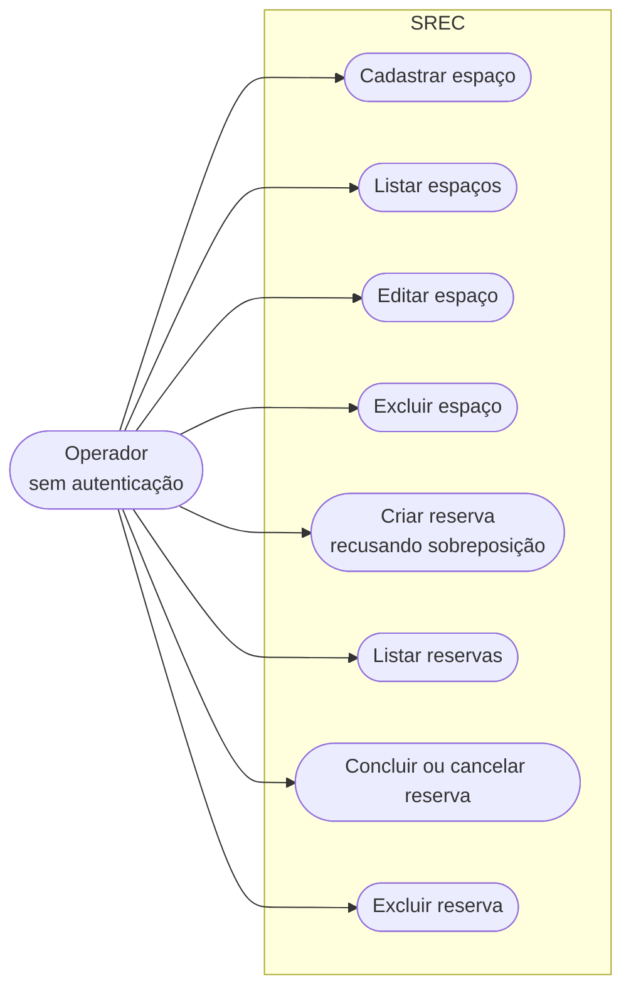

# REQ-04 — Documento de handoff para a N3

* **Responsável:** Diego Nessler (`@Diegonessler`, Engenheiro de Requisitos)
* **Issue:** #24
* **Branch:** `docs/n3-handoff-document`
* **Rubrica:** 3,0 — Processo, Git & Documentação, item de **1,5 ponto direto**: "atualização dos diagramas/README e **clareza nas alterações feitas, para a N3**". É o único artefato da entrega cujo público-alvo é o próximo grupo, e por isso o único em que a nota depende de alguém de fora conseguir usá-lo.
* **Depende de:** REQ-01 (requisitos e o vocabulário de `Situação`), REQ-02 (regras de negócio e DER), REQ-03 (contrato da API). **Consome o resultado final** de BE-01 a BE-08, FE-01 a FE-05, OPS-01 a OPS-05 e QA-01 a QA-04 — é a **última** spec a ser fechada, e QA-04 fornece os números do antes/depois.

## Problema

O pacote que recebemos tinha, como handoff, **dois arquivos markdown**:
`README.md` (68 linhas) e `Documentação Oficial SREC.md` (159 linhas). Nada
mais. Não havia pasta `docs/`, não havia ADR, não havia lista de débito, não
havia relatório de teste, não havia coleção de API e não havia aviso sobre
nenhum defeito.

O custo disso para nós foi medido e dá para contar:

| O que faltava no pacote recebido | Consequência medida na N2 |
|---|---|
| Lista de débito técnico | **15** bugs e **14** code smells descobertos por leitura integral do código, linha a linha, pelo time inteiro |
| Issues registradas | **0** — nenhuma rastreabilidade entre o que foi feito e o porquê |
| Aviso sobre o defeito central | **nenhum**: BUG-01 (dupla reserva sob concorrência) só apareceu lendo `reservationController.js:12-28` |
| Registro de decisão arquitetural | **0** ADRs — cada "por que isso é assim?" virou arqueologia de 10 commits |
| Relatório de cobertura | **nenhum**; medimos **6,14 %** de statements e **0 %** de branches |
| Ambiente reproduzível | **7 passos manuais** no `README.md:40-63`, com a senha do banco mascarada como `***` em `server/.env.example:2` |
| Contrato da API | tabela de 5 linhas, batizada "**Esboço**" pelo próprio autor, com 3 das 5 entradas erradas |
| Documentação fiel ao código | **12 divergências**, nove delas documentação descrevendo um sistema que nunca existiu |

### O silêncio é o pior item da lista

Não é que a documentação recebida estivesse incompleta. É que ela era
**afirmativa sobre coisas falsas**, e em nenhum ponto reconhecia uma limitação:

* `Documentação Oficial SREC.md:67-75` chama a fórmula anti-sobreposição de
  "**Validação Matemática Crítica**" e conclui: "se a condição acima for
  verdadeira ao consultar o banco de dados, significa que há conflito de
  horários e a nova reserva **deve ser bloqueada**". A fórmula está certa. O
  que o documento não diz é que ela é executada como `SELECT` isolado, fora de
  transação, sem nenhuma constraint no banco — e que por isso duas requisições
  simultâneas recebem `201` as duas. O documento afirma a garantia; o código
  não a tem.
* `:65` afirma "Testes unitários automatizados de domínio via Jest". São **2**
  casos, num arquivo, ambos sobre a mesma função, com o banco mockado —
  `server/src/models/reservationModel.test.js:11-37`.
* `:139` afirma "Clean Code: separação estrita de responsabilidades no backend
  e frontend". `client/src/App.jsx` tem **351 linhas** e é 41 % de todo o
  JS/JSX do projeto.
* `:145` afirma "Rastreabilidade: todas as tarefas de desenvolvimento são
  mapeadas com critérios de aceite no Jira". O repositório tem **0** issues e
  não há Jira em nenhum lugar.
* `:153` manda criar branch a partir de `develop`. **`develop` não existe** —
  as branches são `main`, `backend` e `frontend` — e
  `.github/workflows/ci.yml:5-7` dispara em `[ main, develop ]`, ou seja,
  metade do gatilho da CI nunca disparou desde o primeiro commit.

Um documento que promete controle de acesso inexistente, testes inexistentes e
rastreabilidade inexistente é **pior** que documento ausente: ele desarma o
próximo leitor. Quem lê aquele arquivo não vai procurar o bug de concorrência,
porque o documento diz que a reserva "deve ser bloqueada".

### O problema que esta spec resolve

Em novembro o repositório sai das nossas mãos para um terceiro grupo. Se
entregarmos o código corrigido e um documento com o mesmo tom do que recebemos,
reproduzimos o problema uma entrega adiante — com o agravante de que a N3 é
**reengenharia, evolução e CI/CD**, isto é, o grupo seguinte vai *construir
coisa nova em cima* do que deixarmos, e não apenas auditar.

Hoje `docs/handoff/` está vazio:

```bash
ls docs/handoff/ 2>/dev/null | wc -l   # => 0
```

E ele é referenciado por sete documentos que já existem — entre eles
`docs/auditoria/divergencias-doc-codigo.md:147`,
`docs/arquitetura/arquitetura-alvo.md:324`,
`docs/arquitetura/decisoes.md:292` e `docs/time/overview.md:128`. Todos
prometem que o débito "vai para o handoff". Este é o arquivo que recebe a
promessa.

## Evidência

### O que recebemos, contado

```bash
# Artefatos de handoff no pacote recebido
wc -l README.md "Documentação Oficial SREC.md"
#   68 README.md
#  159 Documentação Oficial SREC.md
#  227 total

# Histórico e rastreabilidade
git log --oneline | wc -l        # 10 commits
gh issue list --state all | wc -l # 0 issues
git branch -r                     # origin/main, origin/backend, origin/frontend

# Ausências
ls docs/ 2>/dev/null | wc -l                                   # 0 (não havia docs/)
find . -name 'Dockerfile*' -o -name 'docker-compose*' | wc -l  # 0
find . -path ./node_modules -prune -o -name '*migration*' -print | wc -l  # 0
find . -name 'openapi*' -o -name 'swagger*' | wc -l            # 0
```

### A baseline que o handoff tem de citar

Medida conforme `docs/auditoria/metricas-baseline.md`, com o comando ao lado:

```bash
cd server && npm ci && npx jest --coverage --coverageReporters=text --collectCoverageFrom='src/**/*.js'
cd ../client && npm ci --legacy-peer-deps && npm run lint && npm run build
```

| Métrica | Recebido |
|---|---|
| Cobertura de statements (backend) | **6,14 %** |
| Cobertura de branches (backend) | **0 %** |
| Cobertura de funções (backend) | **3,57 %** |
| Arquivos de teste / casos de teste | **1** / **2** |
| Cobertura de controllers e rotas | **0 %** |
| Testes de frontend | **0** |
| Constraints de integridade no banco | **0** |
| Índices além das 2 PKs | **0** |
| Blocos `try/catch` idênticos nos controllers | **10** |
| Maior arquivo | `client/src/App.jsx`, **351 linhas** |
| LOC de fonte (js/jsx/css) | **1.280**, dos quais **853** de JS/JSX |
| Endpoints implementados × documentados | **10** × **5** |
| Issues / commits | **0** / **10** |

Armadilha de medição que o handoff **precisa** registrar, porque já nos custou
uma discussão: `npx jest --coverage` **sem** `--collectCoverageFrom` reporta
**35,48 %**, porque o Jest só conta arquivos que algum teste importou. O número
honesto, medido contra todo o fonte, é **6,14 %**
(`docs/auditoria/metricas-baseline.md:39-53`).

### Documentos que já apontam para este arquivo

```bash
grep -rn "docs/handoff" docs/ README.md | grep -v "^docs/specs/req-04"
```

Sete referências, de quatro documentos distintos, cada uma prometendo algo
específico:

| Quem aponta | O que promete que estará aqui |
|---|---|
| `docs/auditoria/relatorio-n2.md:223` | "o handoff da N3" como quarta frente da entrega |
| `docs/auditoria/divergencias-doc-codigo.md:147` | "o que o próximo grupo precisa saber" |
| `docs/arquitetura/arquitetura-alvo.md:324` | os defeitos **sem spec atribuída** nesta entrega |
| `docs/arquitetura/decisoes.md:292` | autenticação como débito **prioritário número 1** |
| `docs/arquitetura/decisoes.md:362` | explicação da pasta `.claude/`, "não só listá-la" |
| `docs/time/overview.md:128` | a lista inteira de débito, marcada `herdado` ou `criado-n2` |
| `docs/produto/requisitos.md` (REQ-01) | RF12, RF13, RF14 e RF15 como débito declarado |

Se este arquivo não cumprir as sete, sete documentos passam a mentir — que é
exatamente o defeito de `Documentação Oficial SREC.md`.

### Duas lacunas reais encontradas ao levantar o material deste documento

Não são suposições; são `ls` que não acharam o arquivo.

1. **`CLAUDE.md` não existe na raiz.** `docs/arquitetura/decisoes.md:334-336`
   (ADR-008) declara "mais um `CLAUDE.md` na raiz como orientação de entrada",
   e os prompts de BE-04, BE-05, BE-07 e OPS-01 mandam "Leia `CLAUDE.md`".
   Verificado: `ls CLAUDE.md` não encontra o arquivo. O handoff registra isso
   como débito, não finge que está lá.
2. **`docs/time/divida-tecnica.md` não existe.** É referenciado por
   `docs/time/overview.md:131`, `docs/time/fluxo-tbd.md` (que também não
   existe, apesar de linkado em `docs/time/overview.md:157`) e
   `docs/specs/be-05-proper-http-status-codes/implementacao.md:160`. O handoff
   **não** o substitui: aquele é o registro de débito em voo do ciclo da N2;
   este é a lista entregue à N3. Se ao fim da entrega ele não existir, a seção
   5 deste documento passa a ser a única lista e o link sai.

```bash
ls CLAUDE.md docs/time/divida-tecnica.md docs/time/fluxo-tbd.md 2>&1
# ls: cannot access 'CLAUDE.md': No such file or directory
# ls: cannot access 'docs/time/divida-tecnica.md': No such file or directory
# ls: cannot access 'docs/time/fluxo-tbd.md': No such file or directory
```

### O inventário real de `.claude/`

Levantado com `find`, porque a seção sobre o time de agentes precisa listar o
que existe e não o que o ADR descreve:

```
.claude/settings.json
.claude/agents/code-auditor.md
.claude/agents/maintainer.md
.claude/agents/qa-reviewer.md
.claude/skills/srec-audit/SKILL.md
.claude/skills/srec-audit/templates/achado.md
.claude/skills/srec-backend-architecture/SKILL.md
.claude/skills/srec-backend-architecture/references/01-estado-atual.md
.claude/skills/srec-backend-architecture/references/02-arquitetura-alvo.md
.claude/skills/srec-frontend-architecture/SKILL.md
.claude/skills/srec-frontend-architecture/references/01-estado-atual.md
.claude/skills/srec-frontend-architecture/references/02-arquitetura-alvo.md
.claude/skills/srec-testing/SKILL.md
.claude/skills/tbd-flow/SKILL.md
.claude/skills/tbd-flow/references/branch-naming.md
.claude/skills/tbd-flow/templates/pr-body.md
```

**3** agentes, **5** skills, **16** arquivos. Zero passo de instalação: o
`git clone` traz tudo.

## Decisão

**Um arquivo, `docs/handoff/n3.md`, na ordem de leitura de quem acabou de
clonar, com número antes e depois em toda afirmação de melhoria e marcador
explícito em todo número que ainda não existe.**

### 1. Um arquivo, não uma pasta

A alternativa é `docs/handoff/` com `01-subir.md`, `02-mudancas.md`,
`03-debito.md`. Rejeitada: o handoff é o **primeiro** arquivo que alguém abre,
e uma pasta obriga a escolher por onde começar antes de saber o que é cada
coisa. Um arquivo linkável por âncora resolve o mesmo problema sem a escolha.

Consequência aceita: o arquivo fica longo. Mitigação: um sumário no topo e a
regra de duplicação zero da decisão 2.

### 2. Zero duplicação: o handoff **linka**, nunca copia

Regra operacional, não princípio: **todo número citado aqui existe em
`docs/auditoria/` e aparece neste documento acompanhado do link para lá.**

Motivo direto: a convenção da N2 é uma casa canônica por assunto (contexto,
seção 9), e um handoff que copia a tabela de métricas cria uma segunda tabela
que vai divergir na primeira correção. O documento recebido tem exatamente esse
defeito: repete a stack em `README.md:6-12` e em
`Documentação Oficial SREC.md:59-65`, com conteúdos diferentes.

A exceção deliberada, porque é o ponto do documento: a **seção 5** (backlog de
débito) é casa canônica própria do débito entregue à N3. Ali a lista mora, não
é link.

### 3. A ordem das seções é a ordem de uso, não a ordem de importância

| § | Seção | Por que nesta posição |
|---|---|---|
| 0 | Leia isto primeiro | 5 linhas. O que o sistema é, o que está consertado, o que não está. |
| 1 | Subir em um comando | A primeira coisa que alguém tenta. A rubrica da N2 paga 1,5 pt por "conseguiu subir o sistema do colega" — nós sabemos o quanto isso dói. |
| 2 | O que o sistema faz hoje | Uma página. Antes de ler código, saber o que o produto resolve. |
| 3 | O que mudamos na N2 e por quê | Por tema, amarrado a BUG-nn e CS-nn. |
| 4 | O que deliberadamente não fizemos | **Antes** do débito, porque explica o débito. |
| 5 | Backlog de débito, priorizado | A lista de trabalho. |
| 6 | Por onde a evolução fica mais barata | O payoff: o que a N2 destravou para a N3. |
| 7 | Pontos de entrada do código, em ordem | Só aqui, depois de entender o porquê. |
| 8 | Armadilhas conhecidas | O que vai morder; cada item com o sintoma antes da causa. |
| 9 | O time de agentes em `.claude/` | Ferramental, depois do produto. |
| 10 | Onde está cada documento | Mapa de saída. |
| 11 | Honestidade final | O que faríamos diferente. |

A seção 4 vem antes da 5 de propósito. Débito sem a decisão que o criou parece
negligência; com a decisão ao lado, é escopo. Foi a leitura que nos faltou ao
receber o pacote.

### 4. Vocabulário próprio para o débito: `D3-nn`

Os itens entregues à N3 vêm de quatro origens diferentes — bug herdado não
corrigido (`BUG-nn`), code smell não pago (`CS-nn`), divergência de
documentação (`D-nn`) e débito que a **N2 criou** (sem ID anterior, porque não
existia antes). Um único namespace ordenado é o que dá para priorizar.

Cada item `D3-nn` carrega seis campos obrigatórios:

| Campo | Vocabulário |
|---|---|
| **Prioridade** | `máxima`, `alta`, `média`, `baixa` |
| **Origem** | `herdado` ou `criado-n2` |
| **IDs relacionados** | `BUG-nn`, `CS-nn`, `D-nn`, `RFnn`, `RNFnn`, `ADR-nnn` — ou `—` |
| **Impacto** | o que acontece de ruim se não for pago, em uma frase verificável |
| **Proposta de solução** | o caminho técnico, concreto o suficiente para virar issue |
| **Evidência** | arquivo e linha |

A alternativa — reaproveitar `BUG-nn` e `CS-nn` — foi rejeitada porque alguns
itens não têm bug nem smell de origem. O exemplo mais claro é o passo
obrigatório de `migrate up` que ADR-003 criou: não é defeito, é **débito que a
N2 escolheu criar**, e ADR-003 já antecipa que "vai acontecer com alguém".
Esconder isso dentro do catálogo de bugs do grupo anterior seria desonesto nas
duas direções.

Os três critérios de priorização são os de `docs/time/overview.md:136-140`, e
não são inventados aqui: regra de negócio central, segurança, e capacidade do
time de trabalhar.

### 5. Marcador explícito, nunca número inventado

Este documento é escrito **antes** do fim da entrega. Os números finais de
cobertura, de LOC do `App.jsx` e de casos de teste só existem quando QA-04
fechar o relatório antes/depois.

Mecanismo: o literal `[PENDENTE: <o que falta e quem fecha>]`, contável por
`grep`, mais o validador `scripts/check-handoff.mjs`, que falha quando sobra
qualquer marcador. O portão é ligado ao fechar a entrega.

A alternativa — escrever um número plausível e corrigir depois — é precisamente
o que produziu `Documentação Oficial SREC.md:65` ("testes unitários
automatizados de domínio") e não vai se repetir aqui. **Melhor um buraco
marcado que um número confortável e falso.**

### 6. O documento admite o que deu errado do nosso lado

Seção 11, curta e específica. Não é penitência: é o item que mais nos faltou no
pacote recebido. Saber *onde o grupo anterior sabia que havia risco* teria
poupado dias de leitura.

A tentação é entregar um relatório de vitória — a rubrica paga por "defender com
dados as melhorias feitas", e um documento que lista os próprios erros parece
jogar contra. Rejeitada: o público desta seção não é o avaliador, é o grupo da
N3, e a rubrica paga **clareza**, não autoelogio. O risco mais alto da nossa
entrega está escrito em `docs/arquitetura/decisoes.md:505-510`, por nós mesmos:
a quebra de `App.jsx` é a mudança com maior volume de diff sem **nenhum** teste
de frontend por baixo. Isso vai na seção 11.

### 7. `Documentação Oficial SREC.md` continua no repositório, intacto

Decisão herdada de REQ-01 e mantida: é registro histórico e prova material das
12 divergências. O handoff diz, na primeira linha da seção 10, que aquele
arquivo **não é fonte de verdade** — porque a próxima pessoa vai abri-lo pelo
nome.

## Alterações

### Arquivos a criar

| Arquivo | Conteúdo |
|---|---|
| `docs/handoff/n3.md` | o documento de handoff (esqueleto completo abaixo) |
| `scripts/check-handoff.mjs` | validador: nenhum `[PENDENTE]` restante, todo link relativo resolve, todo ID citado existe |

### Arquivos a alterar

| Arquivo | O que muda |
|---|---|
| `README.md` | bloco de destaque no topo apontando para `docs/handoff/n3.md`, mais a entrada na lista da seção "Documentação" criada em REQ-01 |
| `CLAUDE.md` | **criar**, se ainda não existir ao fim da entrega — ADR-008 o pressupõe e os prompts de quatro specs mandam lê-lo. Se outra spec o criar primeiro, aqui só entra o link para o handoff |

### Arquivos preservados sem alteração

* `Documentação Oficial SREC.md` — **não editar**.
* `docs/auditoria/*`, `docs/arquitetura/*`, `docs/produto/*` — este documento
  **linka** e não reescreve. Se algum deles estiver errado, o PR que conserta é
  o deles.

---

### `docs/handoff/n3.md` — documento completo

> As seções 0 a 11 estão escritas por extenso, com todo o conteúdo que já se
> sabe hoje. Os pontos que dependem do fechamento da entrega carregam o
> marcador `[PENDENTE: ...]`, que o validador bloqueia no merge final. **Não
> substituir marcador por estimativa.**

````markdown
# Handoff do SREC para a N3

Este documento é escrito para o grupo que assume o SREC na **N3**. Foi
escrito por quem o assumiu na **N2** e sabe exatamente o que faltava no pacote
que recebeu.

Nós recebemos este sistema com **6,14 %** de cobertura de testes, **0** issues
registradas, uma documentação que descrevia um banco de dados com colunas
inexistentes, e **nenhum aviso** de que o sistema falhava na única regra de
negócio que justifica a sua existência. Descobrir isso custou a leitura
integral de 1.280 linhas por cinco pessoas.

Este documento existe para que isso não aconteça com vocês.

## Sumário

* [0. Leia isto primeiro](#0-leia-isto-primeiro)
* [1. Subir o sistema em um comando](#1-subir-o-sistema-em-um-comando)
* [2. O que o sistema faz hoje](#2-o-que-o-sistema-faz-hoje)
* [3. O que mudamos na N2, e por quê](#3-o-que-mudamos-na-n2-e-por-quê)
* [4. O que deliberadamente não fizemos](#4-o-que-deliberadamente-não-fizemos)
* [5. Backlog de débito técnico](#5-backlog-de-débito-técnico)
* [6. Por onde a evolução fica mais barata agora](#6-por-onde-a-evolução-fica-mais-barata-agora)
* [7. Pontos de entrada do código, em ordem de leitura](#7-pontos-de-entrada-do-código-em-ordem-de-leitura)
* [8. Armadilhas conhecidas](#8-armadilhas-conhecidas)
* [9. O time de agentes de IA em `.claude/`](#9-o-time-de-agentes-de-ia-em-claude)
* [10. Onde está cada documento](#10-onde-está-cada-documento)
* [11. O que faríamos diferente](#11-o-que-faríamos-diferente)

## 0. Leia isto primeiro

* **O que é.** SREC — Sistema de Reserva de Espaços e Coworking. Cadastra
  estações de trabalho e salas de reunião, e registra reservas recusando
  sobreposição de horário. Node 20 + Express 5 + PostgreSQL com SQL cru no
  backend; React 19 + Vite 8 no frontend.
* **Sobe com.** `docker compose up`. Um comando. Ver a seção 1.
* **O que consertamos.** A dupla reserva sob concorrência, que era o defeito
  central; a janela de tempo invertida; o status arbitrário; os códigos HTTP
  mentirosos; o fuso horário. Ver a seção 3.
* **O que continua quebrado, e nós sabemos.** O sistema **não tem
  autenticação** — qualquer pessoa com a URL apaga qualquer coisa. Excluir um
  espaço apaga o histórico de reservas dele, em silêncio. Capacidade zero ou
  negativa é aceita. Ver a seção 5, itens D3-01, D3-02 e D3-06.
* **O que não acreditar.** `Documentação Oficial SREC.md`, na raiz, é a
  documentação do grupo da **N1**. Está preservada como registro histórico e
  tem **12 afirmações que o código não sustenta**. Não é fonte de verdade. O
  catálogo das 12 está em
  [`docs/auditoria/divergencias-doc-codigo.md`](../auditoria/divergencias-doc-codigo.md).

## 1. Subir o sistema em um comando

Pré-requisito único: **Docker Desktop** (ou Docker Engine com o plugin
Compose).

```bash
git clone https://github.com/igorSeberino/srec.git
cd srec
docker compose up
```

Ao final:

| Serviço | URL | Observação |
|---|---|---|
| Frontend | <http://localhost:5173> | Vite com hot reload |
| API | <http://localhost:5000> | responde `SREC Coworking API is running...` |
| Contrato da API | <http://localhost:5000/docs> | Swagger UI, com "Try it out" |
| PostgreSQL | `localhost:5432` | usuário `srec`, senha `srec`, banco `srec` |

O `docker compose up` sobe o PostgreSQL, **espera o healthcheck**
(`pg_isready`), aplica as migrations versionadas e só então inicia o backend.
Nenhum `.env` precisa ser criado. Entregue por OPS-01 e OPS-02.

Comandos do dia a dia:

```bash
docker compose up -d                  # sobe em background
docker compose logs -f server         # acompanha o log do backend
docker compose exec server npm test   # testes dentro do container
docker compose exec server npm run migrate:up   # aplica migrations pendentes
docker compose exec postgres psql -U srec -d srec
docker compose down                   # para tudo, PRESERVANDO os dados
docker compose down -v                # para tudo e APAGA o volume do banco
docker compose up --build             # reconstrói após mudar dependências
```

**Para comparação, e para que vocês saibam o que não vão passar:** o pacote
que nós recebemos exigia **7 passos manuais** (`README.md:40-63` no commit
`8431181`) — instalar PostgreSQL na máquina, criar o banco `srec` à mão,
preencher `server/.env` a partir de um `.env.example` com a senha mascarada
como `***`, `npm install` em duas pastas e dois terminais abertos. Em máquina
sem PostgreSQL o servidor **subia de qualquer forma**, imprimia
`Server is running on port 5000` e só falhava na primeira requisição, porque o
erro de criação de tabela era engolido por um `catch` com `console.error`
(BUG-11).

Caminho sem Docker, mantido como alternativa: ver "Opção B" no
[`README.md`](../../README.md).

## 2. O que o sistema faz hoje

O SREC resolve um problema de **alocação exclusiva**: em um coworking, dois
ocupantes não podem usar a mesma estação de trabalho nem a mesma sala de
reunião no mesmo intervalo de tempo. Substitui a planilha compartilhada por um
cadastro de espaços e um registro de reservas que recusa sobreposições.

**Um ator, sem credencial.** Chamamos de **Operador**: qualquer pessoa com
acesso à URL, com poder total e irrestrito sobre espaços e reservas. Não existe
login, sessão, token ou papel. A documentação recebida descreve dois atores,
`Usuário` e `Administrador` (`Documentação Oficial SREC.md:36-55`), e nenhum
dos dois jamais existiu em código.

**Duas entidades.** `resources` (espaço: nome, tipo, capacidade) e
`reservations` (reserva: espaço, nome do responsável em texto livre, início,
fim, status). O DER real está em
[`docs/arquitetura/der.md`](../arquitetura/der.md).

**Oito casos de uso**, todos acessíveis ao mesmo ator:



**Dez endpoints**, contratados em
[`docs/arquitetura/openapi.yaml`](../arquitetura/openapi.yaml) e navegáveis em
`/docs`:

```
POST   /api/resources       GET /api/resources      GET    /api/resources/:id
PUT    /api/resources/:id   DELETE /api/resources/:id
POST   /api/reservations    GET /api/reservations    GET    /api/reservations/:id
PATCH  /api/reservations/:id/status                  DELETE /api/reservations/:id
```

**A regra central**, que é a razão de existir do produto: duas reservas do
mesmo espaço se sobrepõem quando

```text
Início_banco < Fim_novo AND Fim_banco > Início_novo
```

Reservas **encostadas** não se sobrepõem — a comparação é estrita, então uma
reserva que termina às 10:00 e outra que começa às 10:00 são as duas aceitas.
Isso é o resultado correto neste domínio, e é o erro clássico de quem
implementa a regra pela primeira vez: **o grupo da N1 acertou a parte difícil.**
A partir da N2, a regra é uma constraint `EXCLUDE` do PostgreSQL, não uma
consulta da aplicação — ver a seção 3, tema 1.

**Reserva cancelada libera o horário.** O predicado da constraint é
`WHERE (status <> 'cancelled')`.

**O que o sistema não faz**, e a documentação recebida afirma que faz:
controle de acesso de administrador, usuário identificado dono da reserva,
ativação/inativação de espaço (`is_active`), e a rota
`PUT /api/reservations/{id}/cancel`. As quatro estão registradas como
`documentado mas inexistente` em
[`docs/produto/requisitos.md`](../produto/requisitos.md) (RF14, RF13, RF15,
RF11) e priorizadas na seção 5 deste documento.

**Perímetro de uso, e isto precisa estar escrito:** o SREC é hoje um sistema de
**uso confiado**. É aceitável em um coworking pequeno, com acesso restrito à
rede interna. É inaceitável em qualquer exposição pública. Não é bug; é o
perímetro do produto.

As regras de negócio completas, com a situação de cada uma, estão em
[`docs/produto/overview.md`](../produto/overview.md).

## 3. O que mudamos na N2, e por quê

Nove temas. Cada um aponta o defeito catalogado que resolve e o número antes e
depois. Os IDs `BUG-nn` e `CS-nn` são de
[`docs/auditoria/bugs-do-cliente.md`](../auditoria/bugs-do-cliente.md) e
[`docs/auditoria/code-smells.md`](../auditoria/code-smells.md); os IDs
`BE-nn`, `FE-nn`, `OPS-nn`, `QA-nn` e `REQ-nn` apontam a spec de
implementação em [`docs/specs/`](../specs/), onde está o detalhe completo.

### Tema 1 — A regra central saiu da aplicação e foi para o banco

**BE-01, BE-02, BE-03.** Resolve **BUG-01** (CRÍTICO), **BUG-02** (CRÍTICO),
**BUG-03** (ALTO) e **BUG-08** (MÉDIO).

O problema: `reservationController.js:12-28` lia a disponibilidade e escrevia a
reserva em **duas idas ao banco, sem transação**. Entre a leitura e a escrita
havia uma janela em que outra requisição lia o mesmo "disponível" e inseria
também — TOCTOU clássico. E o banco não era a última linha de defesa, porque o
schema recebido tinha **zero** constraints de integridade. Agravante: o botão
de submit do frontend não desabilitava (BUG-13), então duplo clique gerava as
duas requisições concorrentes sem precisar de dois usuários.

O que fizemos: declaramos a invariante no schema.

```sql
CREATE EXTENSION IF NOT EXISTS btree_gist;

ALTER TABLE reservations
  ADD CONSTRAINT reservations_no_overlap
  EXCLUDE USING gist (
    resource_id WITH =,
    tstzrange(start_time, end_time) WITH &&
  ) WHERE (status <> 'cancelled');

ALTER TABLE reservations
  ADD CONSTRAINT reservations_valid_window CHECK (end_time > start_time);
ALTER TABLE reservations
  ADD CONSTRAINT reservations_valid_status
  CHECK (status IN ('scheduled', 'cancelled', 'completed'));
```

A aplicação parou de decidir e passou a **traduzir**: o `INSERT` é a
verificação, e o SQLSTATE `23P01` vira 409. Decisão em ADR-001.

Por que isso importa para vocês: a garantia agora vale para **todo mundo** —
`psql`, script de carga, segundo processo, migration de dados. Não só para quem
passar pelo nosso controller.

Dois achados que vale conhecer, porque não são óbvios:

* **A reserva invertida era invisível.** Nada validava `end_time > start_time`.
  Uma reserva das 10h às 9h era aceita — e, como a condição de sobreposição é
  `start_time < novo_fim AND end_time > novo_início`, um intervalo vazio
  **nunca satisfaz a condição**. Virava reserva fantasma: ocupava espaço na
  listagem, não bloqueava ninguém e não era detectável por consulta de
  conflito.
* **`PATCH /:id/status` com corpo vazio desarmava a regra central.**
  `req.body.status` ficava `undefined`, o driver `pg` convertia em `NULL`, e
  `status VARCHAR(20) DEFAULT 'scheduled'` **não** era `NOT NULL`. A partir daí
  `NULL != 'cancelled'` avalia para `NULL`, a linha sai do `WHERE`, e a reserva
  deixava de bloquear qualquer horário.

| | antes | depois |
|---|---|---|
| Constraints de integridade no banco | 0 | [PENDENTE: contar após as migrations de BE-01/02/03 — @gabrielcarvallho] |
| Reservas simultâneas aceitas no mesmo intervalo (10 `POST` em paralelo) | > 1 | 1 |
| Resposta a `end_time < start_time` | 201 | 400 `END_BEFORE_START` |
| Resposta a `status: "banana"` | 200 | 400 `INVALID_RESERVATION_STATUS` |
| Transições de status permitidas, das 9 possíveis | 9 | 2 |
| Resposta a reserva inteiramente no passado | 201 | 400 `START_IN_THE_PAST` |

### Tema 2 — As respostas HTTP pararam de mentir

**BE-04, BE-05.** Resolve **CS-02** (ALTO), **BUG-04** (ALTO) e **BUG-05**
(ALTO).

O problema: **10 blocos `try/catch` idênticos** nos dois controllers, 5 em
cada, todos com `console.error(err)` seguido de
`500 {"error":"Internal server error"}`. São 50 linhas iguais, e o efeito é
destrutivo: **apagam a informação do erro**. `GET /api/resources/abc` fazia o
Postgres recusar `abc` como `integer` (SQLSTATE `22P02`) e o cliente recebia
"o servidor falhou" — nas **6** rotas com `:id`. `PUT` com corpo parcial violava
`NOT NULL` e também virava 500.

O que fizemos: `AppError` com status e código, `asyncHandler` que encaminha a
rejeição, `errorHandler` registrado como **último** `app.use` e único lugar do
backend que decide status HTTP, e `validateIdParam` como middleware de rota. A
tradução vai do mais específico para o mais vago: `AppError` → nome da
constraint → SQLSTATE → 500 genérico. Decisão em ADR-006.

Envelope único, em todas as 10 operações:

```json
{ "error": "Já existe uma reserva para este espaço no período selecionado.", "code": "RESERVATION_OVERLAP" }
```

`error` é texto para pessoa; `code` é identificador estável para máquina, do
conjunto fechado de **20** códigos documentado no contrato. Nenhuma resposta de
erro carrega stack, nome de tabela, nome de constraint ou caminho de arquivo —
decisão de segurança, porque mensagem de erro do PostgreSQL revela estrutura
interna e este sistema não tem autenticação.

| | antes | depois |
|---|---|---|
| Blocos `try/catch` idênticos nos controllers | 10 | 0 |
| Linhas de tratamento de erro duplicadas | 50 | 0 |
| Middlewares de erro registrados | 0 | 1 |
| Pontos de `console.error` espalhados | 10 | 1 (só no logger) |
| Rotas com `:id` que respondem 500 a ID não numérico | 6 de 6 | 0 de 6 |
| `PUT /api/resources/:id` com corpo parcial | 500 | 200 |
| Mapeamentos SQLSTATE → HTTP | 0 | 5 (+3 por nome de constraint) |
| `resourceController.js` | 72 linhas | 43 linhas (−40 %) |

### Tema 3 — A regra de negócio ganhou endereço

**BE-06, BE-03.** Resolve **CS-03** (ALTO) e **CS-05** (MÉDIO).

O problema: o sistema recebido tinha **duas** camadas, controller e model. O
model era SQL cru, o controller era HTTP, e a regra de negócio — que não tinha
endereço — foi morar no controller. Consequência **medida**: 0 % de cobertura
em `controllers/`, porque testar a regra exigia subir Express e mockar `pg`. Os
2 testes que existiam eram do model, com o banco mockado: testavam a função
JavaScript, não a regra.

Isso é a **causa raiz** dos 6,14 %. Não foi falta de disciplina do grupo
anterior; foi que a arquitetura não oferecia superfície de teste. Enquanto isso
não mudasse, escrever teste era caro, e o que é caro não é feito.

O que fizemos: `services/` como dona da regra, `domain/` com funções puras e
enums, e o controller reduzido a adaptador HTTP — lê `req`, chama o service,
responde. **Não** fomos para DDD; ver a seção 4. Decisão em ADR-004.

Onde a regra mora agora, e esta frase é para vocês não deixarem ela vazar de
volta: **a regra de negócio mora em `server/src/services/`. O controller não
decide nada.**

| | antes | depois |
|---|---|---|
| Camadas do backend | 2 (controller, model) | 5 (route, middleware, controller, service, model) + `domain/` |
| Lugares onde a regra pode ser testada sem HTTP nem banco | 0 | 1 (`domain/`) |
| Literais de status/tipo espalhados pelo código | 5 valores em 6 lugares | 1 enum em `domain/` |
| Cobertura de `controllers/` | 0 % | [PENDENTE: medir ao fechar QA-01 — @igorSeberino] |

### Tema 4 — O horário passou a ser um instante

**BE-07, FE-02.** Resolve **BUG-07** (ALTO).

O problema, em três pontos somados. As 6 colunas de horário eram `TIMESTAMP`
sem fuso — guardam um relógio de parede sem dizer **de qual parede**. O
frontend mandava o valor cru de um `<input type="datetime-local">`
(`client/src/App.jsx:90-94`), que não tem offset por especificação do HTML. E a
exibição fazia `new Date(rev.start_time).toLocaleString('pt-BR')`
(`client/src/App.jsx:303-304`), reinterpretando o valor.

Resultado medido:

| Fuso do processo Node | Valor no banco | Exibido ao usuário | Erro |
|---|---|---|---|
| `TZ=UTC` (padrão em container) | `2026-10-23 14:00` | `23/10/2026 11:00` | **−180 min** |
| `TZ=America/Sao_Paulo` | `2026-10-23 14:00` | `23/10/2026 14:00` | 0 |

Ou seja: **o sistema estava certo na máquina do desenvolvedor e errado em
produção.** O pior formato possível de defeito.

O que fizemos: `TIMESTAMPTZ` nas 6 colunas, fuso da aplicação fixado nas duas
pontas (processo Node e sessão do Postgres) por `APP_TIMEZONE`, e **entrada
exigindo ISO 8601 com offset**. Valor sem offset responde 400
`INVALID_DATETIME`. Decisão em ADR-005.

Por que recusamos adivinhar o fuso, e isto é a parte importante para vocês:
**adivinhar o fuso é literalmente o bug.** Se o backend assume
`America/Sao_Paulo`, o defeito sai do código e vira contrato implícito,
herdado sem aviso pelo próximo cliente da API — o app móvel que vocês
escreverem, o script de carga do coworking. Melhor um 400 explícito, detectável
em teste, que um horário plausível e errado.

**Aviso de contrato quebrante:** qualquer script ou coleção de requisições que
mandava `2026-10-23T14:00` **para de funcionar**. Era o nosso próprio frontend,
corrigido por FE-02 no mesmo release. Ver a armadilha A-07.

A migração de dado existente usa `AT TIME ZONE 'America/Sao_Paulo'`, porque os
valores já gravados foram digitados por pessoas em Joinville e são relógio de
parede de São Paulo. Converter assumindo UTC deslocaria **todo o histórico em 3
horas**.

| | antes | depois |
|---|---|---|
| Colunas de horário com fuso | 0 de 6 | 6 de 6 |
| Fuso da aplicação fixado em configuração | não existe | `APP_TIMEZONE=America/Sao_Paulo` |
| Deslocamento do horário exibido com `TZ=UTC` | −180 min | 0 min |
| Resultados diferentes para a mesma entrada, variando o ambiente | 2 | 1 |
| Campos de data com formato especificado no contrato | 0 de 6 | 6 de 6 |
| Testes cobrindo fuso horário | 0 | ≥ 8 |

### Tema 5 — A borda do processo deixou de ser aberta

**BE-08, OPS-04.** Resolve **CS-14** (BAIXO), **BUG-11** (MÉDIO) e **BUG-12**
(MÉDIO).

O problema: `app.use(cors())` sem opções liberava **qualquer** origem; não havia
`helmet`, nem limite de corpo, nem rate limit. `database.js` registrava handler
para `'connect'` e **não** para `'error'`, então uma queda do PostgreSQL emitia
um `error` não tratado no `Pool` e **derrubava o processo**. E `initDb.js`
capturava falha de criação de tabela com `console.error` e seguia para
`app.listen` — o servidor anunciava estar de pé **sem schema**.

O que fizemos: CORS por allowlist, `helmet`, rate limit, limite de corpo,
`pool.on('error')`, `GET /health`, e configuração **validada no boot** — falta
de `DATABASE_URL` passa a falhar rápido, com mensagem dizendo o que falta, em
vez de falhar na primeira requisição.

**Isto não resolve a falta de autenticação.** Reduz a superfície de abuso. Dizer
o contrário seria falso, e está escrito em ADR-007.

### Tema 6 — O frontend deixou de ser um arquivo

**FE-01, FE-03, FE-04, FE-05.** Resolve **CS-01** (ALTO), **CS-08**, **CS-12**,
**CS-13**, **BUG-13**, **BUG-14** e **BUG-15**.

O problema: `client/src/App.jsx` tinha **351 linhas** — 41 % de todo o JS/JSX
do projeto — com 12 `useState`, 5 handlers de mutação e duas telas inteiras
renderizadas por ternário. Não existia pasta `components/`. Os 5 handlers
terminavam chamando `loadData()`, que refazia as duas listas completas: **3
viagens de rede por mutação**, 1 escrita e 2 leituras.

O que fizemos: quebra por feature (`features/resources/`,
`features/reservations/`), cada uma com formulário, lista e hook próprio de
estado de servidor; `App.jsx` reduzido a layout e composição. **Sem**
`react-router` e **sem** gerenciador de estado global ou biblioteca de dado
remoto. Decisão em ADR-012.

Mais: trava do botão de submit enquanto a requisição está pendente (BUG-13),
`setTimeout` do feedback com cleanup (BUG-14), os 7 `<label>` com `htmlFor`
pareado (CS-13), e a tela de edição de recurso que faltava — `api.updateResource`
existia em `client/src/services/api.js:24-35` e **nenhuma tela a chamava**
(BUG-15).

Também unificamos o vocabulário da exclusão de reserva, que confundia o
usuário: o `window.confirm` dizia "Deseja **cancelar** esta reserva
permanentemente?" (`App.jsx:117`), o `title` do mesmo botão dizia "Excluir
Definitivamente" (`:334`) e o feedback dizia "Reserva removida!" (`:120`). Três
vocabulários para uma ação, e um deles era a palavra reservada da **outra**
ação — cancelar preserva o registro, excluir o destrói.

| | antes | depois |
|---|---|---|
| `App.jsx` | 351 linhas | [PENDENTE: medir ao fechar FE-01 — @RenatoColin] |
| Componentes no frontend | 1 | [PENDENTE: contar ao fechar FE-01] |
| Viagens de rede por mutação | 3 | [PENDENTE: medir ao fechar FE-01] |
| `<label>` sem `htmlFor` | 7 | 0 |
| `eslint-disable` no código do frontend | 2 | 0 |
| Endpoints publicados sem tela | 1 (`PUT /api/resources/:id`) | 0 |

### Tema 7 — O ambiente deixou de depender da máquina

**OPS-01, OPS-02.** Resolve **CS-06** (MÉDIO) e o onboarding manual.

O schema do SREC era **efeito colateral do boot**: `initDb.js`, chamado antes
do `app.listen`, com `CREATE TABLE IF NOT EXISTS`. Da segunda subida em diante
é no-op — não havia forma de adicionar coluna, `CHECK` ou índice de maneira
reprodutível. E as constraints do tema 1 exigem, por definição, alterar o
schema de uma base existente.

O que fizemos: `node-pg-migrate` com arquivos versionados em
`server/migrations/`, `initDb()` fora do caminho de boot, e `docker compose up`
como caminho oficial de onboarding. A primeira migration **reproduz o schema
recebido exatamente como estava**, para que uma base existente não seja
alterada por engano; as seguintes acrescentam as invariantes. Decisões em
ADR-003 e ADR-010.

| | antes | depois |
|---|---|---|
| Comandos para subir o sistema inteiro | 7 | 1 |
| Software a instalar na máquina | PostgreSQL + Node 20 | Docker Desktop |
| Variáveis de ambiente a editar à mão | 2 (uma com senha mascarada) | 0 |
| Migrations versionadas | 0 | [PENDENTE: contar ao fechar OPS-02 — @gabrielcarvallho] |
| Dockerfiles | 0 | 2 |

### Tema 8 — A CI deixou de dar verde para qualquer coisa

**OPS-03, OPS-05.** Resolve **CS-10** (MÉDIO) e a divergência **D-10**.

A CI recebida rodava lint e teste, sem limiar de cobertura — então **6,14 %** de
statements e **0 %** de branches passavam verde. Pior: o gatilho era
`[ main, develop ]` e **`develop` nunca existiu** no repositório. Metade do
gatilho era inalcançável desde o primeiro commit, e o guia de contribuição
mandava criar branch a partir dela (`Documentação Oficial SREC.md:153`,
`README.md:30`).

O ESLint tinha 0 erros e nenhuma regra de complexidade, tamanho de arquivo,
segurança ou acessibilidade. Um arquivo de 351 linhas passava; 7 `<label>` sem
`htmlFor` passavam. **O verde não estava medindo qualidade, estava medindo
formatação.**

O que fizemos: gatilho corrigido para os branches que existem, limiar de
cobertura que reprova PR, serviço PostgreSQL no job para a suíte de integração,
proteção de branch com `main` exigindo CI verde e **1 aprovação do QA**,
`CODEOWNERS` e templates de issue e PR. Decisão em ADR-011.

O limiar é um número negociado, portanto arbitrário. Alto demais vira obstáculo
e o time desliga o portão; baixo demais vira teatro. O valor adotado e o
raciocínio estão em `docs/specs/ops-03-ci-quality-gates/implementacao.md`.

### Tema 9 — Os testes passaram a poder falhar

**QA-01, QA-02, QA-03, QA-04.** Resolve **CS-03** na prática e a divergência
**D-12**.

Os 2 testes recebidos usavam `jest.mock('../config/database')` e devolviam
`{ rows: [] }`. Eles verificavam que `checkAvailability` converte linha em
booleano — a fórmula SQL de sobreposição **nunca era executada**. E, para a
N2, isso era pior que insuficiente: a garantia do tema 1 vive **dentro do
banco**, e um teste que mocka o banco não consegue nem **falhar** antes da
correção.

O que fizemos: suíte de integração com Supertest contra **PostgreSQL real**,
com migrations aplicadas, em contêiner no compose e como serviço do job na CI;
testes puros de domínio sobre `domain/`, sem banco e sem HTTP; e o relatório
antes/depois de QA-04. O teste de dupla reserva dispara dois `POST`
concorrentes e exige exatamente **um 201 e um 409** — ele falha no código
recebido e passa depois de BE-01. Decisão em ADR-009.

Detalhe que vale saber: `supertest` **já estava** em
`server/package.json:32` e não era usado por nenhum arquivo. A dependência
estava instalada e parada.

| | antes | depois |
|---|---|---|
| Cobertura de statements | 6,14 % | [PENDENTE: QA-04] |
| Cobertura de branches | 0 % | [PENDENTE: QA-04] |
| Arquivos de teste / casos | 1 / 2 | [PENDENTE: QA-04] |
| Cobertura de controllers e rotas | 0 % / 0 % | [PENDENTE: QA-04] |
| Testes de frontend | 0 | [PENDENTE: QA-04] |
| Bugs corrigidos com teste que falhava antes | 0 | [PENDENTE: QA-04] |

> [PENDENTE: confirmar o escopo e o slug de QA-03 com @igorSeberino — a matriz
> RACI em `docs/time/overview.md:76` atribui ao QA o "roteiro de regressão
> manual", mas a spec correspondente ainda não está em `docs/specs/`.]

### Tema 10 — A documentação voltou a descrever o sistema

**REQ-01, REQ-02, REQ-03, REQ-04.** Resolve as **12 divergências**.

O pacote recebido tinha **2 histórias de usuário** sem critério de aceitação,
para um sistema com 10 endpoints e 2 tabelas. Reconstruímos **34 requisitos**
(19 funcionais, 15 não funcionais) a partir do **código**, não da documentação,
cada um com arquivo e linha e um campo `Situação` de vocabulário fechado de
quatro valores.

A regra que seguimos, e que recomendamos manter: **requisito que o sistema não
implementa é débito declarado, nunca ficção documentada.** Quatro promessas da
documentação recebida entraram no documento marcadas `documentado mas
inexistente`, com a decisão "não implementar na N2" escrita e justificada.

| | antes | depois |
|---|---|---|
| Requisitos documentados | 2 | 34 |
| Requisitos com critério de aceitação | 0 | 34 |
| Requisitos rastreados a arquivo e linha | 0 | 34 |
| Regras de negócio escritas | 1 (a fórmula) | 15 |
| Elementos errados no DER | 8 | 0 |
| Endpoints documentados corretamente | 2 de 5 | 10 de 10 |
| Divergências doc × código rastreadas | 0 | 12 |
| ADRs | 0 | 13 |
| Issues no repositório | 0 | [PENDENTE: contar ao fechar a entrega — @igorSeberino] |

## 4. O que deliberadamente não fizemos

Cada "não" abaixo é uma decisão registrada, com alternativas consideradas e
custo assumido, em
[`docs/arquitetura/decisoes.md`](../arquitetura/decisoes.md). Nenhum é
esquecimento.

### Não introduzimos autenticação — ADR-007

A documentação recebida marca `POST /api/resources` como "Nível de acesso
Admin", separa Usuário de Administrador no diagrama de casos de uso, documenta
`reservations.user_id UUID` no MER e afirma que `GET /api/reservations` lista
"as reservas do usuário atual". **Nada disso existe.** Não há tabela de
usuário, não há sessão, não há token, não há middleware de autorização.

Por que não fizemos: autenticação é **feature**, não bug. Exige modelar
usuário, substituir `user_name` por FK para `users`, migrar o dado já gravado,
construir tela de login e registro, proteger 10 rotas e testar tudo — em um
prazo que já continha BE-01 a BE-08, FE-01 a FE-05, OPS-01 a OPS-05 e QA-01 a
QA-04. A rubrica da N2 pontua correção de bug e redução de dívida no código
recebido.

Também recusamos a meia-solução — chave fixa em header, ou Basic Auth no
`/api`. É o pior dos mundos: dá aparência de segurança, não cria associação
entre usuário e reserva (que é o problema real), e produz a ilusão de item
resolvido. Vocês leriam "tem auth" e não revisariam.

**O custo, dito sem maquiagem:** ao fim da N2 o SREC **continua sem controle de
acesso**, qualquer pessoa cancela a reserva de qualquer outra, e nenhum dos
nossos números de melhoria muda isso. É o item **D3-01**, prioridade máxima.

### Não trocamos SQL cru por ORM — ADR-002

Os models são 108 linhas de SQL cru em dois objetos literais, com parâmetros
posicionais em todas as queries — **não há injeção de SQL**. Prisma, Knex,
Kysely e Sequelize foram considerados e recusados: reescreveriam 12 métodos que
funcionam, e a correção central da N2 é uma constraint `EXCLUDE` com
`btree_gist`, que ORM costuma não modelar e exigiria `migration.sql` cru de
qualquer forma.

**O custo:** continuamos montando string SQL à mão, sem checagem de tipo entre
coluna e JavaScript. Um `SELECT namee` só falha em runtime. A conversão de tipo
fica por conta do driver `pg`, que é a origem de BUG-04.

### Não fomos para DDD — ADR-004

Entrou uma pasta `domain/` com enums e funções puras, e uma `services/` com a
regra. **Não** entraram entidades ricas, agregados, value objects, repositórios
com interface, nem inversão de dependência. Em um sistema de 2 tabelas e 10
endpoints, o custo de cerimônia excede o benefício por uma margem larga, e a N2
é manutenção, não reescrita.

**O custo:** uma criação de recurso atravessa route → middleware → controller →
service → model, cinco saltos para um `INSERT`, e em parte dos casos o service é
repasse quase puro. Isso parece — e é — cerimônia. Aceitamos porque o service é
onde a tradução de `23P01` em 409 precisa morar, e porque sem ele a cobertura
não sai do lugar.

### Não reescrevemos o frontend em TypeScript

Tentador e fora de escopo. A N2 é manutenção de software alheio com prazo de
uma entrega; migrar 853 linhas de JS/JSX para TypeScript não corrige nenhum dos
15 bugs catalogados e consumiria o orçamento que BE-01 a BE-08 ocupou.
Registrado em
[`docs/auditoria/relatorio-n2.md`](../auditoria/relatorio-n2.md), seção 9, e em
[`docs/arquitetura/arquitetura-alvo.md`](../arquitetura/arquitetura-alvo.md).

**Nota para a N3:** depois de FE-01 isso ficou barato. Ver a seção 6.

### Não introduzimos roteador nem estado global no frontend — ADR-012

As abas continuam estado local. **O custo:** a aba não está na URL e não é
compartilhável por link, e o botão "voltar" do navegador sai da aplicação em vez
de voltar de aba. O cache de dado remoto é feito à mão nos hooks, sem
deduplicação de requisição nem revalidação — melhor que o refetch total
anterior e pior que uma biblioteca dedicada.

### Não migramos `SERIAL` para `UUID` — ADR-013

O MER recebido documenta `UUID` como chave primária; o código usa `SERIAL`.
Resolvemos **corrigindo o documento**. Migrar as PKs quebraria as URLs dos 6
endpoints com `:id` e o estado do cliente, por zero benefício funcional. A
exposição de cardinalidade por ID sequencial fica como débito **D3-09**, a pagar
junto com autenticação.

### Não implementamos quatro coisas que a doc recebida prometia

`is_active` (RF15), usuário identificado (RF13), acesso de administrador (RF14)
e a rota `PUT /api/reservations/{id}/cancel` (RF11). As três primeiras estão no
backlog da seção 5. A quarta é a única que recomendamos **não** fazer: o
cancelamento já é alcançável por `PATCH /:id/status`, endurecido por BE-03, e
criar um segundo caminho para o mesmo efeito aumentaria a superfície da API sem
ganho. Está descartada por decisão, não por falta de tempo — não a procurem.

## 5. Backlog de débito técnico

Esta seção é **casa canônica**: a lista mora aqui, não é link.

Origem `herdado` significa que recebemos do grupo da N1. Origem `criado-n2`
significa que **nós** o criamos, por escolha registrada. Os dois tipos aparecem
na mesma lista e com a mesma tipografia, porque entregar débito conhecido e
documentado é honesto e entregar débito escondido é o que gerou os 6,14 % que
recebemos.

Critérios de prioridade, de `docs/time/overview.md:136-140`: a regra de negócio
central, a segurança, e a capacidade do time de trabalhar.

### Prioridade máxima

#### D3-01 — O sistema não tem controle de acesso

* **Origem:** `herdado`
* **IDs:** BUG — nenhum (é ausência, não defeito) · CS-14 · D-06 · RF13, RF14 ·
  RNF07 · ADR-007
* **Impacto:** qualquer pessoa com acesso à URL cadastra, altera e **apaga**
  qualquer espaço e qualquer reserva, sem registro de quem fez. Inclui
  `DELETE /api/resources/:id`, que destrói o histórico de reservas em cascata
  (D3-02). Não há como listar "minhas reservas" nem impedir alguém de cancelar
  a reserva de outro.
* **Evidência:** `server/src/index.js:12-14` registra só `cors()` e
  `express.json()`; `server/src/routes/resourceRoutes.js:5-9` e
  `reservationRoutes.js:5-9` não têm middleware;
  `server/package.json` não traz nenhuma dependência de autenticação.
  `reservations.user_name VARCHAR(100)` é texto livre
  (`server/src/config/initDb.js:17`, `client/src/App.jsx:252-259`).
* **Proposta de solução:** tabela `users` por migration; `reservations.user_id`
  como FK, com migration de dado que converte os `user_name` distintos
  existentes em usuários; autenticação por sessão ou JWT em um middleware
  **antes** do controller; autorização no service, que já é o dono da regra;
  `GET /api/reservations` filtrando pelo usuário da sessão. Decidir junto se
  `GET /api/resources` segue público.
* **Por que ficou mais barato depois da N2:** ver a seção 6, item 1.

#### D3-02 — Excluir um espaço destrói o histórico de reservas

* **Origem:** `herdado`
* **IDs:** BUG-06 (ALTO) · RN09 · RF05
* **Impacto:** é o único defeito do catálogo que **perde dado de forma
  irrecuperável com um clique**. Apaga, no mesmo comando e em silêncio, todas
  as reservas do espaço — passadas, futuras e já concluídas. A resposta da API
  é `{"message":"Recurso excluído com sucesso."}`, sem contagem do que foi
  destruído.
* **Evidência:** `server/src/config/initDb.js:16` —
  `resource_id INTEGER REFERENCES resources(id) ON DELETE CASCADE`. FE-05
  acrescentou o aviso na interface, o que reduz o acidente e **não** remove a
  perda. Pendência declarada em `docs/arquitetura/der.md`, seção 2.1.
* **Proposta de solução:**

  ```sql
  ALTER TABLE reservations DROP CONSTRAINT reservations_resource_id_fkey;
  ALTER TABLE reservations
    ADD CONSTRAINT reservations_resource_id_fkey
    FOREIGN KEY (resource_id) REFERENCES resources(id) ON DELETE RESTRICT;
  ```

  Mais 409 com a contagem de reservas vinculadas. **Fazer junto com D3-03**: com
  `RESTRICT`, a inativação lógica deixa de ser paliativo para exclusão e passa a
  ser estado de produto legítimo. Fazer na ordem errada custa retrabalho.
* **Regra de processo que herdamos e passamos adiante:** quem implementar isto
  atualiza o DER alvo em `docs/arquitetura/der.md` **no mesmo PR**.

### Prioridade alta

#### D3-03 — Não existe como tirar um espaço de circulação sem apagá-lo

* **Origem:** `herdado`
* **IDs:** D-02 · RF15 · RN14
* **Impacto:** a **única** forma de tirar um espaço de circulação hoje é
  `DELETE`, que por D3-02 destrói o histórico. A ausência de `is_active`
  transforma uma inativação temporária — sala em manutenção, estação quebrada
  — em **perda permanente de dado**.
* **Evidência:** o MER recebido declara `BOOLEAN is_active`
  (`Documentação Oficial SREC.md:88`); a coluna **não existe**
  (`server/src/config/initDb.js:5-12`) e nenhum model a referencia.
* **Proposta de solução:** 1 migration (`is_active BOOLEAN NOT NULL DEFAULT
  TRUE`), 1 filtro em `GET /api/resources` (`?active=true`), 1 guarda em
  `reservationService.create` respondendo 409 para espaço inativo, e 1
  alternância na tela de edição de recurso **que já existe** (FE-05). Reservas
  de um espaço inativado permanecem consultáveis.
* **É a evolução de melhor relação custo-benefício disponível.** Ver a seção 6,
  item 2.

#### D3-04 — Nenhum teste de frontend sob a maior mudança da entrega

* **Origem:** `criado-n2`
* **IDs:** CS-03 (análogo no frontend) · ADR-012
* **Impacto:** a quebra de `App.jsx` por feature (FE-01) é a mudança com maior
  volume de diff da N2 e se apoia em revisão e teste manual. Uma regressão de
  interface não é detectada por nenhum portão automático. Nós registramos esse
  risco em ADR-012 no momento de assumi-lo, e ele não foi pago.
* **Evidência:** `client/package.json` não tem runner de teste; **0** arquivos
  de teste em `client/`. `docs/arquitetura/decisoes.md:505-510`.
* **Proposta de solução:** Vitest com Testing Library (casa com Vite, sem
  configuração nova de transform). Começar pelos dois formulários e pelo hook
  de feedback, que são onde BUG-13 e BUG-14 moravam. A escolha do runner exige
  decisão em spec, porque muda a CI.

#### D3-05 — `CLAUDE.md` não existe, e quatro specs mandam lê-lo

* **Origem:** `criado-n2`
* **IDs:** ADR-008
* **Impacto:** ADR-008 declara um `CLAUDE.md` na raiz como orientação de
  entrada para os agentes, e os prompts de BE-04, BE-05, BE-07 e OPS-01 mandam
  "Leia `CLAUDE.md`". O arquivo não está lá. Uma sessão de agente começa sem as
  convenções do repositório, que é precisamente o problema que a vendorização
  de `.claude/` existe para resolver.
* **Evidência:** `ls CLAUDE.md` → arquivo inexistente;
  `docs/arquitetura/decisoes.md:334-336`.
* **Proposta de solução:** criar `CLAUDE.md` na raiz, curto, apontando para
  `.claude/skills/`, para `docs/time/` e para este handoff. Não duplicar
  conteúdo: a convenção é uma casa canônica por assunto.
* [PENDENTE: se `CLAUDE.md` for criado até o fim da entrega, remover este item
  e reduzir a lista — @igorSeberino]

#### D3-06 — `capacity` e `type` não têm domínio no banco

* **Origem:** `herdado`
* **IDs:** BUG-09 (MÉDIO) · BUG-10 (MÉDIO) · RN01 · RN02 · RNF03
* **Impacto:** duas falhas opostas no mesmo campo. `capacity: 0` responde
  **201** e grava **1** — o dado do usuário é silenciosamente trocado, sem
  erro. `capacity: -5` responde **201** e grava `-5`. E `type` aceita qualquer
  string: um espaço com `type: "banana"` é renderizado ao Operador como
  "Estação de Trabalho" — o dado inválido não fica visível, fica **disfarçado**.
* **Evidência:** `server/src/controllers/resourceController.js:10` usa
  `capacity || 1`, e `0 || 1 === 1`. `server/src/config/initDb.js:8-9` não tem
  `CHECK`; os valores válidos de `type` estão em comentário SQL, que o banco
  ignora. `client/src/App.jsx:212` renderiza
  `res.type === 'meeting_room' ? 'Sala de Reunião' : 'Estação de Trabalho'`.
  Registrado como alvo sem dono em
  `docs/arquitetura/arquitetura-alvo.md:335-339`.
* **Proposta de solução:** uma migration com
  `CHECK (capacity >= 1)` e
  `CHECK (type IN ('workstation','meeting_room'))`, mais validação explícita no
  service substituindo o `||`. Os dois `CHECK` já estão desenhados no DER alvo
  (`docs/arquitetura/der.md`, seção 2) e **não** foram entregues: o DER os
  atribui a BE-02, cujo escopo final ficou restrito à janela de tempo. Barato;
  só não teve dono.

#### D3-07 — `migrate up` é um passo obrigatório que alguém vai esquecer

* **Origem:** `criado-n2`
* **IDs:** ADR-003 · CS-06 (resolvido, com este custo)
* **Impacto:** quem der `git pull` e não rodar `npm run migrate:up` recebe erro
  de coluna inexistente. ADR-003 antecipa textualmente: "isso vai acontecer com
  alguém". Migration mal escrita em produção também é mais perigosa que
  `CREATE TABLE IF NOT EXISTS`, porque de fato altera dado.
* **Evidência:** `docs/arquitetura/decisoes.md:133-141`.
* **Proposta de solução:** rodar `migrate up` como passo do `postinstall` ou do
  `npm run dev`, com log claro, e um `migrate:status` no `npm run doctor`. É
  conveniência, não arquitetura — e é o tipo de atrito que custa uma tarde por
  pessoa até ser pago.

### Prioridade média

#### D3-08 — Dois índices do DER alvo podem não ter sido criados

* **Origem:** `herdado`
* **IDs:** CS-09 (MÉDIO) · RNF13
* **Impacto:** o índice GiST que a constraint `EXCLUDE` cria cobre
  `checkAvailability` e `findByResourceId`, o que resolve a maior parte de
  CS-09 **de graça**. Os índices adicionais do DER alvo
  (`idx_reservations_status`, `idx_resources_type`) são otimização separada e
  podem não ter entrado.
* **Evidência:** `docs/arquitetura/der.md`, seção 2, bloco de índices.
* **Proposta de solução:** medir antes de criar.
  `EXPLAIN ANALYZE` nas consultas de `reservationModel.js` com volume realista.
  Índice sem medição é cargo cult.

#### D3-09 — Chave primária `SERIAL` expõe cardinalidade

* **Origem:** `herdado`
* **IDs:** D-01 · ADR-013
* **Impacto:** `GET /api/resources/1` revela que existe um recurso 1, e a
  sequência revela quantos existem. Em um sistema sem autenticação (D3-01)
  isso é enumeração trivial de toda a base.
* **Evidência:** `server/src/config/initDb.js:6` e `:15`.
* **Proposta de solução:** **não** migrar isoladamente. Só faz sentido pagar
  junto com D3-01, quando o controle de acesso passar a importar, e aí a decisão
  é entre `UUID` como PK ou uma coluna pública de identificação separada da PK
  interna. Migrar as duas PKs com FK entre elas, agora, é risco puro: quebra as
  URLs dos 6 endpoints com `:id` e o estado do cliente.

#### D3-10 — "Cancelar" e "excluir" ainda são decisões de produto sem dono

* **Origem:** `herdado`
* **IDs:** RN08 · RF10
* **Impacto:** a exclusão física de reserva coexiste com o cancelamento por
  status, e não há regra de produto dizendo quando cada uma vale. FE-01
  unificou o vocabulário da interface, o que resolve a confusão imediata e
  **não** responde a pergunta: um coworking deveria poder apagar o registro de
  uma reserva concluída?
* **Evidência:** as duas rotas existem
  (`server/src/routes/reservationRoutes.js:8` e `:9`).
* **Proposta de solução:** decisão do PO, não do engenheiro. A opção técnica
  natural, se a resposta for "não", é remover
  `DELETE /api/reservations/:id` do contrato e manter só o cancelamento — e
  isso é mudança de contrato, com aviso.

#### D3-11 — Duas regras de negócio sem valores definidos

* **Origem:** `herdado`
* **IDs:** RN06 · RN15
* **Impacto:** **RN06** — a N2 passou a recusar reserva inteiramente no passado
  (400 `START_IN_THE_PAST`), mas não ficou decidido se uma reserva que começa
  "agora, com três minutos de atraso de digitação" deve ser aceita. **RN15** —
  não há duração mínima nem máxima: uma reserva de 5 minutos ou de 3 anos é
  aceita.
* **Evidência:** `docs/produto/overview.md`, RN06 e RN15, as duas marcadas com
  decisão de produto pendente.
* **Proposta de solução:** números vêm do PO. Até existirem, não acrescentem
  `CHECK` chutado — constraint com valor arbitrário é pior que a ausência,
  porque dá aparência de regra.

#### D3-12 — Três códigos de erro redundantes no contrato

* **Origem:** `criado-n2`
* **IDs:** —
* **Impacto:** `INVALID_START_TIME` e `INVALID_END_TIME` (BE-02) cobrem a mesma
  classe de erro que `INVALID_DATETIME` (BE-07). Com a normalização de BE-07
  rodando antes da validação de janela, os dois primeiros ficam inalcançáveis
  para erro de formato — mas continuam no `enum` do contrato, porque remover
  código de erro é mudança quebrante e não cabia no prazo.
* **Evidência:** o `enum ErrorCode` de
  `docs/arquitetura/openapi.yaml`, com os dois marcados para aposentadoria.
* **Proposta de solução:** confirmar por teste que nenhum caminho os emite e
  removê-los do `enum` no mesmo PR.

### Prioridade baixa

#### D3-13 — Placeholders de 0 byte versionados

* **Origem:** `herdado` · **IDs:** CS-11
* **Impacto:** `client/client.txt`, `server/server.txt` e `shared/shared.txt`
  têm 0 byte e `shared/` contém apenas o placeholder. Confunde quem lê a árvore
  pela primeira vez — a pasta `shared/` parece ter código compartilhado e não
  tem.
* **Proposta de solução:** remover os três e a pasta `shared/`, ou dar conteúdo
  a ela. Limpeza; nenhuma spec da N2 a reivindicou.

#### D3-14 — `docs/time/divida-tecnica.md` e `docs/time/fluxo-tbd.md` são links quebrados

* **Origem:** `criado-n2` · **IDs:** —
* **Impacto:** `docs/time/overview.md:131` e `:157` linkam os dois arquivos, e
  `docs/specs/be-05-.../implementacao.md:160` registra uma regra técnica
  ("se uma coluna anulável com semântica de limpar aparecer, `COALESCE` deixa de
  servir") como estando anotada em `divida-tecnica.md`. Nenhum dos dois existe.
* **Proposta de solução:** criar os dois ou remover os links. Esta seção 5
  **não** os substitui: aquele é o registro de débito em voo de um ciclo; este é
  a lista entregue à N3.
* [PENDENTE: reconferir ao fechar a entrega — se os arquivos passarem a existir,
  remover este item]

### Resumo do backlog

| Prioridade | Itens | Herdados | Criados pela N2 |
|---|---|---|---|
| máxima | D3-01, D3-02 | 2 | 0 |
| alta | D3-03, D3-04, D3-05, D3-06, D3-07 | 2 | 3 |
| média | D3-08, D3-09, D3-10, D3-11, D3-12 | 4 | 1 |
| baixa | D3-13, D3-14 | 1 | 1 |
| **total** | **14** | **9** | **5** |

A N2 criou 5 débitos e pagou [PENDENTE: contar bugs e code smells efetivamente
fechados ao final da entrega — @igorSeberino, via QA-04]. Os 5 criados estão
todos com decisão registrada em ADR, exceto D3-12 e D3-14, que são
consequência de execução e não de decisão.

## 6. Por onde a evolução fica mais barata agora

A N3 é **reengenharia, evolução e CI/CD**: aplicar melhorias de processo,
adicionar automação e evoluir funcionalidades complexas. Esta seção é o mapa de
onde o terreno já está preparado.

### 1. Autenticação deixou de ser cirurgia

**Antes da N2, acrescentar autenticação exigia:** inventar um jeito de alterar
o schema, porque o DDL era `CREATE TABLE IF NOT EXISTS` dentro de `initDb.js` e
em qualquer banco que já tivesse as tabelas **nenhuma alteração era aplicada** —
editar aquele arquivo produzia um schema correto só em banco novo e um falso
senso de pronto em todos os outros. Depois, espalhar a verificação pelos 10
handlers, porque não havia camada onde a regra morasse. E tudo isso sem teste
de integração para saber se quebrou.

**Depois da N2:**

| Peça necessária | Onde encaixa hoje | Esforço |
|---|---|---|
| tabela `users` e FK em `reservations` | um arquivo em `server/migrations/`, revisado em PR, aplicável de forma idêntica na máquina, no compose e na CI | 2 migrations |
| migração do dado existente | migration de dados sobre os `user_name` distintos; o padrão de "verificar e tratar antes do `SET NOT NULL`" já está estabelecido pelas migrations de BE-03 | 1 migration |
| ponto de verificação | 1 middleware antes do controller, no mesmo lugar onde `validateIdParam` já vive | 1 arquivo |
| autorização por recurso | no `service`, que **já é** o dono da regra de negócio e já lança `AppError` | 1 arquivo por entidade |
| respostas 401 e 403 | `AppError` com status e código; o `errorHandler` já é o único lugar que decide status HTTP | 2 linhas no mapa |
| filtro de "minhas reservas" | `reservationService`, não o controller | 1 método |
| rotas tocadas | 10, **uma linha cada** (acrescentar o middleware) | 2 arquivos de rota |
| garantia de não regressão | a suíte de integração com Supertest contra PostgreSQL real já existe e já exercita as 10 rotas | — |

A diferença não é de volume de código; é que **cada peça tem endereço**. Antes,
a resposta para "onde eu ponho isso?" era "no controller, junto com tudo".

### 2. `is_active` é a evolução de melhor custo-benefício disponível

1 migration, 1 filtro em `GET /api/resources`, 1 guarda em
`reservationService.create`, 1 alternância na tela de edição de recurso **que
já existe** (FE-05). E resolve D3-02 pela raiz: com inativação lógica, tirar
uma sala de circulação para manutenção para de ser `DELETE`.

A ordem importa: **D3-02 antes ou junto de D3-03**. Com `ON DELETE RESTRICT`,
`is_active` deixa de ser paliativo para exclusão e passa a ser estado de
produto legítimo. Na ordem inversa, `is_active` nasce como gambiarra e é
redesenhado depois.

### 3. Há um endpoint quase pronto, escrito e nunca ligado

`ReservationModel.findByResourceId`
(`server/src/models/reservationModel.js:26-30`) executa
`SELECT * FROM reservations WHERE resource_id = $1 ORDER BY start_time ASC` e
**nenhum controller a chama**. É código morto desde o primeiro commit, e é o
requisito RF12 ("ver a agenda de um espaço específico").

Falta: 1 método de controller, 1 linha de rota, 1 operação no contrato
OpenAPI, 1 teste de integração. O índice GiST que a constraint `EXCLUDE` criou
**já cobre** exatamente esse acesso (`resource_id` + faixa de tempo), então não
há trabalho de desempenho a fazer.

### 4. Escrever teste deixou de ser caro

Esta é a mudança que mais muda o custo de tudo o mais.

A causa raiz dos 6,14 % não era desleixo: era que não havia **onde** testar a
regra. Hoje há dois lugares, com custos muito diferentes:

* `server/src/domain/` — funções puras e enums. Teste novo é um `expect()`, sem
  banco, sem Express, sem mock. É onde a cobertura de branches sai do zero
  barato.
* a suíte de integração com Supertest contra PostgreSQL real, com migrations
  aplicadas, já configurada no compose e como serviço do job na CI. Teste novo
  é um arquivo, não uma refatoração.

E há um padrão estabelecido que vale manter: **para correção de bug, escreva o
teste que falha antes.** Ele está na Definition of Done
(`docs/time/overview.md:105`) e é o que transforma "corrigimos" em evidência.

### 5. A base de CI/CD está pronta; falta o D do CD

O escopo da N3 inclui CI/CD, e o que já existe:

* workflow com jobs de backend e frontend, gatilho nos branches que realmente
  existem, limiar de cobertura que **reprova** PR, e serviço PostgreSQL para a
  suíte de integração;
* `docker compose -f docker-compose.yml build`, que constrói as **duas** imagens
  de produção — server com `USER node` e client servido por nginx com o bundle
  estático;
* smoke test do compose como job, que falha se a stack não subir;
* proteção de branch em `main`, exigindo CI verde e 1 aprovação do QA.

O que falta é especificamente o **deploy**: registro de imagem, ambiente de
destino, estratégia de release, e a decisão sobre rodar `migrate up` no deploy.
Não falta a base.

### 6. TypeScript, se vocês quiserem, virou migração incremental

Antes, `client/src/App.jsx` era um arquivo de 351 linhas com 12 `useState` e
duas telas: migrar significava converter tudo de uma vez. Depois de FE-01, o
front está quebrado por feature com hooks, e a migração pode ser arquivo por
arquivo, com `allowJs` ligado, começando pelos hooks (que é onde tipo paga mais
rápido). No backend, o `jsconfig`/`checkJs` com JSDoc nos services dá parte do
ganho sem tocar na extensão dos arquivos.

### 7. Os três documentos que valem ler antes de propor arquitetura

* [`docs/arquitetura/decisoes.md`](../arquitetura/decisoes.md) — 13 ADRs. Cada
  um tem a seção "Consequências" com o **custo** da decisão escrito. Se vocês
  discordarem de uma, discordem do custo registrado, não da suposição.
* [`docs/arquitetura/arquitetura-alvo.md`](../arquitetura/arquitetura-alvo.md) —
  o desenho de camadas e o fluxo de criação de reserva em diagrama de
  sequência, incluindo o caminho de corrida.
* [`docs/auditoria/relatorio-n2.md`](../auditoria/relatorio-n2.md) — o
  diagnóstico com os números de origem.

## 7. Pontos de entrada do código, em ordem de leitura

Esta é a ordem que nós **gostaríamos** de ter recebido. São 12 paradas, e o
backend inteiro tem menos de 900 linhas de JS — dá para ler tudo numa tarde.

1. **[`README.md`](../../README.md)** — como subir. Comece pelo sistema
   rodando; ler código de sistema que você não viu funcionar é mais lento.
2. **Este arquivo** — você está nele. Leia a seção 8 (armadilhas) antes de
   tocar em qualquer coisa.
3. **`server/src/index.js`** (33 linhas) — bootstrap. A ordem dos middlewares é
   contrato: `cors` e `express.json` antes das rotas, `/docs` depois das rotas,
   e **`app.use(errorHandler)` por último**. Express só roteia para um
   middleware de 4 argumentos depois de um erro, e só se ele estiver registrado
   depois de todas as rotas que deve cobrir.
4. **`server/src/routes/resourceRoutes.js`** e
   **`server/src/routes/reservationRoutes.js`** (11 linhas cada) — o mapa
   inteiro da API em 22 linhas. Os 10 endpoints, com os middlewares de
   validação visíveis na própria linha da rota.
5. **`server/migrations/`** — o schema. A primeira migration reproduz
   exatamente o schema recebido; as seguintes são as invariantes que a N2
   acrescentou. Leia em ordem: é a história do banco. O `initDb.js` **não** é
   mais a fonte de verdade do schema.
6. **`server/src/domain/reservationStatus.js`** — o enum de status e as
   transições válidas, em forma pura. É o arquivo mais curto que explica mais
   regra de negócio, e é o modelo do que `domain/` deve conter.
7. **`server/src/services/reservationService.js`** — **onde a regra de negócio
   mora.** Se você for acrescentar regra, é aqui. Se encontrar regra no
   controller, é regressão.
8. **`server/src/models/reservationModel.js:49-61`** — `checkAvailability`, a
   fórmula anti-sobreposição. Leia sabendo que ela **deixou de ser a garantia**:
   hoje é consulta de leitura, útil para a mensagem amigável e para o front
   avisar antes de enviar. Quem garante é a constraint.
9. **`server/src/middlewares/errorHandler.js`** e
   **`server/src/errors/pgErrorCodes.js`** — o **único** lugar do backend que
   decide status HTTP a partir de erro. Se uma resposta está com o código
   errado, o conserto é aqui ou no `AppError` que a originou, nunca num
   `try/catch` novo.
10. **[`docs/arquitetura/openapi.yaml`](../arquitetura/openapi.yaml)**, ou
    `/docs` no navegador — o contrato dos 10 endpoints, com os códigos de
    status, o envelope de erro e exemplos executáveis. As operações carregam
    `x-srec-debito` onde o comportamento documentado é defeituoso de propósito.
11. **`client/src/features/reservations/`** — a tela principal, já quebrada por
    feature. Compare com `git show <commit-de-FE-01>^:client/src/App.jsx` para
    ver de onde veio.
12. **[`docs/arquitetura/decisoes.md`](../arquitetura/decisoes.md)** — por que
    nada disso é diferente. Deixe para o fim: faz muito mais sentido depois de
    ler o código.

Um atalho útil: o backend tem **menos de 900 linhas de JavaScript**. Em caso de
dúvida sobre onde algo mora,
`grep -rn "<termo>" server/src` responde mais rápido que qualquer documento —
inclusive este.

## 8. Armadilhas conhecidas

Cada item traz o **sintoma primeiro**, porque é assim que você vai encontrá-lo.

### A-01 — "Erro de coluna inexistente" depois de um `git pull`

Você esqueceu `npm run migrate:up`. O schema é gerenciado por migrations
versionadas desde a N2, e aplicar as pendentes é um passo obrigatório do fluxo.
É o débito D3-07, e ADR-003 já avisa que ia acontecer com alguém.

```bash
docker compose exec server npm run migrate:up
```

### A-02 — "Editei o `initDb.js` e nada mudou no banco"

`server/src/config/initDb.js` usava `CREATE TABLE IF NOT EXISTS`. Em qualquer
banco que já tenha as tabelas, aquele arquivo é **no-op**: acrescentar coluna,
`CHECK` ou índice editando-o não tem efeito algum. Isso produzia um schema
correto só em banco novo e um falso senso de pronto em todos os outros.

Depois de OPS-02 ele saiu do caminho de boot. **Se alguém o reintroduzir no
`index.js`, BUG-11 volta:** o `catch` dele engolia a falha de DDL e o servidor
subia anunciando `Server is running on port 5000` **sem schema**.

### A-03 — A migration da constraint `EXCLUDE` falha

Duas causas distintas, e as duas são recurso e não defeito:

* **`extension "btree_gist" is not available` / permissão negada.** A
  constraint combina igualdade em `integer` com sobreposição de intervalo, e a
  classe de operadores vem da extensão `btree_gist`. É contrib padrão do
  PostgreSQL, e `CREATE EXTENSION` exige superusuário ou dono do banco. No
  compose isso já está resolvido; num banco gerenciado de terceiro, pode não
  estar.
* **`conflicting key value violates exclusion constraint`.** A base **já tem**
  reservas sobrepostas gravadas, o que é perfeitamente possível, porque BUG-01
  estava solto. A migration falha até o dado ser limpo, e ela deve falhar. Está
  no runbook de ADR-001.

### A-04 — A ordem das migrations não é livre

**BE-07 (`TIMESTAMPTZ`) tem de rodar antes de BE-01 (`EXCLUDE`).** A constraint
usa `tstzrange(start_time, end_time)`, que exige `timestamptz`; com colunas
`timestamp`, a expressão não compila. O caminho inverso também trava: converter
o tipo de uma coluna usada pela expressão de índice da constraint falha por
dependência, então a migration de BE-07 faz
`DROP CONSTRAINT IF EXISTS reservations_no_overlap` antes do `ALTER TYPE` e a
recria depois com `tstzrange`.

### A-05 — `CHECK` ou `SET NOT NULL` falha por dado legado

Toda migration que aperta o schema precisa **verificar e tratar antes**. O caso
concreto: antes de `ALTER COLUMN status SET NOT NULL`, é obrigatório
`UPDATE reservations SET status = 'scheduled' WHERE status IS NULL`, porque
`status NULL` era alcançável por um `PATCH /:id/status` com corpo vazio. Mesmo
raciocínio para `resource_id SET NOT NULL`.

### A-06 — `cancelled` tem dois `l`

Os valores reais gravados são `scheduled`, `cancelled`, `completed` — minúsculo.
O MER da documentação recebida escreve `Canceled`, com um `l` e maiúscula
(`Documentação Oficial SREC.md:97`). Quem programar contra aquele diagrama envia
um status que o `CHECK` rejeita. O mesmo vale para `type`: é `workstation` e
`meeting_room`, não `Workstation`/`MeetingRoom`.

### A-07 — Seu script antigo de carga parou de funcionar com 400

BE-07 é **mudança quebrante de contrato**. Entrada de data sem offset agora
responde `400 INVALID_DATETIME`. Qualquer coleção de requisições, script ou
`curl` salvo que mandava `2026-10-23T14:00` precisa passar a mandar
`2026-10-23T14:00:00-03:00`.

Isso é deliberado: assumir o fuso no servidor transformaria o defeito BUG-07 em
contrato implícito, herdado sem aviso por todo cliente futuro.

### A-08 — O teste de concorrência fica intermitente

Teste de corrida é, por natureza, o candidato mais provável a flakear. Se ficar
vermelho por motivo errado, o time aprende a ignorar vermelho — **que é o pior
resultado possível**, e está escrito em ADR-009.

A mitigação adotada e que deve ser mantida: `Promise.all` de dois `POST` com a
mesma janela, e asserção sobre o **conjunto** de respostas (`[201, 409]` em
qualquer ordem), nunca sobre a ordem.

### A-09 — `docker compose down -v` apaga o banco

`down` preserva o volume nomeado `srec_pgdata`; `down -v` o destrói. Use `-v`
de propósito, quando quiser testar as migrations do zero.

### A-10 — `npm install` no client falha sem `--legacy-peer-deps`

`client/package.json` declara `eslint: ^9.39.5` junto de
`eslint-plugin-react-hooks` e `@eslint/js: ^10.0.1`, e o conflito de peer
dependency é real. A flag está no `README.md`, na CI e no Dockerfile — os três
repetem a mesma coisa de propósito, para não divergir.

### A-11 — A cobertura que o Jest mostra pode não ser a cobertura

`npx jest --coverage` **sem** `--collectCoverageFrom` reporta um número
enganosamente alto, porque só conta arquivos que algum teste importou. No
código recebido isso dava **35,48 %**; medido contra todo o fonte, **6,14 %**.
Use sempre:

```bash
npx jest --coverage --coverageReporters=text --collectCoverageFrom='src/**/*.js'
```

### A-12 — Em Express 5 não existe `:id(\d+)`

O roteador passou a usar `path-to-regexp` 8, que **removeu** o sufixo de regex
em parâmetros: `router.get('/:id(\\d+)')` levanta erro na montagem da rota. E
um padrão que não casa produziria **404**, não 400, o que mentiria sobre a
causa. É por isso que a validação de `:id` é um middleware
(`validateIdParam`) e não um padrão de rota.

### A-13 — `GET /api/resources/:id` e `GET /api/reservations/:id` não têm cliente

As duas operações existem no backend e **não têm função** em
`client/src/services/api.js`. São alcançáveis só por cliente HTTP direto. Não é
bug: é escopo de produto não entregue. Não saia "consertando" o que não está
quebrado.

### A-14 — `/docs` não deve ir para produção sem decisão

O Swagger UI só é montado quando `ENABLE_API_DOCS=true`, e as ferramentas que o
servem são `devDependencies` — a imagem de produção, construída com
`npm ci --omit=dev`, simplesmente não as tem. Isso é proteção por construção, e
não por configuração.

Antes de ligar em produção: o SREC **não tem autenticação** (D3-01), e o
contrato publica a estrutura das tabelas, os códigos de erro e um botão de
executar as duas operações destrutivas. Ligar é uma escolha legítima **se
feita de propósito**, com o perímetro de rede decidido junto.

### A-15 — `shared/` não tem código compartilhado

A pasta contém um único arquivo de **0 byte** (`shared.txt`). O mesmo vale para
`client/client.txt` e `server/server.txt`. São placeholders versionados por
acidente — débito D3-13. Não procure código lá.

## 9. O time de agentes de IA em `.claude/`

O repositório carrega, versionado na raiz, um time de agentes de IA para
trabalhar neste projeto. **Não exige instalação:** o `git clone` traz tudo, na
versão exata daquele commit.

### Por que está dentro do repositório

Na N1 esse ferramental vivia como plugin externo, instalado por máquina. Três
problemas apareceram na prática: cada pessoa tinha de instalar e manter
atualizado, e quem não instalava trabalhava sem as convenções; corrigir uma
skill exigia publicar e pedir que todos atualizassem, sem garantia de que a
versão em uso fosse a mesma em revisão; e, na troca de projeto entre grupos, o
repositório viajava e o plugin não — o grupo seguinte recebia o código **sem o
ferramental que o produziu**.

Vocês estão recebendo os dois. Decisão em ADR-008.

### O que tem lá

**3 agentes** (`.claude/agents/`):

| Agente | Para que serve |
|---|---|
| `code-auditor` | auditar código recebido e produzir achado com evidência |
| `maintainer` | implementar correção dentro das convenções do projeto |
| `qa-reviewer` | revisar PR contra a Definition of Done |

**5 skills** (`.claude/skills/`):

| Skill | Carrega quando |
|---|---|
| `srec-audit` | auditando ou medindo — comandos exatos de medição, taxonomia de code smell, escala de severidade e formato obrigatório do achado |
| `srec-backend-architecture` | tocando qualquer coisa em `server/` — onde cada camada mora e o que **não** fazer |
| `srec-frontend-architecture` | tocando qualquer coisa em `client/` — estrutura por feature, limite de linhas por arquivo, camada de API |
| `srec-testing` | escrevendo ou revisando teste — a pirâmide adotada, como lidar com o PostgreSQL nos testes, e a regra do teste que falha antes |
| `tbd-flow` | começando, commitando, revisando ou mergeando — nome de branch, Conventional Commits em português, tamanho de PR, aprovação obrigatória do QA |

Mais `.claude/settings.json`, com as permissões.

### Como usar

1. Abra o Claude Code **na raiz do repositório**. As skills carregam por nome
   quando o assunto aparece.
2. Para implementar uma issue, use o prompt pronto. **Cada spec em
   `docs/specs/<slug>/implementacao.md` termina com uma seção "Prompt para o
   Claude Code"**, que referencia a spec, lista os arquivos a ler antes, as
   restrições duras e os comandos cuja saída real deve ser colada. São
   [PENDENTE: contar as specs ao fechar a entrega — @Diegonessler] prompts
   prontos, um por issue.
3. Para auditar algo novo, invoque o agente `code-auditor` e deixe a skill
   `srec-audit` definir o formato do achado — inclusive a exigência de número
   antes e número depois.

### Os limites, que são de propósito

`.claude/settings.json` **nega**:

* leitura de `server/.env`, `client/.env` e `client/.env.local`;
* `git push --force` e `git push -f`;
* `git reset --hard`;
* `gh pr merge`.

O último é o mais importante: **o merge continua sendo ato humano, aprovado
pelo QA.** A rubrica cobra "Pull Requests aprovados pelo QA", e isso não é
delegável a um agente.

### Duas regras de manutenção

* **Mudança de skill é PR**, revisada e aprovada como qualquer alteração de
  código. O histórico de evolução do ferramental fica no mesmo log do projeto.
* **Não apaguem `.claude/` por parecer peso morto.** ADR-008 registra
  explicitamente esse risco — é a razão pela qual esta seção existe e não é só
  uma linha no mapa de arquivos. Se vocês decidirem não usar agentes, deixem a
  pasta: ela documenta as convenções que produziram o código que vocês estão
  lendo.

**O custo honesto, para vocês decidirem com informação:** o repositório carrega
16 arquivos que **não são** o produto, `.claude/` compete por atenção com
`server/` e `client/` na raiz, o conteúdo é um fork por projeto — uma melhoria
feita aqui não chega a outro repositório — e PRs de skill aparecem no mesmo
histórico dos PRs de código, o que torna a leitura do log menos limpa.

## 10. Onde está cada documento

**Primeiro, o aviso:** `Documentação Oficial SREC.md`, na raiz, é a documentação
do grupo da **N1**. Está preservada como registro histórico e prova material
das 12 divergências, e **não é fonte de verdade**. Não a edite para "corrigir":
o valor dela é justamente mostrar o que foi prometido.

| Assunto | Casa canônica |
|---|---|
| Como subir, stack, comandos | [`README.md`](../../README.md) |
| **Handoff para a N3** | este arquivo |
| Requisitos, com a situação real de cada um | [`docs/produto/requisitos.md`](../produto/requisitos.md) |
| Visão do produto e as 15 regras de negócio | [`docs/produto/overview.md`](../produto/overview.md) |
| DER real e DER alvo, e as 12 divergências | [`docs/arquitetura/der.md`](../arquitetura/der.md) |
| Contrato da API, 10 endpoints | [`docs/arquitetura/openapi.yaml`](../arquitetura/openapi.yaml) · navegável em `/docs` |
| Arquitetura como está | [`docs/arquitetura/estado-atual.md`](../arquitetura/estado-atual.md) |
| Arquitetura alvo da N2 | [`docs/arquitetura/arquitetura-alvo.md`](../arquitetura/arquitetura-alvo.md) |
| Decisões, com alternativas e custo | [`docs/arquitetura/decisoes.md`](../arquitetura/decisoes.md) |
| Relatório de auditoria | [`docs/auditoria/relatorio-n2.md`](../auditoria/relatorio-n2.md) |
| Métricas de baseline e comandos | [`docs/auditoria/metricas-baseline.md`](../auditoria/metricas-baseline.md) |
| Os 15 bugs, com reprodução | [`docs/auditoria/bugs-do-cliente.md`](../auditoria/bugs-do-cliente.md) |
| Os 14 code smells | [`docs/auditoria/code-smells.md`](../auditoria/code-smells.md) |
| As 12 divergências doc × código | [`docs/auditoria/divergencias-doc-codigo.md`](../auditoria/divergencias-doc-codigo.md) |
| Papéis, RACI, DoR e DoD | [`docs/time/overview.md`](../time/overview.md) |
| Uma spec por issue, com o PR montado | [`docs/specs/`](../specs/) |
| **Débito entregue à N3** | seção 5 **deste** arquivo |

A convenção que seguimos e recomendamos: **uma casa canônica por assunto**.
Para relacionar documentos, use link, não cópia. Se um documento divergir do
código, **o código vence** — corrija o documento.

## 11. O que faríamos diferente

Isto é o que mais nos faltou no pacote recebido: saber onde o grupo anterior
sabia que havia risco. Em ordem de quanto nos custou.

**Teríamos escrito os requisitos antes de corrigir os bugs.** Começamos
corrigindo, e descobrimos no meio que não havia requisito contra o qual medir a
correção. "A reserva com fim antes do início é aceita" só é bug se houver uma
regra escrita dizendo que o fim é posterior ao início — e não havia. REQ-01 e
REQ-02 deveriam ter sido a primeira entrega da N2, não uma paralela.

**A quebra de `App.jsx` é o maior risco que deixamos.** É a mudança com maior
volume de diff da entrega e está apoiada em revisão e teste manual, porque não
há **nenhum** teste de frontend. Nós registramos isso em ADR-012 no momento de
assumir o risco, e o risco não foi pago. Se algo de interface quebrar, é o
primeiro lugar para olhar. É o débito D3-04.

**Deixamos quatro constraints desenhadas e sem dono.** O DER alvo em
`docs/arquitetura/der.md` mostra `CHECK (capacity >= 1)` e
`CHECK (type IN (...))` atribuídos a BE-02, e o escopo final de BE-02 ficou
restrito à janela de tempo. Ninguém pegou. O custo de escrever as duas é uma
migration; o custo de descobrir isso pela leitura do diagrama é maior. É o
débito D3-06, e é o item mais barato da lista.

**Três specs ficaram com referência a arquivo inexistente.** BE-05 e BE-07
apontavam o contrato da API para `docs/arquitetura/contrato-api.md` enquanto
REQ-01, REQ-02 e a auditoria apontavam para `docs/arquitetura/openapi.yaml`.
Corrigimos em REQ-03, e o aprendizado vale: **o nome do arquivo entra na spec
antes de alguém escrever o arquivo**, e ninguém confere. Um `grep` por link
quebrado em `docs/` deveria estar na CI desde o primeiro dia.

**Acumular PO e QA na mesma pessoa criou um conflito real.** O PO quer
entregar; o QA quer bloquear. A regra que adotamos — "quando os dois papéis
discordarem, o QA vence e o escopo é cortado"
(`docs/time/overview.md:38-42`) — funcionou, e só porque foi escrita **antes**
do primeiro conflito. Se vocês tiverem acúmulo de papéis, escrevam a regra de
desempate no começo.

**O que deu certo e vale repetir:** medir antes de opinar. A frase "melhoramos
a qualidade" não aparece em nenhum documento desta entrega, e cada melhoria
carrega um número antes e um número depois. Isso tornou o pitch uma leitura de
tabela em vez de uma defesa de opinião — e tornou este handoff possível.

---

Boa entrega. Se algo aqui estiver errado, **o código vence**: corrijam este
documento.

— Time SREC, N2: Igor Thiago Seberino (`@igorSeberino`, PO + QA), Gabriel
Carvalho (`@gabrielcarvallho`, DevOps), Adrian Cesar Gonçalves
(`@adrian-cesar`, Backend), Renato Colin Neto (`@RenatoColin`, Frontend),
Diego Nessler (`@Diegonessler`, Requisitos).
````

---

### `scripts/check-handoff.mjs` — validador

Três verificações, todas baratas e todas feitas para falhar quando o documento
começar a apodrecer. Sem dependência, por isso vive na raiz como o
`scripts/check-requirements.mjs` de REQ-01.

```javascript
#!/usr/bin/env node
// Validates docs/handoff/n3.md before it ships to the next group:
//  1. no [PENDENTE] marker survives the final tag;
//  2. every relative link resolves to a file that exists;
//  3. every debt item carries the six mandatory fields, and the D3 numbering
//     has no gap and no repetition.
//
// The previous group's handoff shipped with 12 claims the code did not
// support. This script is the cheapest possible guard against repeating that.
import { readFile, access } from 'node:fs/promises';
import path from 'node:path';

const FILE = 'docs/handoff/n3.md';
const DIR = path.dirname(FILE);
// Set to true in the release commit, once QA-04 closed the numbers.
const STRICT = process.env.HANDOFF_STRICT === 'true';

const text = await readFile(FILE, 'utf8');
const errors = [];
const warnings = [];

// 1. pending markers
const pendentes = [...text.matchAll(/\[PENDENTE:([^\]]*)\]/g)];
if (pendentes.length > 0) {
  const list = pendentes.map((m) => `[PENDENTE:${m[1].trim().slice(0, 60)}...]`);
  if (STRICT) {
    errors.push(`${pendentes.length} marcador(es) [PENDENTE] restante(s):\n      ${list.join('\n      ')}`);
  } else {
    warnings.push(`${pendentes.length} marcador(es) [PENDENTE] — ainda aceitos (HANDOFF_STRICT != true)`);
  }
}

// 2. relative links
const links = [...text.matchAll(/\]\((\.{1,2}\/[^)#\s]+)/g)].map((m) => m[1]);
for (const link of [...new Set(links)]) {
  const target = path.join(DIR, link);
  try {
    await access(target);
  } catch {
    errors.push(`link quebrado: ${link} (resolve para ${target})`);
  }
}

// 3. debt items
const REQUIRED_FIELDS = ['Origem:', 'IDs:', 'Impacto:', 'Evidência:', 'Proposta de solução:'];
const items = [...text.matchAll(/^#### (D3-(\d{2})) — (.+)$/gm)];
const seen = [];

for (let i = 0; i < items.length; i += 1) {
  const [, id, numero] = items[i];
  seen.push(Number(numero));
  const start = items[i].index;
  const end = i + 1 < items.length ? items[i + 1].index : text.length;
  const block = text.slice(start, end);
  for (const field of REQUIRED_FIELDS) {
    // 'Evidência' is waived only for items whose impact is a pure absence.
    if (!block.includes(field)) errors.push(`${id}: falta o campo "${field}"`);
  }
  if (!/\*\*Origem:\*\* `(herdado|criado-n2)`/.test(block)) {
    errors.push(`${id}: Origem fora do vocabulário (herdado | criado-n2)`);
  }
}

if (items.length === 0) errors.push('nenhum item D3-nn encontrado — verifique o formato dos títulos');

seen.sort((a, b) => a - b);
for (let i = 0; i < seen.length; i += 1) {
  if (seen[i] !== i + 1) {
    errors.push(`numeração de D3 com lacuna ou repetição em D3-${String(seen[i]).padStart(2, '0')}`);
    break;
  }
}

for (const w of warnings) console.warn(`check-handoff: aviso — ${w}`);

if (errors.length > 0) {
  console.error(`check-handoff: ${errors.length} problema(s)`);
  for (const e of errors) console.error(`  - ${e}`);
  process.exit(1);
}
console.log(
  `check-handoff: ${items.length} itens de débito, ${new Set(links).size} links e ${pendentes.length} pendências`,
);
```

O modo `STRICT` existe porque este documento é escrito **antes** do fim da
entrega. Durante o ciclo, `[PENDENTE]` é aviso; no commit de release,
`HANDOFF_STRICT=true` o transforma em erro. É o que impede que um marcador
chegue às mãos da N3.

### `README.md` — bloco a acrescentar no topo

````markdown
> **Está chegando neste repositório agora?** Comece por
> [`docs/handoff/n3.md`](docs/handoff/n3.md): o que o sistema faz, como subir,
> o que mudou na entrega N2, o que **não** foi feito e por quê, e o backlog de
> débito técnico priorizado.
>
> `Documentação Oficial SREC.md` é a documentação do grupo da N1, preservada
> como registro histórico. Tem 12 afirmações que o código não sustenta e **não
> é fonte de verdade**.
````

E, na lista da seção "Documentação" criada em REQ-01:

```markdown
* `docs/handoff/n3.md` — o que o grupo da N3 precisa saber: como subir, o que
  mudamos, o que deliberadamente não fizemos e o débito priorizado.
```

### `CLAUDE.md` — criar se ainda não existir

ADR-008 o pressupõe e os prompts de BE-04, BE-05, BE-07 e OPS-01 mandam lê-lo.
Verificar antes; se outra spec já o criou, aqui só entra o link para o handoff.

```markdown
# Orientação para agentes neste repositório

Este é o **SREC**, sistema de reserva de espaços de coworking, recebido de
outro grupo na entrega N2 da disciplina de Manutenção e Melhoria de Software.
Trabalho aqui é **manutenção de software alheio**: o objetivo é registrar e
corrigir o que existe, não reescrever.

## Leia antes de agir

* `docs/handoff/n3.md` — o retrato completo: o que o sistema faz, o que mudou,
  o que não foi feito, o débito e as armadilhas.
* `docs/produto/requisitos.md` — os 34 requisitos, com a situação real de cada.
* `docs/arquitetura/decisoes.md` — os 13 ADRs, cada um com o custo da decisão.
* `docs/arquitetura/openapi.yaml` — o contrato dos 10 endpoints.

`Documentação Oficial SREC.md` é documentação **recebida** e tem 12 afirmações
que o código não sustenta. Confronte, nunca copie.

## Skills deste repositório

Em `.claude/skills/`, vendorizadas e sem instalação:
`srec-audit`, `srec-backend-architecture`, `srec-frontend-architecture`,
`srec-testing`, `tbd-flow`. Carregue a pertinente **antes** de escrever código.

## Regras duras

* Onde documento e código divergirem, **o código vence**.
* Toda afirmação de melhoria carrega número antes e número depois.
* Requisito que o sistema não implementa é débito declarado, nunca ficção
  documentada.
* Conventional Commits em português, no imperativo. Branch, identificadores e
  nomes de arquivo em inglês.
* Nenhum arquivo fora do escopo da issue é alterado.
* Merge é ato humano, aprovado pelo QA. Nunca rode `gh pr merge`.
```

## Testes

Documento de handoff não tem teste unitário. Tem validação automática, conferência
de fatos e — o único que realmente importa — um **teste de uso por quem não
escreveu o documento**.

### T1 — O validador passa

```bash
node scripts/check-handoff.mjs
```

Esperado durante o ciclo: `check-handoff: 14 itens de débito, N links e M
pendências`, com aviso sobre os `[PENDENTE]`, saída `0`.

No commit de release:

```bash
HANDOFF_STRICT=true node scripts/check-handoff.mjs
```

Esperado: `0 pendências` e saída `0`.

**Teste que falha antes:** remover o campo `**Impacto:**` de qualquer item
`D3-nn`, ou escrever `**Origem:** herdada` em vez de `` `herdado` ``, ou pular
de `D3-05` para `D3-07`, reprova e nomeia o item.

### T2 — Nenhum link aponta para arquivo inexistente

Coberto por T1, verificação 2. Conferência independente, porque este é o modo
de falha mais provável de um documento que linka tanto:

```bash
grep -oE '\]\(\.{1,2}/[^)#]+' docs/handoff/n3.md | sed 's/^](//' | sort -u \
  | while read -r l; do
      t="docs/handoff/$l"
      [ -e "$t" ] || echo "QUEBRADO: $l"
    done
```

Esperado: nenhuma saída. É esta verificação que pegaria as três lacunas que
encontramos ao escrever a spec — `CLAUDE.md`,
`docs/time/divida-tecnica.md` e `docs/time/fluxo-tbd.md`.

### T3 — Todo ID citado existe de verdade

O handoff cita `BUG-nn`, `CS-nn`, `D-nn`, `RFnn`, `RNFnn`, `ADR-nnn` e os IDs
de spec. Cada classe tem uma casa canônica onde conferir:

```bash
# BUG e CS
for id in $(grep -oE 'BUG-[0-9]{2}|CS-[0-9]{2}' docs/handoff/n3.md | sort -u); do
  grep -q "$id" docs/auditoria/bugs-do-cliente.md docs/auditoria/code-smells.md \
    || echo "ID INEXISTENTE: $id"
done

# ADR
for id in $(grep -oE 'ADR-[0-9]{3}' docs/handoff/n3.md | sort -u); do
  grep -q "## $id" docs/arquitetura/decisoes.md || echo "ADR INEXISTENTE: $id"
done

# RF e RNF
for id in $(grep -oE 'RNF[0-9]{2}|RF[0-9]{2}' docs/handoff/n3.md | sort -u); do
  grep -q "### $id" docs/produto/requisitos.md || echo "REQUISITO INEXISTENTE: $id"
done

# Specs
for id in $(grep -oE '\b(BE|FE|OPS|QA|REQ)-[0-9]{2}\b' docs/handoff/n3.md | sort -u); do
  slug=$(echo "$id" | tr 'A-Z' 'a-z')
  ls -d docs/specs/${slug}-* >/dev/null 2>&1 || echo "SPEC INEXISTENTE: $id"
done
```

Esperado: nenhuma saída. **Hoje este roteiro falha** para `QA-03` e `OPS-05`,
cujas pastas ainda não existem em `docs/specs/` — e é por isso que o item de
QA-03 no tema 9 carrega um `[PENDENTE]` em vez de uma afirmação.

### T4 — Todo número citado é reproduzível

Os números do handoff vêm de `docs/auditoria/metricas-baseline.md`. Conferência
de que não divergiram:

```bash
cd server && npm ci
npx jest --coverage --coverageReporters=text --collectCoverageFrom='src/**/*.js'
```

Para a baseline recebida, no commit `8431181`: **6,14 %** de statements,
**0 %** de branches, **3,57 %** de funções. Se qualquer número do handoff
divergir da auditoria, **o handoff está errado** — ele linka, não é fonte.

Verificação dos números que o próprio handoff afirma sobre o código recebido:

```bash
git show 8431181:README.md | sed -n '40,63p' | grep -c '^[0-9]\.'   # passos manuais
grep -c 'catch (err)' server/src/controllers/*.js                   # 5 + 5
wc -l client/src/App.jsx                                            # 351 no recebido
grep -hoE "router\.(get|post|put|patch|delete)\('[^']*'" server/src/routes/*.js | wc -l   # 10
grep -cE '^\| `(GET|POST|PUT|PATCH|DELETE)`' "Documentação Oficial SREC.md"               # 5
find .claude -type f | wc -l                                        # 16
```

### T5 — Os diagramas mermaid renderizam

Abrir `docs/handoff/n3.md` no GitHub, na branch do PR, e confirmar que o
diagrama de casos de uso renderiza sem erro de sintaxe.

### T6 — As sete promessas feitas por outros documentos estão cumpridas

Conferência item a item da tabela da seção "Evidência" desta spec. Para cada
documento que aponta para `docs/handoff/n3.md`, confirmar que o handoff entrega
o que foi prometido:

| Promessa | Onde o handoff cumpre |
|---|---|
| "o que o próximo grupo precisa saber" | seções 0 a 11 |
| defeitos **sem spec atribuída** nesta entrega | D3-02 (BUG-06), D3-06 (BUG-09/BUG-10), D3-13 (CS-11); BUG-08 e BUG-12 cobertos pelos temas 1 e 5 |
| autenticação como débito **prioritário número 1** | D3-01, prioridade máxima, primeiro item da seção 5 |
| explicação de `.claude/`, "não só listá-la" | seção 9, com por que, o que, como usar, limites e custo |
| débito inteiro, marcado `herdado` ou `criado-n2` | seção 5, campo **Origem** em cada item, e a tabela de resumo |
| RF12, RF13, RF14, RF15 como débito declarado | D3-01 (RF13/RF14), D3-03 (RF15), seção 6 item 3 (RF12) |
| quarta frente da entrega | seção 10, mapa de documentos |

### T7 — O teste que importa: alguém que não escreveu o documento consegue usá-lo

Executado por **um integrante que não é `@Diegonessler`**, em um computador que
nunca rodou o SREC, antes do merge. Cronometrado.

| Passo | Critério |
|---|---|
| 1 | Clonar o repositório e abrir `docs/handoff/n3.md` sem pedir ajuda a ninguém. |
| 2 | Seguir **apenas** a seção 1 e chegar ao sistema no navegador. **Meta: menos de 10 minutos**, incluindo o download das imagens. |
| 3 | Criar um espaço e uma reserva pela interface, sem erro no console. |
| 4 | Abrir `/docs`, executar `POST /api/reservations` pelo exemplo `sobreposta` e obter **409**. |
| 5 | Responder, lendo só o handoff: "o sistema tem controle de acesso?" (não), "o que acontece se eu excluir um espaço com reservas?" (apaga as reservas, D3-02), "onde ponho uma regra de negócio nova?" (`server/src/services/`, seção 7 item 7). |
| 6 | Apontar, lendo só a seção 6, qual é a evolução mais barata disponível. Resposta esperada: `is_active` (D3-03) ou o endpoint de agenda por recurso (RF12). |

Qualquer passo que falhe é defeito **do documento**, não da pessoa. Isso é o
inverso do que recebemos: o nosso passo 2 levou a tarde de cinco pessoas.

Registrar no PR quem executou, o tempo do passo 2 e o que travou.

### T8 — O validador entra na CI

Passo contribuído ao workflow que OPS-03 reescreve:

```yaml
      - name: Validar o handoff da N3
        run: node scripts/check-handoff.mjs
```

No commit de release, com `HANDOFF_STRICT: 'true'` no `env` do passo.

## Critérios de aceite

* [ ] `docs/handoff/n3.md` existe, com as **12 seções** (0 a 11) e sumário
      navegável no topo.
* [ ] A seção 0 cabe em 5 bullets e diz, explicitamente, o que **continua
      quebrado**.
* [ ] A seção 1 mostra **um** comando (`docker compose up`) e registra o
      contraste com os 7 passos manuais do pacote recebido, com a linha do
      `README.md` de origem.
* [ ] A seção 2 cabe em uma página, tem o diagrama mermaid de casos de uso com
      **um** ator, lista os 10 endpoints, enuncia a regra central e declara o
      perímetro de "uso confiado".
* [ ] A seção 3 está organizada por **tema** — não por spec — e cada tema cita
      os `BUG-nn`/`CS-nn` que resolve, as specs responsáveis e uma tabela
      antes/depois.
* [ ] A seção 4 cobre os quatro "não" exigidos — **sem autenticação**
      (ADR-007), **sem ORM** (ADR-002), **sem DDD** (ADR-004) e **sem
      TypeScript** — cada um com a justificativa e o **custo assumido**, puxando
      o ADR por link.
* [ ] A seção 5 é casa canônica: **14 itens** `D3-01` a `D3-14`, sem lacuna,
      priorizados, cada um com Prioridade, Origem (`herdado`/`criado-n2`), IDs
      relacionados, Impacto, Proposta de solução e Evidência com arquivo e
      linha.
* [ ] A seção 5 inclui os débitos que a **N2 criou**, não só os herdados, e a
      tabela de resumo fecha em 14 com a divisão entre as duas origens.
* [ ] A seção 6 diz **explicitamente** por onde a evolução fica mais barata
      depois da N2, com a tabela peça-por-peça de autenticação ("deixou de ser
      cirurgia"), `is_active`, o endpoint de agenda por recurso, o custo de
      escrever teste, a base de CI/CD e TypeScript incremental.
* [ ] A seção 7 lista os pontos de entrada **em ordem de leitura**, numerados,
      cada um dizendo o que se aprende ali — e declara onde a regra de negócio
      mora.
* [ ] A seção 8 tem no mínimo **12** armadilhas, cada uma com o **sintoma
      primeiro**, e cobre: `migrate up` esquecido, `initDb.js` como no-op,
      `btree_gist`, ordem BE-07 antes de BE-01, dado legado bloqueando
      constraint, `cancelled` com dois `l`, a quebra de contrato de data,
      flakiness do teste de concorrência, `down -v`, `--legacy-peer-deps`, a
      armadilha de medição de cobertura e `:id(\d+)` em Express 5.
* [ ] A seção 9 explica `.claude/` — **por que** está vendorizado (ADR-008), os
      3 agentes e 5 skills reais, **como usar** (incluindo os prompts prontos em
      `docs/specs/<slug>/implementacao.md`), os limites de
      `.claude/settings.json` com a regra de que merge é ato humano, e o aviso
      de não apagar a pasta.
* [ ] A seção 10 abre com o aviso de que `Documentação Oficial SREC.md` não é
      fonte de verdade.
* [ ] A seção 11 existe, é específica e nomeia o maior risco da nossa entrega
      (a quebra de `App.jsx` sem teste de frontend).
* [ ] Todo número da seção 3 que depende do fechamento da entrega está marcado
      `[PENDENTE: ...]` com quem fecha. **Nenhuma estimativa disfarçada de
      medição.**
* [ ] `node scripts/check-handoff.mjs` sai com código 0 (T1).
* [ ] `HANDOFF_STRICT=true node scripts/check-handoff.mjs` sai com código 0 no
      commit de release — **zero** `[PENDENTE]` restante.
* [ ] T2 passa: nenhum link relativo quebrado.
* [ ] T3 passa: todo `BUG-nn`, `CS-nn`, `ADR-nnn`, `RFnn`, `RNFnn` e ID de spec
      citado existe na sua casa canônica.
* [ ] T4 confere: nenhum número do handoff divergente de
      `docs/auditoria/metricas-baseline.md`.
* [ ] O diagrama mermaid renderiza no GitHub (T5).
* [ ] T6 passa: as **sete** promessas que outros documentos fazem sobre
      `docs/handoff/` estão cumpridas.
* [ ] **T7 executado por quem não escreveu o documento**, em máquina limpa, com
      o tempo do passo 2 registrado no PR. Meta: sistema no navegador em menos
      de 10 minutos.
* [ ] `README.md` tem o bloco de destaque no topo apontando para o handoff.
* [ ] `CLAUDE.md` existe na raiz — criado aqui ou por outra spec — e aponta para
      o handoff.
* [ ] O passo `check-handoff` está no workflow da CI.
* [ ] `Documentação Oficial SREC.md` **não** foi alterado:
      `git status --porcelain "Documentação Oficial SREC.md"` sai vazio.
* [ ] Nenhum documento de `docs/auditoria/`, `docs/arquitetura/` ou
      `docs/produto/` foi reescrito por este PR — o handoff linka, não copia.
* [ ] PR aprovado por Igor Seberino (`@igorSeberino`) no papel de QA.

## Passo a passo TBD

Esta é a **última** spec da entrega a ser fechada. O esqueleto pode ser escrito
desde já; o commit de release depende de QA-04.

```bash
# 1. Partir de main atualizada
git checkout main
git pull --ff-only origin main
git checkout -b docs/n3-handoff-document

# 2. Levantar o material, e NÃO escrever de memória
#    a) o que já aponta para este arquivo (as 7 promessas a cumprir)
grep -rn "docs/handoff" docs/ README.md
#    b) o inventário real do time de agentes
find .claude -type f | sort
#    c) os links que podem estar quebrados
ls CLAUDE.md docs/time/divida-tecnica.md docs/time/fluxo-tbd.md
#    d) as specs que existem de fato, para não citar spec inexistente
ls -d docs/specs/*/ | sed 's|docs/specs/||;s|/||'
#    e) os números do recebido, reconferidos
git show 8431181:README.md | sed -n '40,63p'
grep -c 'catch (err)' server/src/controllers/*.js
grep -hoE "router\.(get|post|put|patch|delete)\('[^']*'" server/src/routes/*.js | wc -l
grep -cE '^\| `(GET|POST|PUT|PATCH|DELETE)`' "Documentação Oficial SREC.md"

# 3. Escrever o documento e o validador
mkdir -p docs/handoff scripts
# criar docs/handoff/n3.md     com o conteúdo da seção "Alterações"
# criar scripts/check-handoff.mjs

# 4. Validar
node scripts/check-handoff.mjs
#    Roteiro T2 (links) e T3 (IDs). Corrigir TODO link quebrado antes de seguir.

# 5. Alterar README.md (bloco de destaque) e criar CLAUDE.md se ainda não existir
ls CLAUDE.md 2>/dev/null || echo "criar CLAUDE.md nesta branch"

# 6. Confirmar que nada fora do escopo foi tocado
git diff --name-only main
#    esperado: docs/handoff/n3.md, scripts/check-handoff.mjs, README.md,
#              CLAUDE.md, docs/specs/req-04-n3-handoff-document/implementacao.md
#    e NADA em docs/auditoria/, docs/arquitetura/, docs/produto/, server/, client/
git status --porcelain "Documentação Oficial SREC.md"   # deve sair vazio

# 7. Commits
git add docs/handoff/n3.md
git commit -m "docs(handoff): entregar o documento de handoff do SREC para a N3

Reune, em um arquivo, o que o proximo grupo precisa saber: o que o sistema faz
hoje, como subir em um comando, o que mudamos na N2 organizado por tema e
amarrado aos IDs de bug e de code smell, o que deliberadamente nao fizemos com
a justificativa de cada ADR, o backlog de debito tecnico priorizado, os pontos
de entrada do codigo em ordem de leitura, as armadilhas conhecidas e como usar
o time de agentes vendorizado em .claude/.

Declara por onde a evolucao fica mais barata depois da N2: com migrations
versionadas e camada de servico no lugar, acrescentar autenticacao deixou de
ser cirurgia.

Recebemos um pacote com 6,14 por cento de cobertura, 0 issues, documentacao
que descrevia outro sistema e nenhum aviso sobre a dupla reserva. Este
documento existe para nao repetir isso com o proximo grupo.

Refs #24"

git add scripts/check-handoff.mjs
git commit -m "test(handoff): impedir que o handoff chegue a N3 com buraco

Falha o build quando sobra marcador [PENDENTE], quando um link relativo nao
resolve, ou quando um item de debito fica sem impacto, evidencia ou proposta
de solucao. A numeracao D3 e conferida contra lacuna e repeticao.

Refs #24"

git add README.md CLAUDE.md
git commit -m "docs(readme): apontar o handoff da N3 na porta de entrada

Refs #24"

# 8. Push e PR
git push -u origin docs/n3-handoff-document
# Abrir PR para main, título:
#   docs(handoff): entregar o documento de handoff do SREC para a N3
# Revisor: @igorSeberino (QA). Fecha a issue #24.

# 9. ANTES DO MERGE FINAL, quando QA-04 fechar os números:
#    - substituir cada [PENDENTE] pelo número medido
#    - rodar o roteiro T7 com alguém que não escreveu o documento
HANDOFF_STRICT=true node scripts/check-handoff.mjs
git add docs/handoff/n3.md
git commit -m "docs(handoff): fechar os numeros do antes e depois da N2

Substitui os marcadores de pendencia pelos valores medidos por QA-04.

Refs #24"
```

Corpo sugerido do PR:

```markdown
## O que muda

Cria `docs/handoff/n3.md`: o documento que o grupo da N3 vai abrir primeiro.

## Por que

Vale **1,5 ponto direto** da rubrica ("clareza nas alterações feitas, para a
N3"). E, mais importante: nós recebemos um pacote com **6,14 %** de cobertura,
**0** issues, uma documentação que descrevia um banco com colunas inexistentes
e **nenhum aviso** de que o sistema falhava na dupla reserva. O documento
recebido chegava a chamar a fórmula anti-sobreposição de "Validação Matemática
Crítica" e a afirmar que a reserva conflitante "deve ser bloqueada" — sem dizer
que ela era verificada fora de transação e sem constraint.

Descobrir isso custou a leitura integral de 1.280 linhas por cinco pessoas.
Este documento é a chance de não repetir.

## O que ele entrega

| Seção | Conteúdo |
|---|---|
| 0 | Leia isto primeiro — 5 bullets, incluindo o que **continua quebrado** |
| 1 | Subir em um comando (OPS-01), contra os 7 passos manuais que recebemos |
| 2 | O que o sistema faz hoje, em uma página, com diagrama de casos de uso |
| 3 | O que mudamos na N2, por tema, amarrado a BUG-nn/CS-nn, com antes/depois |
| 4 | O que deliberadamente não fizemos: sem auth (ADR-007), sem ORM (ADR-002), sem DDD (ADR-004), sem TypeScript — cada um com o custo assumido |
| 5 | **14** itens de débito `D3-01..D3-14`, priorizados, 9 herdados e 5 criados por nós |
| 6 | Por onde a evolução fica mais barata agora — o payoff para a N3 |
| 7 | 12 pontos de entrada do código, em ordem de leitura |
| 8 | 15 armadilhas, sintoma primeiro |
| 9 | Como usar o time de agentes em `.claude/`, sem instalação |
| 10 | Mapa de documentos, com o aviso sobre a doc recebida |
| 11 | O que faríamos diferente — inclusive o maior risco que deixamos |

## Números

| | pacote que recebemos | pacote que entregamos |
|---|---|---|
| Documentos de handoff | 0 | 1 |
| Itens de débito técnico declarados | 0 | 14 |
| Débitos criados pelo grupo e assumidos por escrito | 0 | 5 |
| ADRs explicando o que não foi feito | 0 | 13 |
| Armadilhas documentadas | 0 | 15 |
| Pontos de entrada do código, em ordem | 0 | 12 |
| Comandos para subir o sistema | 7 | 1 |
| Verificação automática do handoff | nenhuma | `scripts/check-handoff.mjs` na CI |

## Achados colaterais deste PR

Ao levantar o material, três links prometidos não existem e estão registrados
como débito em vez de disfarçados:

* `CLAUDE.md` — pressuposto por ADR-008 e pelos prompts de 4 specs (D3-05);
* `docs/time/divida-tecnica.md` e `docs/time/fluxo-tbd.md` — linkados por
  `docs/time/overview.md` e por BE-05 (D3-14).

## Como revisar

1. `node scripts/check-handoff.mjs` → 14 itens, 0 links quebrados.
2. Rodar o roteiro T3 da spec: nenhum ID citado é inexistente.
3. **Executar o T7**: alguém que não é @Diegonessler clona em máquina limpa e
   segue só a seção 1. Tempo até o sistema no navegador: _____ min.
4. Conferir que nenhum documento de `docs/auditoria/` foi reescrito —
   `git diff --name-only main`.
5. Confirmar que todo `[PENDENTE]` restante tem dono nomeado.
```

## Prompt para o Claude Code

```text
Você está na raiz do fork igorSeberino/srec, projeto SREC, entrega N2 da
disciplina de Manutenção e Melhoria de Software. Esta entrega é MANUTENÇÃO DE
SOFTWARE ALHEIO, e este é o ÚLTIMO artefato: o documento que o grupo da N3 vai
abrir primeiro.

Implemente integralmente a spec docs/specs/req-04-n3-handoff-document/implementacao.md.

Leia antes, por inteiro — este documento não se escreve de memória:
- docs/auditoria/relatorio-n2.md, metricas-baseline.md, bugs-do-cliente.md,
  code-smells.md e divergencias-doc-codigo.md
- docs/arquitetura/decisoes.md (os 13 ADRs), estado-atual.md,
  arquitetura-alvo.md, der.md
- docs/produto/requisitos.md e docs/produto/overview.md
- docs/arquitetura/openapi.yaml
- docs/time/overview.md
- TODAS as specs em docs/specs/*/implementacao.md — pelo menos o cabeçalho
  (Responsável, Rubrica, Depende de) e a seção "Critérios de aceite" de cada,
  porque é de lá que saem os números antes/depois
- README.md
E leia, como documento a CONFRONTAR e nunca copiar:
- "Documentação Oficial SREC.md"

Levante o material com comando, não por suposição:
  grep -rn "docs/handoff" docs/ README.md     # as 7 promessas a cumprir
  find .claude -type f | sort                  # o inventário real dos agentes
  ls -d docs/specs/*/                          # as specs que existem DE FATO
  ls CLAUDE.md docs/time/divida-tecnica.md docs/time/fluxo-tbd.md

Entregue:
1. docs/handoff/n3.md — as 12 seções (0 a 11), exatamente na ordem e com o
   conteúdo da seção "Alterações" da spec.
2. scripts/check-handoff.mjs — o validador descrito na spec.
3. O bloco de destaque no topo do README.md.
4. CLAUDE.md, se ainda não existir na raiz.

REGRAS DURAS:
- NÃO INVENTE NÚMERO. Todo valor que depende do fechamento da entrega entra
  como [PENDENTE: o que falta — @quem fecha]. Um buraco marcado é melhor que
  um número confortável e falso: é exatamente assim que a documentação que
  recebemos ficou errada.
- Todo número que você AFIRMAR precisa existir em docs/auditoria/ e vir
  acompanhado do link para lá. O handoff LINKA, nunca copia.
- NÃO reescreva nenhum arquivo de docs/auditoria/, docs/arquitetura/ ou
  docs/produto/. Se encontrar erro neles, registre no corpo do PR; o conserto
  é outro PR.
- Não cite spec, arquivo, ADR ou ID que você não confirmou que existe. Se um
  link estiver quebrado, registre como item de débito D3-nn — não finja que
  está lá. Já sabemos de três: CLAUDE.md, docs/time/divida-tecnica.md e
  docs/time/fluxo-tbd.md.
- A seção 5 tem 14 itens D3-01..D3-14, sem lacuna, cada um com os seis campos
  obrigatórios e Origem no vocabulário fechado (`herdado` | `criado-n2`).
  Inclua os débitos que a N2 CRIOU, não só os herdados.
- A seção 4 cobre obrigatoriamente os quatro "não": sem autenticação
  (ADR-007), sem ORM (ADR-002), sem DDD (ADR-004) e sem TypeScript. Cada um com
  o CUSTO assumido, copiado do raciocínio do ADR e não de uma frase genérica.
- A seção 6 tem de dizer explicitamente por onde a evolução fica mais barata
  depois do que arrumamos — com a tabela peça-por-peça de autenticação, porque
  é o item mais caro do backlog e o que mais mudou de custo.
- A seção 8 traz o SINTOMA antes da causa em cada armadilha. Quem lê está com o
  erro na tela.
- A seção 11 nomeia o que nós fizemos de errado, incluindo o maior risco que
  deixamos (a quebra de App.jsx sem nenhum teste de frontend, ADR-012).
- Português do Brasil no texto; inglês em nomes de arquivo, identificadores,
  SQL, branch e mensagem de erro de script. Marcador de lista `*`. Diagramas em
  mermaid. Sem linha de metadados de cabeçalho.
- NÃO altere "Documentação Oficial SREC.md". NÃO altere nada em server/ nem em
  client/: esta spec é só documentação.

Ao final, rode e cole a saída real:
  node scripts/check-handoff.mjs
  grep -oE '\]\(\.{1,2}/[^)#]+' docs/handoff/n3.md | sed 's/^](//' | sort -u \
    | while read -r l; do [ -e "docs/handoff/$l" ] || echo "QUEBRADO: $l"; done
  grep -c '\[PENDENTE' docs/handoff/n3.md
  grep -cE '^#### D3-[0-9]{2} — ' docs/handoff/n3.md
  git diff --name-only main
O terceiro comando tem de dar 14, e o git diff NÃO pode listar nada em
docs/auditoria/, docs/arquitetura/, docs/produto/, server/ ou client/.

Depois execute o "Passo a passo TBD" da spec: branch docs/n3-handoff-document,
os três commits com as mensagens prontas (Conventional Commits em português, no
imperativo), e o PR para main com @igorSeberino como revisor de QA. NÃO rode o
commit de release do item 9 — ele depende de QA-04.
```
